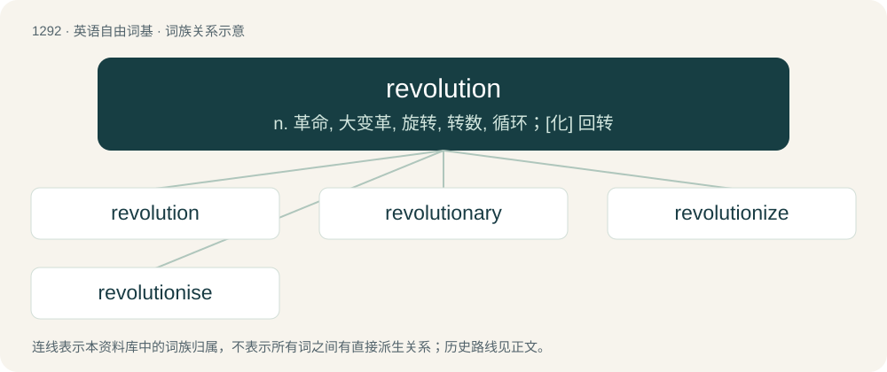

# 1375 · revolution — n. 革命, 大变革, 旋转, 转数, 循环；\[化\] 回转

[总目录](../00_总目录_按常用程度.md)

**类型**：英语自由词基　｜　**来源语言**：见词源记录

## 核心含义与来源

- 核心含义：n. 革命, 大变革, 旋转, 转数, 循环；\[化\] 回转
- 英文含义：A political upheaval in a government or state characterized by great change.
- 词形：revolution

**来源记录 1**（名词；A political upheaval in a government or state characterized by great change.）

Inherited from Middle English revolucion, borrowed from Old French revolucion, from Late Latin revolūtiō (“the act of revolving; revolution”), from Latin revolvō (“roll back, revolve”).

## 词族图

## 单词速览（常用到不常用）

| 单词 | 音标 | 释义 |
|---|---|---|
| [revolution](#w-1) | /ˌɹɛv.əˈluː.ʃən/ | n. 革命, 大变革, 旋转, 转数, 循环；\[化\] 回转 |
| [revolutionary](#w-2) | 英 /ˌɹɛvəˈluːʃənɹi/；美 /ˌɹɛvəˈluʃənɛɹi/ | n. 革命者, 革命党人；a. 革命的, 革命性的 |
| [revolutionize](#w-3) | 英 /ˌɹɛv.əˈl(j)uː.ʃəˌnaɪz/；美 /ˌɹɛv.əˈl(j)u.ʃəˌnaɪz/ | vt. 向...鼓吹革命, 使发生革命性剧变 |
| [revolutionise](#w-4) | /,revəˈljuːʃənaiz/ | vt. 使革命化, 彻底改革, 彻底改变 |

## 逐词详解

### 1. revolution

**词性**：名词　｜　**音标**：/ˌɹɛv.əˈluː.ʃən/

**中文释义**：n. 革命, 大变革, 旋转, 转数, 循环；\[化\] 回转

**英文义项**：A political upheaval in a government or state characterized by great change. / The popular removal and replacement of a government, especially by sudden violent action.

**词源与演化**：

Inherited from Middle English revolucion, borrowed from Old French revolucion, from Late Latin revolūtiō (“the act of revolving; revolution”), from Latin revolvō (“roll back, revolve”).

**例句**：

> It takes 365 days for the Earth to complete one revolution around the sun.

该用例对应义项：In the case of celestial bodies, the traversal of one body along an orbit around another body.

### 2. revolutionary

**词性**：形容词　｜　**音标**：英 /ˌɹɛvəˈluːʃənɹi/；美 /ˌɹɛvəˈluʃənɛɹi/

**中文释义**：n. 革命者, 革命党人；a. 革命的, 革命性的

**英文义项**：Of or pertaining to a revolution in government; tending to, or promoting, revolution / Of or pertaining to something that portends of great change; overthrowing a standing mindset

**构词拆分**：revolution + -ary

**词源与演化**：

Compare French révolutionnaire; equivalent to revolution + -ary.

**用法示例／搭配（非完整句）**：

> a revolutionary new tool

该用例对应义项：Of or pertaining to something that portends of great change; overthrowing a standing mindset

### 3. revolutionize

**词性**：动词　｜　**音标**：英 /ˌɹɛv.əˈl(j)uː.ʃəˌnaɪz/；美 /ˌɹɛv.əˈl(j)u.ʃəˌnaɪz/

**中文释义**：vt. 向...鼓吹革命, 使发生革命性剧变

**英文义项**：To radically or significantly change (something), as in a revolution.

**构词拆分**：revolution + -ize

**词源与演化**：

From revolution + -ize.

**例句**：

> Carlos is excited about the potential of genetic engineering to revolutionize medicine.

### 4. revolutionise

**词性**：动词　｜　**音标**：/,revəˈljuːʃənaiz/

**中文释义**：vt. 使革命化, 彻底改革, 彻底改变

**英文义项**：To change radically or significantly, as in a revolution.

**构词拆分**：From revolution + -ise.

**词源与演化**：

From revolution + -ise.
