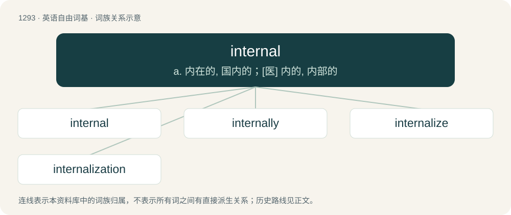

# 1376 · internal — a. 内在的, 国内的；\[医\] 内的, 内部的

[总目录](../00_总目录_按常用程度.md)

**类型**：英语自由词基　｜　**来源语言**：见词源记录

## 核心含义与来源

- 核心含义：a. 内在的, 国内的；\[医\] 内的, 内部的
- 英文含义：Of or situated on the inside.
- 词形：internal

**来源记录 1**（形容词；Of or situated on the inside.）

From Middle English internall, internalle, borrowing from New Latin internālis (“of or pertaining to the inner part”), from internus (“inward, internal”) + -ālis (“-al”, adjectival suffix). By surface analysis, intern + -al.

## 词族图

## 单词速览（常用到不常用）

| 单词 | 音标 | 释义 |
|---|---|---|
| [internal](#w-1) | 英 /ɪnˈtɜː.nəl/；美 /ɪnˈtɜɹ.nəl/ | a. 内在的, 国内的；\[医\] 内的, 内部的 |
| [internally](#w-2) | 英 /ɪnˈtɜːnəli/；美 /ɪnˈtɜɹnəli/ | \[计\] 内部的 |
| [internalize](#w-3) | 美 /ɪnˈtɝnəlaɪz/ | vt. 使内在化 |
| [internalization](#w-4) | /in,t\\\\ːnəlaiˈzeiʃən;-liˈz-/ | n. 成为主观, 内在化 |

## 逐词详解

### 1. internal

**词性**：形容词　｜　**音标**：英 /ɪnˈtɜː.nəl/；美 /ɪnˈtɜɹ.nəl/

**中文释义**：a. 内在的, 国内的；\[医\] 内的, 内部的

**英文义项**：Of or situated on the inside. / Within the body.

**构词拆分**：By surface analysis, intern + -al

**词源与演化**：

From Middle English internall, internalle, borrowing from New Latin internālis (“of or pertaining to the inner part”), from internus (“inward, internal”) + -ālis (“-al”, adjectival suffix). By surface analysis, intern + -al.

**例句**：

> We saw the internal compartments of the machine.

该用例对应义项：Of or situated on the inside.

### 2. internally

**词性**：副词　｜　**音标**：英 /ɪnˈtɜːnəli/；美 /ɪnˈtɜɹnəli/

**中文释义**：\[计\] 内部的

**英文义项**：In an internal manner; within or inside of external limits; in an inner part or situation. / With regard to internal affairs.

**构词拆分**：internal + -ly

**词源与演化**：

From internal + -ly.

**例句**：

> An internally controlled environment.

该用例对应义项：on or from the inside

### 3. internalize

**词性**：动词　｜　**音标**：美 /ɪnˈtɝnəlaɪz/

**中文释义**：vt. 使内在化

**英文义项**：To make something internal; to incorporate it in oneself. / To process new information in one's mind.

**构词拆分**：internal + -ize

**词源与演化**：

From internal + -ize.

**例句**：

> You are not going to get good at socialising by approaching social situations like it's a formula where you do 1, 2 and 3 from a book, but books can definitely help you internalize useful things if you get what I'm saying.

该用例对应义项：To make something internal; to incorporate it in oneself.

### 4. internalization

**词性**：名词　｜　**音标**：/in,t\\\\ːnəlaiˈzeiʃən;-liˈz-/

**中文释义**：n. 成为主观, 内在化

**英文义项**：The process of internalizing something.

**构词拆分**：internal + -ization

**词源与演化**：

From internal + -ization.
