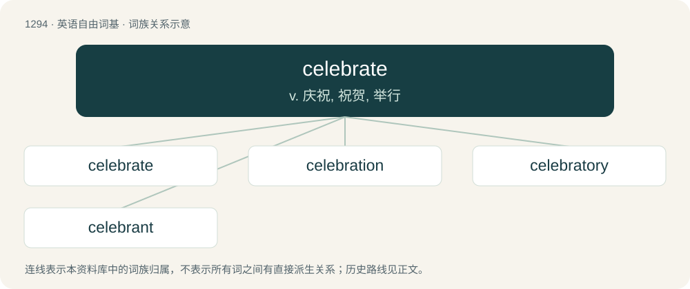

# 1377 · celebrate — v. 庆祝, 祝贺, 举行

[总目录](../00_总目录_按常用程度.md)

**类型**：英语自由词基　｜　**来源语言**：见词源记录

## 核心含义与来源

- 核心含义：v. 庆祝, 祝贺, 举行
- 英文含义：To extol or honour in a solemn manner.
- 词形：celebrate

**来源记录 1**（动词；To extol or honour in a solemn manner.）

From Middle English celebraten, from celebrat(e) (“celebrated”, also used as the past participle of celebraten) + -en, borrowed from Latin celebrātus, perfect passive participle of celebrō (“frequent, go to in great numbers, celebrate, honor, praise”) (see -ate (verb-forming suffix)), from celeber (“frequented, populous”). Displaced native Old English fæġnian and frēolsian.

## 词族图

## 单词速览（常用到不常用）

| 单词 | 音标 | 释义 |
|---|---|---|
| [celebrate](#w-1) | 英 /ˈsɛl.ɪ.bɹeɪt/；美 /ˈsɛl.ə.bɹeɪt/ | v. 庆祝, 祝贺, 举行 |
| [celebration](#w-2) | 英 /ˌsɛl.ɪˈbɹeɪ.ʃən/；美 /ˌsɛl.əˈbɹeɪ.ʃən/ | n. 庆祝, 庆典 |
| [celebratory](#w-3) | 英 /ˌsɛlɪˈbɹeɪtəɹi/；美 /ˈsɛləbɹəˌtɔːɹi/ | a. 快乐的, 兴高采烈的 |
| [celebrant](#w-4) | /ˈsɛlɪbɹənt/ | n. 主持仪式的人, 主持弥撒的教父 |

## 逐词详解

### 1. celebrate

**词性**：动词　｜　**音标**：英 /ˈsɛl.ɪ.bɹeɪt/；美 /ˈsɛl.ə.bɹeɪt/

**中文释义**：v. 庆祝, 祝贺, 举行

**英文义项**：To extol or honour in a solemn manner. / To honour by rites, by ceremonies of joy and respect, or by refraining from ordinary business; to observe duly.

**词源与演化**：

From Middle English celebraten, from celebrat(e) (“celebrated”, also used as the past participle of celebraten) + -en, borrowed from Latin celebrātus, perfect passive participle of celebrō (“frequent, go to in great numbers, celebrate, honor, praise”) (see -ate (verb-forming suffix)), from celeber (“frequented, populous”). Displaced native Old English fæġnian and frēolsian.

**例句**：

> I was promoted today at work—let’s celebrate!

该用例对应义项：To engage in joyful activity in appreciation of an event.

### 2. celebration

**词性**：名词　｜　**音标**：英 /ˌsɛl.ɪˈbɹeɪ.ʃən/；美 /ˌsɛl.əˈbɹeɪ.ʃən/

**中文释义**：n. 庆祝, 庆典

**英文义项**：The formal performance of a solemn rite, such as Christian sacrament. / The observance of a holiday or feast day, as by solemnities.

**构词拆分**：celebrate + -ion

**词源与演化**：

From Old French celebration, from Latin celebratio. Equivalent to celebrate + -ion.

**例句**：

> Next week includes celebrations for both Martin's birthday and for his new job.

该用例对应义项：A social gathering for entertainment and fun; a party.

### 3. celebratory

**词性**：形容词　｜　**音标**：英 /ˌsɛlɪˈbɹeɪtəɹi/；美 /ˈsɛləbɹəˌtɔːɹi/

**中文释义**：a. 快乐的, 兴高采烈的

**英文义项**：Having the manner of, or forming part of, a celebration.

**构词拆分**：celebrate + -ory

**词源与演化**：

From celebrate + -ory.

**例句**：

> Tonight, the two of us are having a celebratory get-together.

### 4. celebrant

**词性**：名词　｜　**音标**：/ˈsɛlɪbɹənt/

**中文释义**：n. 主持仪式的人, 主持弥撒的教父

**英文义项**：A person who officiates at a religious ceremony, especially a marriage or the Eucharist. / A person who conducts formal ceremonies in the community, particularly weddings, baby namings, renewals of wedding vows and funerals.

**构词拆分**：celebrate + -ant

**词源与演化**：

From French célébrant, from Latin celebrāns, present participle of celebrō, equivalent to celebrate + -ant.

**例句**：

> The celebrant asked whether anyone present knew of any reason why the bride and groom should not be married.
