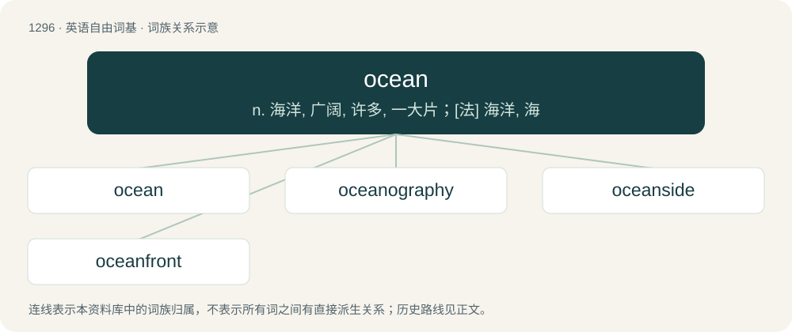

# 1380 · ocean — n. 海洋, 广阔, 许多, 一大片；\[法\] 海洋, 海

[总目录](../00_总目录_按常用程度.md)

**类型**：英语自由词基　｜　**来源语言**：见词源记录

## 核心含义与来源

- 核心含义：n. 海洋, 广阔, 许多, 一大片；\[法\] 海洋, 海
- 英文含义：One of the large bodies of water separating the continents.
- 词形：ocean

**来源记录 1**（名词；One of the large bodies of water separating the continents.）

From Middle English \*ocean, occean, occian, occyan, from Old French occean (later reborrowed or reinforced by Middle French ocean), from Latin Ōceanus, originally from Ancient Greek Ὠκεανός (Ōkeanós, “Oceanus”, a water deity). Displaced native Old English gārseċġ. Also commonly referred to as the ocean sea, the sea of ocean (compare Latin mare ōceanum; Old French mer oceane, occeanne mer). Compare Saterland Frisian Oceoan (“ocean”), West Frisian oseaan (“ocean”), Dutch oceaan (“ocean”), German Low German Ozeaan (“ocean”), German Ozean (“ocean”), Danish ocean (“ocean”), Swedish ocean (“ocean”), French océan (“ocean”), Italian oceano (“ocean”). Doublet of Oceanus/Okeanos.

## 词族图

## 单词速览（常用到不常用）

| 单词 | 音标 | 释义 |
|---|---|---|
| [ocean](#w-1) | 英 /ˈəʊ.ʃən/；美 /ˈoʊ.ʃən/ | n. 海洋, 广阔, 许多, 一大片；\[法\] 海洋, 海 |
| [oceanography](#w-2) | 英 /ˌəʊʃjəˈnɒɡɹəfi/；美 /ˌoʊʃəˈnɑɡɹəfi/ | n. 海洋学 |
| [oceanside](#w-3) |  | 【英文】Located on the coast of an ocean. |
| [oceanfront](#w-4) | /ˈəjʃənfrʌnt/ | n. 海滨 |

## 逐词详解

### 1. ocean

**词性**：名词　｜　**音标**：英 /ˈəʊ.ʃən/；美 /ˈoʊ.ʃən/

**中文释义**：n. 海洋, 广阔, 许多, 一大片；\[法\] 海洋, 海

**英文义项**：One of the large bodies of water separating the continents. / Water belonging to an ocean.

**词源与演化**：

From Middle English \*ocean, occean, occian, occyan, from Old French occean (later reborrowed or reinforced by Middle French ocean), from Latin Ōceanus, originally from Ancient Greek Ὠκεανός (Ōkeanós, “Oceanus”, a water deity). Displaced native Old English gārseċġ. Also commonly referred to as the ocean sea, the sea of ocean (compare Latin mare ōceanum; Old French mer oceane, occeanne mer). Compare Saterland Frisian Oceoan (“ocean”), West Frisian oseaan (“ocean”), Dutch oceaan (“ocean”), German Low German Ozeaan (“ocean”), German Ozean (“ocean”), Danish ocean (“ocean”), Swedish ocean (“ocean”), French océan (“ocean”), Italian oceano (“ocean”). Doublet of Oceanus/Okeanos.

**用法示例／搭配（非完整句）**：

> The island is surrounded by ocean

该用例对应义项：Water belonging to an ocean.

### 2. oceanography

**词性**：名词　｜　**音标**：英 /ˌəʊʃjəˈnɒɡɹəfi/；美 /ˌoʊʃəˈnɑɡɹəfi/

**中文释义**：n. 海洋学

**英文义项**：The exploration and scientific study of the oceans and ocean floor.

**构词拆分**：ocean + -graphy

**词源与演化**：

From ocean + -ography.

**例句**：

> Oceanography was pioneered by voyages of exploration.

### 3. oceanside

**词性**：形容词

**英文义项**：Located on the coast of an ocean.

**构词拆分**：ocean + -side

**词源与演化**：

From ocean + -side.

**例句**：

> We stayed in an oceanside hotel and ate fresh seafood every night, all week long.

该用例对应义项：Located on the coast of an ocean.

### 4. oceanfront

**词性**：形容词　｜　**音标**：/ˈəjʃənfrʌnt/

**中文释义**：n. 海滨

**英文义项**：Of property or real estate: adjacent to the ocean.

**构词拆分**：ocean + front

**词源与演化**：

From ocean + front.

**例句**：

> Oceanfront houses bore the brunt of the huge waves whipped up by the storm.
