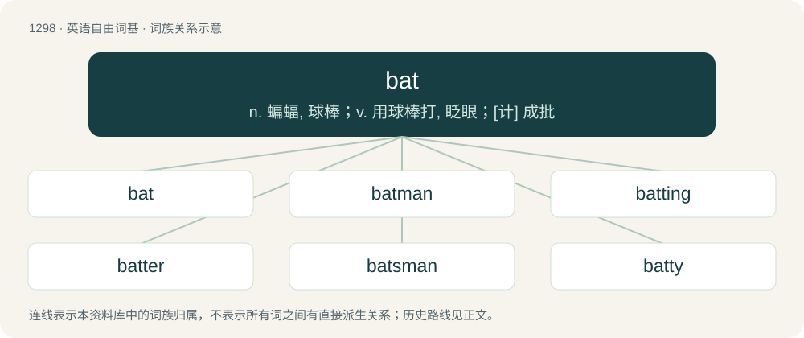

# 1383 · bat — n. 蝙蝠, 球棒；v. 用球棒打, 眨眼；\[计\] 成批

[总目录](../00_总目录_按常用程度.md)

**类型**：英语自由词基　｜　**来源语言**：见词源记录

## 核心含义与来源

- 核心含义：n. 蝙蝠, 球棒；v. 用球棒打, 眨眼；\[计\] 成批
- 英文含义：Any flying mammal of the order Chiroptera, usually small and nocturnal, insectivorous or frugivorous.
- 词形：bat

**多个词源／构词路径**：同一拼写可能有不同来源；以下按词性和含义分别列出。

**来源记录 1**（名词；Any flying mammal of the order Chiroptera, usually small and nocturnal, insectivorous or frugivorous.）

Dialectal variant of Middle English bakke, balke, of North Germanic origin (akin to dialectal Swedish natt-batta). Perhaps compare Old Norse (leðr)blaka (literally “(leather) flapper”), from leðr + blaka (“to flap”). Compare also Old Swedish natbakka, Old Danish nathbakkæ.

**来源记录 2**（名词；A club, made of wood like a baseball bat or otherwise, used as a weapon）

From Middle English bat, batte, from Old English batt (“bat, club, cudgel”), probably of Celtic origin, compare Old Breton bath (“club, cudgel”) and modern Breton bazh (“swagger stick”), ultimately from a derivative of Proto-Indo-European \*bʰedʰh₂- (“to strike, beat, pierce”), similar to the Gaulish source of Latin battuō (“to beat, pound”).

**来源记录 3**（动词；To hit with a bat or (figuratively) as if with a bat.）

From Middle English batten, baten (“to beat”), from Old French batre (“to beat”), from Late Latin battere, from Latin battuere, of uncertain origin; perhaps of Germanic or Celtic origin. In modern English reinterpreted as a verbal derivative of Etymology 2. Compare batter, battery.

**来源记录 4**（动词；To flutter）

Possibly a variant of bate.

## 词族图

## 单词速览（常用到不常用）

| 单词 | 音标 | 释义 |
|---|---|---|
| [bat](#w-1) | 英 /bæt/ | n. 蝙蝠, 球棒；v. 用球棒打, 眨眼；\[计\] 成批 |
| [batman](#w-2) | 英 /ˈbæt.mən/ | n. 勤务兵 |
| [batting](#w-3) | /ˈbætɪŋ/ | n. 击球, 球棒的使用, 棉絮；\[机\] 棉胎 |
| [batter](#w-4) | 英 /ˈbætə/；美 /ˈbætɚ/ | v. 连续猛打（尤其指妇女），猛击；n. 面糊（食物），击球员，打击手 |
| [batsman](#w-5) | /ˈbætsmən/ | n. 击球手 |
| [batty](#w-6) | 英 /ˈbæti/；美 /ˈbæti/ | a. 疯癫的, 古怪的, 蝙蝠的 |
| [batmobile](#w-7) |  | 蝙蝠车 |
| [batgirl](#w-8) | /ˈbætˌgɜːl/ | 棒球女球童 |
| [batwing](#w-9) | /ˈbætwiŋ/ | a. 状似蝙蝠之翼的 |

## 逐词详解

### 1. bat

**词性**：名词　｜　**音标**：英 /bæt/

**中文释义**：n. 蝙蝠, 球棒；v. 用球棒打, 眨眼；\[计\] 成批

**英文义项**：Any flying mammal of the order Chiroptera, usually small and nocturnal, insectivorous or frugivorous. / An old woman.

**词源与演化**：

Dialectal variant of Middle English bakke, balke, of North Germanic origin (akin to dialectal Swedish natt-batta). Perhaps compare Old Norse (leðr)blaka (literally “(leather) flapper”), from leðr + blaka (“to flap”). Compare also Old Swedish natbakka, Old Danish nathbakkæ.

**例句**：

> We didn't help him, so he did it off his own bat.

### 2. batman

**词性**：名词　｜　**音标**：英 /ˈbæt.mən/

**中文释义**：n. 勤务兵

**英文义项**：A servant or valet to a military officer. / A personal assistant or supporter.

**构词拆分**：bat (“packsaddle”) + man

**词源与演化**：

From bat (“packsaddle”) + man. The element bat is from French bât, from Old French bast, from Late Latin bastum, possibly from Ancient Greek βαστάζω (bastázō, “to bear, carry, lift”).

**例句**：

> The thing you have to know about Batman is, he's a superhero.

### 3. batting

**词性**：名词　｜　**音标**：/ˈbætɪŋ/

**中文释义**：n. 击球, 球棒的使用, 棉絮；\[机\] 棉胎

**英文义项**：Cotton, wool, silk or synthetic material used to stuff the inside of a mattress, quilt etc. / Special cotton for surgery.

**构词拆分**：bat + -ing；batt + -ing (“material, collection”)

**词源与演化**：

From bat + -ing, batt + -ing (“material, collection”).

**例句**：

> She can tell the most outrageous lie without batting an eye.

### 4. batter

**词性**：动词　｜　**音标**：英 /ˈbætə/；美 /ˈbætɚ/

**中文释义**：v. 连续猛打（尤其指妇女），猛击；n. 面糊（食物），击球员，打击手

**英文义项**：To hit or strike violently and repeatedly. / To coat with batter (the food ingredient).

**构词拆分**：bat + -er (frequentative suffix)

**词源与演化**：

From Middle English batteren, batren, bateren, a frequentative of Middle English batten, baten (“to beat”), equivalent to bat + -er (frequentative suffix).

**例句**：

> I prefer it when they batter the cod with breadcrumbs.

该用例对应义项：To coat with batter (the food ingredient).

### 5. batsman

**词性**：名词　｜　**音标**：/ˈbætsmən/

**中文释义**：n. 击球手

**英文义项**：A player of the batting side now on the field. / The player now receiving strike; the striker.

**构词拆分**：bat + -s- + -man

**词源与演化**：

From bat + -s- + -man.

**例句**：

> Bangladesh national cricket team batsman Nasir Hossain said this.

### 6. batty

**词性**：形容词　｜　**音标**：英 /ˈbæti/；美 /ˈbæti/

**中文释义**：a. 疯癫的, 古怪的, 蝙蝠的

**英文义项**：Mad, crazy, silly.

**构词拆分**：bat + -y

**词源与演化**：

From bat + -y. In sense “insane”, attested 1903, from expression have bats in one's belfry, from tendency of bats to fly around erratically. Compare also batshit (“insane”) and squirrelly (“jumpy, eccentric”).

### 7. batmobile

**词性**：动词

**中文释义**：蝙蝠车

**英文义项**：To move or proceed as if in the Batmobile / To put up an emotional or intellectual shield, especially to protect oneself from something that makes one uncomfortable.

**构词拆分**：bat + -mobile

**词源与演化**：

From the Batmobile driven by superhero Batman in the eponymous media franchise, from bat + -mobile. The second verb sense references the retractable shielding featured on the vehicle in the 1989 film.

**例句**：

> Now where did I park the batmobile?

### 8. batgirl

**词性**：名词　｜　**音标**：/ˈbætˌgɜːl/

**中文释义**：棒球女球童

**英文义项**：The female equivalent of a batboy.

**构词拆分**：bat + girl

**词源与演化**：

From bat + girl.

### 9. batwing

**词性**：名词　｜　**音标**：/ˈbætwiŋ/

**中文释义**：a. 状似蝙蝠之翼的

**英文义项**：The wing of a bat, or its shape. / Several South or Southeast Asian species of tailless dark swallowtail butterflies in the genus Atrophaneura.

**构词拆分**：bat + wing

**词源与演化**：

From bat + wing.
