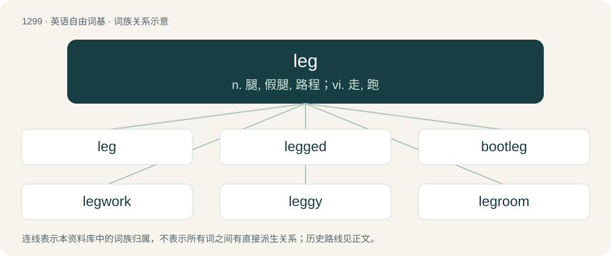

# 1385 · leg — n. 腿, 假腿, 路程；vi. 走, 跑

[总目录](../00_总目录_按常用程度.md)

**类型**：英语自由词基　｜　**来源语言**：见词源记录

## 核心含义与来源

- 核心含义：n. 腿, 假腿, 路程；vi. 走, 跑
- 英文含义：A limb or appendage that an animal uses for support or locomotion on land.
- 词形：leg

**来源记录 1**（名词；A limb or appendage that an animal uses for support or locomotion on land.）

From Middle English leg, legge, from Old Norse leggr (“leg, calf, bone of the arm or leg, hollow tube, stalk”), from Proto-Germanic \*lagjaz, \*lagwijaz (“leg, thigh”) (see it for more). Cognate with Scots leg (“leg”), Icelandic leggur (“leg, limb”), Norwegian Bokmål legg (“leg”), Norwegian Nynorsk legg (“leg”), Swedish lägg (“leg, shank, shaft”), Danish læg (“leg”), Lombardic lagi (“thigh, shank, leg”), Latin lacertus (“limb, arm”), Persian لنگ (leng). Upon borrowing, mostly displaced the native Old English term sċanca (Modern English shank).

## 词族图

## 单词速览（常用到不常用）

| 单词 | 音标 | 释义 |
|---|---|---|
| [leg](#w-1) | /lɛɡ/ | n. 腿, 假腿, 路程；vi. 走, 跑 |
| [legged](#w-2) | /ˈlɛɡɪd/ | a. 有...腿的 |
| [bootleg](#w-3) | 美 /ˈbutˌlɛɡ/ | v. 私卖(酒) |
| [legwork](#w-4) | 英 /ˈlɛɡˌwɜːk/；美 /ˈlɛɡˌwɝk/ | n. &lt;口&gt;外出搜集情况的工作(如新闻采访,案件调查等) |
| [leggy](#w-5) | /ˈlɛɡi/ | a. 长腿的, 腿细长的, 茎长的 |
| [legroom](#w-6) | /ˈlɛɡɹuːm/ | n. 放脚空间, 踏脚处 |
| [legless](#w-7) | /ˈlegləs/ | a. 无腿的 |
| [legging](#w-8) | /ˈlɛɡ.ɪŋ/ | n. 绑腿, 裹腿 |

## 逐词详解

### 1. leg

**词性**：名词　｜　**音标**：/lɛɡ/

**中文释义**：n. 腿, 假腿, 路程；vi. 走, 跑

**英文义项**：A limb or appendage that an animal uses for support or locomotion on land. / In humans, the lower limb extending from the groin to the ankle.

**词源与演化**：

From Middle English leg, legge, from Old Norse leggr (“leg, calf, bone of the arm or leg, hollow tube, stalk”), from Proto-Germanic \*lagjaz, \*lagwijaz (“leg, thigh”) (see it for more). Cognate with Scots leg (“leg”), Icelandic leggur (“leg, limb”), Norwegian Bokmål legg (“leg”), Norwegian Nynorsk legg (“leg”), Swedish lägg (“leg, shank, shaft”), Danish læg (“leg”), Lombardic lagi (“thigh, shank, leg”), Latin lacertus (“limb, arm”), Persian لنگ (leng). Upon borrowing, mostly displaced the native Old English term sċanca (Modern English shank).

**例句**：

> Dan won't be able to come to the party, since he broke his leg last week and is now on crutches.

该用例对应义项：In humans, the lower limb extending from the groin to the ankle.

### 2. legged

**词性**：形容词　｜　**音标**：/ˈlɛɡɪd/

**中文释义**：a. 有...腿的

**英文义项**：Having legs of a certain specified type or number. / Having legs; provided with legs.

**构词拆分**：leg (“noun”) + -ed

**词源与演化**：

From Middle English legged, leggyd, equivalent to leg (“noun”) + -ed.

**例句**：

> A robot which runs at a speed of over 29mph has set a new land-speed record for legged robots.

该用例对应义项：Having legs; provided with legs.

### 3. bootleg

**词性**：动词　｜　**音标**：美 /ˈbutˌlɛɡ/

**中文释义**：v. 私卖(酒)

**英文义项**：To engage in bootlegging. / To make, transport and/or sell illegal alcoholic liquor.

**构词拆分**：boot + leg

**词源与演化**：

From boot + leg. Originally a nickname given to smugglers in King George III's reign, derived from the smugglers' custom of hiding packages of valuables in their large sea-boots when dodging the king's coastguardsmen.

**例句**：

> In the 1930s, Grandpa used to bootleg whiskey from a still hidden in the backwoods.

该用例对应义项：To make, transport and/or sell illegal alcoholic liquor.

### 4. legwork

**词性**：名词　｜　**音标**：英 /ˈlɛɡˌwɜːk/；美 /ˈlɛɡˌwɝk/

**中文释义**：n. &lt;口&gt;外出搜集情况的工作(如新闻采访,案件调查等)

**英文义项**：Work, especially research or preparation, that involves significant walking, travel, or similar effort. / Skillful or vigorous use of the legs, as in dance or sports.

**构词拆分**：leg + work

**词源与演化**：

From leg + work.

### 5. leggy

**词性**：形容词　｜　**音标**：/ˈlɛɡi/

**中文释义**：a. 长腿的, 腿细长的, 茎长的

**英文义项**：Having long, attractive legs; long-legged. / Exposing the bare or pantyhose-clad legs, especially the thighs.

**构词拆分**：leg + -y

**词源与演化**：

From leg + -y.

**例句**：

> Pam looked leggy today because she was wearing a miniskirt.

该用例对应义项：Exposing the bare or pantyhose-clad legs, especially the thighs.

### 6. legroom

**词性**：名词　｜　**音标**：/ˈlɛɡɹuːm/

**中文释义**：n. 放脚空间, 踏脚处

**英文义项**：Space to stretch the legs while seated. / Freedom to move or grow.

**构词拆分**：leg + room

**词源与演化**：

From leg + room.

**例句**：

> The lack of legroom on international flights can be a health hazard as blood clots can form from not being able to move around.

该用例对应义项：Space to stretch the legs while seated.

### 7. legless

**词性**：形容词　｜　**音标**：/ˈlegləs/

**中文释义**：a. 无腿的

**英文义项**：Without legs. / Too drunk to stand.

**构词拆分**：leg + -less

**词源与演化**：

From Middle English legles, equivalent to leg + -less.

**例句**：

> That idea was legless.

该用例对应义项：Going nowhere.

### 8. legging

**词性**：名词　｜　**音标**：/ˈlɛɡ.ɪŋ/

**中文释义**：n. 绑腿, 裹腿

**英文义项**：A covering, usually of leather, worn from knee to ankle. / Stretchy tight-fitting pants often worn by women or for exercise.

**构词拆分**：From leg + -ing.

**词源与演化**：

From leg + -ing.

**例句**：

> Take the legging and turn up the cuff.

该用例对应义项：One of the legs of a pair of trousers.
