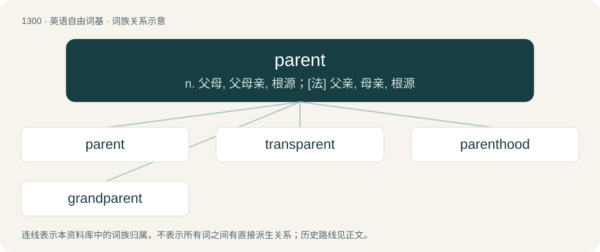

# 1386 · parent — n. 父母, 父母亲, 根源；\[法\] 父亲, 母亲, 根源

[总目录](../00_总目录_按常用程度.md)

**类型**：英语自由词基　｜　**来源语言**：见词源记录

## 核心含义与来源

- 核心含义：n. 父母, 父母亲, 根源；\[法\] 父亲, 母亲, 根源
- 英文含义：A person who raises a child (which they have made, adopted, fostered, taken as their own, etc.).
- 词形：parent

**来源记录 1**（名词；A person who raises a child (which they have made, adopted, fostered, taken as their own, etc.).）

From Middle English parent, borrowed from Anglo-Norman parent, Middle French parent, from Latin parentem, accusative of parēns (“parent”), present participle of pariō (“to breed, bring forth”).

## 词族图

## 单词速览（常用到不常用）

| 单词 | 音标 | 释义 |
|---|---|---|
| [parent](#w-1) | 英 /ˈpɛəɹənt/；美 /ˈpɛəɹənt/ | n. 父母, 父母亲, 根源；\[法\] 父亲, 母亲, 根源 |
| [transparent](#w-2) | /trænsˈpærənt/ | 【英文】A transgender or transsexual parent. |
| [parenthood](#w-3) | /ˈperənthud/ | n. 父母身分 |
| [grandparent](#w-4) | 美 /ˈɡɹæn(d)pɛəɹənt/ | n. 祖父母 |

## 逐词详解

### 1. parent

**词性**：名词　｜　**音标**：英 /ˈpɛəɹənt/；美 /ˈpɛəɹənt/

**中文释义**：n. 父母, 父母亲, 根源；\[法\] 父亲, 母亲, 根源

**英文义项**：A person who raises a child (which they have made, adopted, fostered, taken as their own, etc.). / A person who has had a baby; this person in relation to their child or children.

**词源与演化**：

From Middle English parent, borrowed from Anglo-Norman parent, Middle French parent, from Latin parentem, accusative of parēns (“parent”), present participle of pariō (“to breed, bring forth”).

**例句**：

> After both her parents were killed in a forest fire, Sonia was adopted by her aunt and uncle.

该用例对应义项：A person who raises a child (which they have made, adopted, fostered, taken as their own, etc.).

### 2. transparent

**词性**：名词　｜　**音标**：/trænsˈpærənt/

**英文义项**：A transgender or transsexual parent.

**构词拆分**：trans- + parent

**词源与演化**：

From trans- (“transgender or transsexual”) + parent.

### 3. parenthood

**词性**：名词　｜　**音标**：/ˈperənthud/

**中文释义**：n. 父母身分

**英文义项**：The state of being a parent

**构词拆分**：parent + -hood

**词源与演化**：

From parent + -hood.

**例句**：

> To everyone's surprise, parenthood reformed the man.

该用例对应义项：the state of being a parent

### 4. grandparent

**词性**：名词　｜　**音标**：美 /ˈɡɹæn(d)pɛəɹənt/

**中文释义**：n. 祖父母

**英文义项**：The parent of someone's parent.

**构词拆分**：grand- + parent

**词源与演化**：

From grand- + parent. Compare French grand-parent.

**例句**：

> A second cousin is the granddaughter of the brother or sister of a grandparent.
