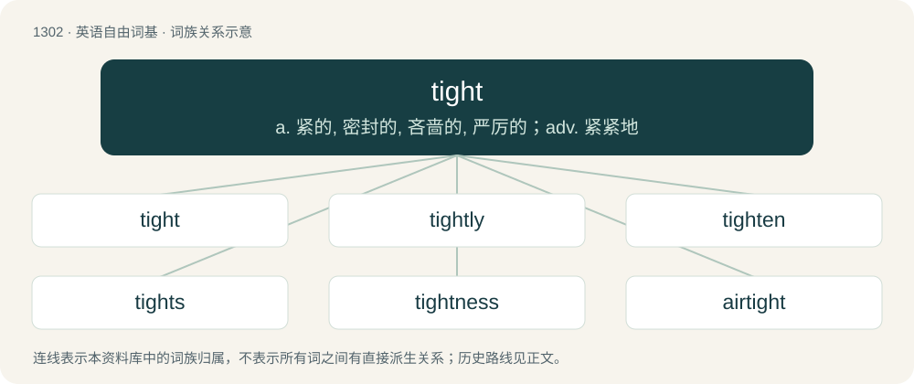

# 1387 · tight — a. 紧的, 密封的, 吝啬的, 严厉的；adv. 紧紧地

[总目录](../00_总目录_按常用程度.md)

**类型**：英语自由词基　｜　**来源语言**：见词源记录

## 核心含义与来源

- 核心含义：a. 紧的, 密封的, 吝啬的, 严厉的；adv. 紧紧地
- 英文含义：Firmly held together; compact; not loose or open.
- 词形：tight

**来源记录 1**（形容词；Firmly held together; compact; not loose or open.）

From Middle English tight, tyght, tyȝt, tiht, variants of thight, thiht, from Old English \*þiht, \*þīht (attested in meteþiht), from Proto-West Germanic \*þį̄ht(ī), from Proto-Germanic \*þinhtaz, from Proto-Indo-European \*tenkt- (“dense, thick, tight”), from Proto-Indo-European \*ten- (“to stretch, pull”). Cognate with Scots ticht, West Frisian ticht, Danish tæt, Icelandic þéttur (“dense”), Norwegian tett, Swedish tät, Dutch dicht (“dense”), German dicht (“dense”). The current form with t- /t/ rather than etymologically-expected th- /θ/ arose in Middle English under the influence of the etymologically-unrelated verbs tighten and tight, which come from a different Proto-Indo-European root (starting with \*d- and thus regularly having t-).

## 词族图

## 单词速览（常用到不常用）

| 单词 | 音标 | 释义 |
|---|---|---|
| [tight](#w-1) | /taɪt/ | a. 紧的, 密封的, 吝啬的, 严厉的；adv. 紧紧地 |
| [tightly](#w-2) | /ˈtaɪtli/ | adv. 紧紧地, 坚固地 |
| [tighten](#w-3) | /ˈtaɪ.tən/ | vt. 勒紧, 使变紧；vi. 变紧, 绷紧 |
| [tights](#w-4) | 英 /taɪts/ | n. 紧身衣裤 |
| [tightness](#w-5) | /ˈtaitnis/ | n. 坚固, 紧密；\[化\] 紧度; 严密度 |
| [airtight](#w-6) | /ˈєətait/ | a. 气密的, 不透气的, 无懈可击的；\[机\] 气密, 不透气 |
| [watertight](#w-7) | 英 /ˈwɔː.tə.taɪt/ | a. 不透水的, 不漏水的, 无懈可击的；\[化\] 不透水的; 不漏水的 |
| [tightrope](#w-8) | 美 /ˈtaɪtˌɹoʊp/ | n. 拉紧的绳索 |
| [skintight](#w-9) | 美 /ˈskɪnˌtaɪt/ | a. 紧身的 |

## 逐词详解

### 1. tight

**词性**：形容词　｜　**音标**：/taɪt/

**中文释义**：a. 紧的, 密封的, 吝啬的, 严厉的；adv. 紧紧地

**英文义项**：Firmly held together; compact; not loose or open. / Unyielding or firm.

**词源与演化**：

From Middle English tight, tyght, tyȝt, tiht, variants of thight, thiht, from Old English \*þiht, \*þīht (attested in meteþiht), from Proto-West Germanic \*þį̄ht(ī), from Proto-Germanic \*þinhtaz, from Proto-Indo-European \*tenkt- (“dense, thick, tight”), from Proto-Indo-European \*ten- (“to stretch, pull”). Cognate with Scots ticht, West Frisian ticht, Danish tæt, Icelandic þéttur (“dense”), Norwegian tett, Swedish tät, Dutch dicht (“dense”), German dicht (“dense”). The current form with t- /t/ rather than etymologically-expected th- /θ/ arose in Middle English under the influence of the etymologically-unrelated verbs tighten and tight, which come from a different Proto-Indo-European root (starting with \*d- and thus regularly having t-).

**例句**：

> I grew up in a poor neighborhood; money was very tight, but we made do.

该用例对应义项：Scarce, hard to come by.

### 2. tightly

**词性**：副词　｜　**音标**：/ˈtaɪtli/

**中文释义**：adv. 紧紧地, 坚固地

**英文义项**：In a tight manner. / Curtly in a way that suggests anger or other intense emotion is being contained.

**构词拆分**：tight + -ly

**词源与演化**：

From tight + -ly.

**例句**：

> A tightly packed pub.

该用例对应义项：in a tight or constricted manner

### 3. tighten

**词性**：动词　｜　**音标**：/ˈtaɪ.tən/

**中文释义**：vt. 勒紧, 使变紧；vi. 变紧, 绷紧

**英文义项**：To make tighter. / To become tighter.

**构词拆分**：tight + -en

**词源与演化**：

Synchronically equivalent to tight + -en, but actually derived from Middle English tighten, from Old English tyhtan, thus originally unrelated to tight (Old English \*þiht).

**例句**：

> If the government doesn't tighten the money supply, inflation is certain to be harsh.

该用例对应义项：To make money harder to borrow or obtain.

### 4. tights

**词性**：名词　｜　**音标**：英 /taɪts/

**中文释义**：n. 紧身衣裤

**英文义项**：A close-fitting, sheer or non-sheer skin-tight garment worn principally by women and girls that covers the body completely from the waist down, usually including the feet. / A similar, non-sheer garment worn by dancers of either sex, especially by ballet dancers.

**构词拆分**：From tight + -s.

**词源与演化**：

From tight + -s.

**例句**：

> She put two pairs of sheer tights in the suitcase.

### 5. tightness

**词性**：名词　｜　**音标**：/ˈtaitnis/

**中文释义**：n. 坚固, 紧密；\[化\] 紧度; 严密度

**英文义项**：The quality or degree of being tight.

**构词拆分**：tight + -ness

**词源与演化**：

From tight + -ness.

**例句**：

> She felt an alarming tightness in her chest.

该用例对应义项：a tight feeling in some part of the body

### 6. airtight

**词性**：形容词　｜　**音标**：/ˈєətait/

**中文释义**：a. 气密的, 不透气的, 无懈可击的；\[机\] 气密, 不透气

**英文义项**：Impermeable to air or other gases. / Having no weak points or flaws.

**构词拆分**：air + tight

**词源与演化**：

From air + tight.

**例句**：

> We have an airtight argument they won’t be able to punch holes in.

该用例对应义项：Having no weak points or flaws.

### 7. watertight

**词性**：形容词　｜　**音标**：英 /ˈwɔː.tə.taɪt/

**中文释义**：a. 不透水的, 不漏水的, 无懈可击的；\[化\] 不透水的; 不漏水的

**英文义项**：So tightly made that water cannot enter or escape. / So devised or planned as to be impossible to defeat, evade or nullify.

**构词拆分**：water + tight

**词源与演化**：

From water + tight. Compare Scots wattirticht (“watertight”), West Frisian wetterticht (“waterproof”), Dutch waterdicht (“waterproof, watertight”), German wasserdicht (“watertight, waterproof”), Danish vandtæt (“watertight”), Swedish vattentät (“watertight, waterproof”).

**用法示例／搭配（非完整句）**：

> a watertight regulation

该用例对应义项：So devised or planned as to be impossible to defeat, evade or nullify.

### 8. tightrope

**词性**：名词　｜　**音标**：美 /ˈtaɪtˌɹoʊp/

**中文释义**：n. 拉紧的绳索

**英文义项**：A tightly stretched rope or cable on which acrobats perform high above the ground. / A difficult or desperate situation.

**构词拆分**：tight + rope

**词源与演化**：

From tight + rope.

**例句**：

> I've been walking a tightrope; I don't know if I'm going to pass.

### 9. skintight

**词性**：形容词　｜　**音标**：美 /ˈskɪnˌtaɪt/

**中文释义**：a. 紧身的

**英文义项**：Conforming tightly to the body, snug against the skin.

**构词拆分**：skin + tight

**词源与演化**：

From skin + tight.

**例句**：

> The BioSuit is a skintight spacesuit that provides astronauts with greater mobility.
