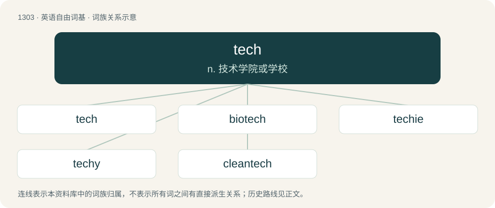

# 1388 · tech — n. 技术学院或学校

[总目录](../00_总目录_按常用程度.md)

**类型**：英语自由词基　｜　**来源语言**：见词源记录

## 核心含义与来源

- 核心含义：n. 技术学院或学校
- 英文含义：Technology.
- 词形：tech

**来源记录 1**（名词；Technology.）

Clipping of technology, technician, and technique.

## 词族图

## 单词速览（常用到不常用）

| 单词 | 音标 | 释义 |
|---|---|---|
| [tech](#w-1) | /tɛk/ | n. 技术学院或学校 |
| [biotech](#w-2) | 英 /ˈbaɪəʊˌtɛk/；美 /ˈbaɪoʊˌtɛk/ | n. 生物技术 |
| [techie](#w-3) | /ˈtɛki/ | n. 技师, 技术员 |
| [techy](#w-4) | /ˈtɛki/ | a. 易怒的,暴躁的 |
| [cleantech](#w-5) | 英 /ˈkliː.ntɛk/ | 【英文】Technologies that support increased productivity or profitability while also reducing resource consumption or pollution. |

## 逐词详解

### 1. tech

**词性**：名词　｜　**音标**：/tɛk/

**中文释义**：n. 技术学院或学校

**英文义项**：Technology. / Technology businesses or the technology industry, especially in the field of computing and the Internet.

**词源与演化**：

Clipping of technology, technician, and technique.

**例句**：

> The service writers collaborate with the techs and communicate with the customers.

该用例对应义项：Technician; technologist.

### 2. biotech

**词性**：名词　｜　**音标**：英 /ˈbaɪəʊˌtɛk/；美 /ˈbaɪoʊˌtɛk/

**中文释义**：n. 生物技术

**英文义项**：Biotechnology. / A company specializing in biotechnology, or stock in such a company.

**构词拆分**：bio- (“biological”) + tech (“technology”)

**词源与演化**：

Clipping of biotechnology. Analyzable as bio- (“biological”) + tech (“technology”) or as a clipped compound, bio(logical) tech(nology).

**例句**：

> A lot of people invested in biotechs back in the ’90s.

该用例对应义项：A company specializing in biotechnology, or stock in such a company.

### 3. techie

**词性**：名词　｜　**音标**：/ˈtɛki/

**中文释义**：n. 技师, 技术员

**英文义项**：One who works with, or has an interest in, technology or computers. / A person who works on the technical side of events.

**构词拆分**：tech + -ie

**词源与演化**：

From tech + -ie (q.v.). Compare techy and yuppie.

### 4. techy

**词性**：形容词　｜　**音标**：/ˈtɛki/

**中文释义**：a. 易怒的,暴躁的

**英文义项**：Technical, of or related to technology.

**构词拆分**：tech + -y

**词源与演化**：

From tech + -y. Compare techie.

**例句**：

> Are there any techy types around? My computer has stopped working.

该用例对应义项：Technical, of or related to technology.

### 5. cleantech

**词性**：名词　｜　**音标**：英 /ˈkliː.ntɛk/

**英文义项**：Technologies that support increased productivity or profitability while also reducing resource consumption or pollution.

**构词拆分**：clean + tech

**词源与演化**：

From clean + tech.
