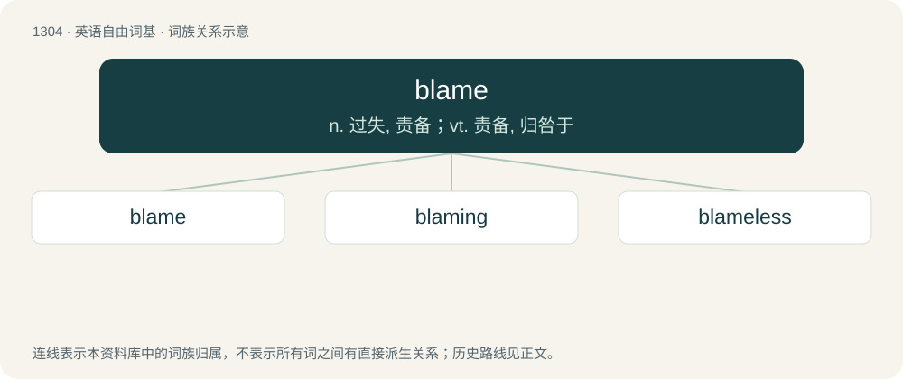

# 1389 · blame — n. 过失, 责备；vt. 责备, 归咎于

[总目录](../00_总目录_按常用程度.md)

**类型**：英语自由词基　｜　**来源语言**：见词源记录

## 核心含义与来源

- 核心含义：n. 过失, 责备；vt. 责备, 归咎于
- 英文含义：Censure.
- 词形：blame

**多个词源／构词路径**：同一拼写可能有不同来源；以下按词性和含义分别列出。

**来源记录 1**（名词；Censure.）

From Middle English blame, borrowed from Old French blame, blasme, produced from the verb blasmer, which in turn is derived from Late Latin blastēmāre, variant of blasphēmāre, from Ancient Greek βλασφημέω (blasphēméō). Doublet of blaspheme. Displaced native Old English tǣling (“blame”) and tǣlan (“to blame”).

**来源记录 2**（动词；To assert or consider that someone is the cause of something negative; to place blame; to attribute responsibility (for something negative or for doing something negative).）

From Middle English blamen, borrowed from Old French blasmer, from Late Latin blasphēmāre (“to reproach, to revile”), from Ancient Greek βλασφημέω (blasphēméō). Compare blaspheme, a doublet. Overtook common use from the native wite (“to blame, accuse, reproach, suspect”) (from Middle English wīten, from Old English wītan).

## 词族图

## 单词速览（常用到不常用）

| 单词 | 音标 | 释义 |
|---|---|---|
| [blame](#w-1) | /bleɪm/ | n. 过失, 责备；vt. 责备, 归咎于 |
| [blaming](#w-2) | /ˈbleɪmɪŋ/ | vbl. 归咎；责备；谴责 |
| [blameless](#w-3) | /ˈbleimlis/ | a. 无可责难的, 无过失的, 清白的 |

## 逐词详解

### 1. blame

**词性**：名词　｜　**音标**：/bleɪm/

**中文释义**：n. 过失, 责备；vt. 责备, 归咎于

**英文义项**：Censure. / Culpability for something negative or undesirable.

**词源与演化**：

From Middle English blame, borrowed from Old French blame, blasme, produced from the verb blasmer, which in turn is derived from Late Latin blastēmāre, variant of blasphēmāre, from Ancient Greek βλασφημέω (blasphēméō). Doublet of blaspheme. Displaced native Old English tǣling (“blame”) and tǣlan (“to blame”).

**例句**：

> The blame for starting the fire lies with the arsonist.

该用例对应义项：Culpability for something negative or undesirable.

### 2. blaming

**词性**：名词　｜　**音标**：/ˈbleɪmɪŋ/

**中文释义**：vbl. 归咎；责备；谴责

**英文义项**：The act of accusing or assigning culpability to.

**构词拆分**：blame + -ing

**词源与演化**：

From Middle English blamyng, blamynge, equivalent to blame + -ing.

**例句**：

> Many locals are blaming oil and gas extraction for the powerful tremor.

### 3. blameless

**词性**：形容词　｜　**音标**：/ˈbleimlis/

**中文释义**：a. 无可责难的, 无过失的, 清白的

**英文义项**：Free from blame; without fault; innocent. / Not meriting blame or censure; undeserving of reproof.

**构词拆分**：blame + -less

**词源与演化**：

From Middle English blameles, equivalent to blame + -less.

**例句**：

> Has lived a blameless life.

该用例对应义项：free of guilt; not subject to blame
