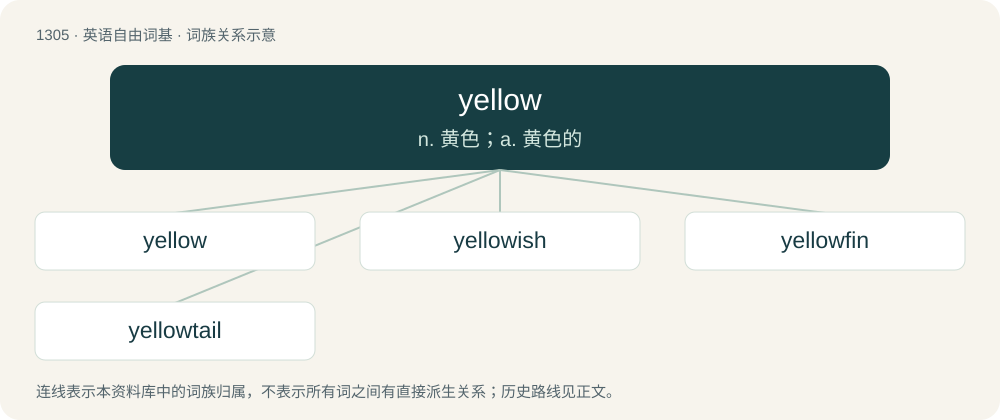

# 1390 · yellow — n. 黄色；a. 黄色的

[总目录](../00_总目录_按常用程度.md)

**类型**：英语自由词基　｜　**来源语言**：见词源记录

## 核心含义与来源

- 核心含义：n. 黄色；a. 黄色的
- 英文含义：The color of sunflower petals and lemons; the color obtained by mixing green and red light, or by subtracting blue from white light; the color evoked by light of wavelength around 580 nm; one of the three primary colors in subtractive color systems.
- 词形：yellow

**多个词源／构词路径**：同一拼写可能有不同来源；以下按词性和含义分别列出。

**来源记录 1**（名词；The color of sunflower petals and lemons; the color obtained by mixing green and red light, or by subtracting blue from white light; the color evoked by light of wavelength around 580 nm; one of the three primary colors in subtractive color systems.）

From Middle English yelwe, yelou, from Old English ġeolwe, oblique form of Old English ġeolu, from Proto-West Germanic \*gelu, from Proto-Germanic \*gelwaz, from Proto-Indo-European \*ǵʰelh₃wós, from \*ǵʰelh₃- (“green, yellow”). Cognate with Scots yella (“yellow”), North Frisian gööl, güül (“yellow”), Saterland Frisian jeel (“yellow”), West Frisian giel (“yellow”), Cimbrian gel, ghéel (“yellow”), Dutch geel (“yellow”), Dutch Low Saxon gael, gel (“yellow”), German gelb, gehl (“yellow”), German Low German gel, geel, gęl, gäl (“yellow”), Luxembourgish giel (“yellow”), Vilamovian gaoł (“yellow”), Yiddish געל (gel), געלב (gelb, “yellow”), Danish, Norwegian Bokmål, Norwegian Nynorsk, and Swedish gul (“yellow”), Faroese and Icelandic gulur (“yellow”). Compare also Welsh gell (“bay, tawny”), Latin helvus (“dull yellow”), Irish geal (“white, bright”), Lithuanian žalias (“green”), Ancient Greek χλωρός (khlōrós, “light green”), Persian زرد (zard, “yellow”), Sanskrit हरि (hari, “greenish-yellow”), Russian жёлтый (žóltyj, “yellow”), Russian зелёный (zeljónyj, “green”). Not related to Italian giallo—see galbinus. The verb is from Middle English yelwen, ȝalowen, ȝolewen, from Old English ġeolwian, from the adjective.

**来源记录 2**（感叹词；Used to indicate that the speaker needs a temporary break from current sexual activity.）

From the colors used on traffic lights; yellow being the one for warning vehicles to stop soon.

## 词族图

## 单词速览（常用到不常用）

| 单词 | 音标 | 释义 |
|---|---|---|
| [yellow](#w-1) | 美 /ˈjɛloʊ/；/ˈjɛlə/ | n. 黄色；a. 黄色的 |
| [yellowish](#w-2) | 英 /ˈjɛləʊɪʃ/；美 /ˈjɛlɔʊɪʃ/ | a. 淡黄的, 微黄的 |
| [yellowfin](#w-3) | /ˈjeləjfin/ | tuna\[鱼\]黄鳍金枪鱼(亦作yellowfin) |
| [yellowtail](#w-4) | /jeləʊˈteɪl/ | n. 黄鳍短须石首鱼 |

## 逐词详解

### 1. yellow

**词性**：形容词　｜　**音标**：美 /ˈjɛloʊ/；/ˈjɛlə/

**中文释义**：n. 黄色；a. 黄色的

**英文义项**：Of a yellow hue. / Lacking courage.

**词源与演化**：

From Middle English yelwe, yelou, from Old English ġeolwe, oblique form of Old English ġeolu, from Proto-West Germanic \*gelu, from Proto-Germanic \*gelwaz, from Proto-Indo-European \*ǵʰelh₃wós, from \*ǵʰelh₃- (“green, yellow”). Cognate with Scots yella (“yellow”), North Frisian gööl, güül (“yellow”), Saterland Frisian jeel (“yellow”), West Frisian giel (“yellow”), Cimbrian gel, ghéel (“yellow”), Dutch geel (“yellow”), Dutch Low Saxon gael, gel (“yellow”), German gelb, gehl (“yellow”), German Low German gel, geel, gęl, gäl (“yellow”), Luxembourgish giel (“yellow”), Vilamovian gaoł (“yellow”), Yiddish געל (gel), געלב (gelb, “yellow”), Danish, Norwegian Bokmål, Norwegian Nynorsk, and Swedish gul (“yellow”), Faroese and Icelandic gulur (“yellow”). Compare also Welsh gell (“bay, tawny”), Latin helvus (“dull yellow”), Irish geal (“white, bright”), Lithuanian žalias (“green”), Ancient Greek χλωρός (khlōrós, “light green”), Persian زرد (zard, “yellow”), Sanskrit हरि (hari, “greenish-yellow”), Russian жёлтый (žóltyj, “yellow”), Russian зелёный (zeljónyj, “green”). Not related to Italian giallo—see galbinus. The verb is from Middle English yelwen, ȝalowen, ȝolewen, from Old English ġeolwian, from the adjective.

**例句**：

> He had a yellow laptop in his bag.

该用例对应义项：Of a yellow hue.

### 2. yellowish

**词性**：形容词　｜　**音标**：英 /ˈjɛləʊɪʃ/；美 /ˈjɛlɔʊɪʃ/

**中文释义**：a. 淡黄的, 微黄的

**英文义项**：Somewhat yellow in colour.

**构词拆分**：yellow + -ish

**词源与演化**：

From Middle English ȝelowisch; equivalent to yellow + -ish.

**例句**：

> Everyone knows that the moon is only a block of yellowish cheese.

### 3. yellowfin

**词性**：名词　｜　**音标**：/ˈjeləjfin/

**中文释义**：tuna\[鱼\]黄鳍金枪鱼(亦作yellowfin)

**英文义项**：Any of various fish with yellow fins. / especially, yellowfin tuna (Thunnus albacares, in family Scombridae)

**构词拆分**：yellow + fin

**词源与演化**：

From yellow + fin.

### 4. yellowtail

**词性**：形容词　｜　**音标**：/jeləʊˈteɪl/

**中文释义**：n. 黄鳍短须石首鱼

**英文义项**：Having a yellow tail.

**构词拆分**：yellow + tail

**词源与演化**：

Bahuvrihi compound of yellow + tail
