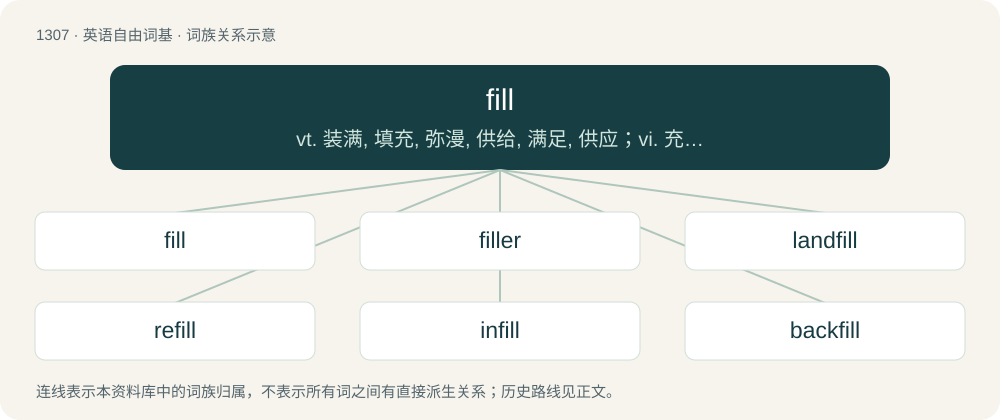

# 1393 · fill — vt. 装满, 填充, 弥漫, 供给, 满足, 供应；vi. 充满, 变得沉重；n. 满足, 装满, 充分, 填方

[总目录](../00_总目录_按常用程度.md)

**类型**：英语自由词基　｜　**来源语言**：见词源记录

## 核心含义与来源

- 核心含义：vt. 装满, 填充, 弥漫, 供给, 满足, 供应；vi. 充满, 变得沉重；n. 满足, 装满, 充分, 填方
- 英文含义：To add contents to (a container, cavity, or the like) so that it is full.
- 词形：fill

**多个词源／构词路径**：同一拼写可能有不同来源；以下按词性和含义分别列出。

**来源记录 1**（动词；To add contents to (a container, cavity, or the like) so that it is full.）

From Middle English fillen, fullen, from Old English fyllan (“to fill, fill up, replenish, satisfy; complete, fulfill”), from Proto-West Germanic \*fullijan, from Proto-Germanic \*fullijaną (“to make full, fill”), from \*fullaz (“full”), from Proto-Indo-European \*pl̥h₁nós (“full”). Cognate with Scots fill (“to fill”), West Frisian folje (“to fill”), Low German füllen (“to fill”), Dutch vullen (“to fill”), German füllen (“to fill”), Danish fylde (“to fill”), Swedish fylla (“to fill”), Norwegian fylle (“to fill”), Icelandic fylla (“to fill”) and Latin plenus (“full”)

**来源记录 2**（名词；A sufficient or more than sufficient amount.）

From Middle English fille, vülle, fülle, from Old English fyllu, from Proto-West Germanic \*fullī, from Proto-Germanic \*fullį̄ (“fullness”). Cognate with German Fülle.

**来源记录 3**（名词；One of the thills or shafts of a carriage.）

See thill.

## 词族图

## 单词速览（常用到不常用）

| 单词 | 音标 | 释义 |
|---|---|---|
| [fill](#w-1) | /fɪl/ | vt. 装满, 填充, 弥漫, 供给, 满足, 供应；vi. 充满, 变得沉重；n. 满足, 装满, 充分, 填方 |
| [filler](#w-2) | 英 /ˈfɪləː/；美 /ˈfɪlɚ/ | n. 装填者, 补白, 装填物；\[计\] 填充符 |
| [landfill](#w-3) | 英 /ˈlæn(d).fɪl/ | n. 垃圾堆；垃圾填埋地 |
| [refill](#w-4) | /ˈɹiː.fɪl/ | n. 再注满, 替换物；vt. 再将...注满；vi. 被再注满 |
| [infill](#w-5) | /ˈinfil/ | v. 填实(空隙等) |
| [backfill](#w-6) | /ˈbækfɪl/ | vt. 装填, 回填；n. 装填, 回填 |

## 逐词详解

### 1. fill

**词性**：动词　｜　**音标**：/fɪl/

**中文释义**：vt. 装满, 填充, 弥漫, 供给, 满足, 供应；vi. 充满, 变得沉重；n. 满足, 装满, 充分, 填方

**英文义项**：To add contents to (a container, cavity, or the like) so that it is full. / To enter (something), making it full.

**词源与演化**：

From Middle English fillen, fullen, from Old English fyllan (“to fill, fill up, replenish, satisfy; complete, fulfill”), from Proto-West Germanic \*fullijan, from Proto-Germanic \*fullijaną (“to make full, fill”), from \*fullaz (“full”), from Proto-Indo-European \*pl̥h₁nós (“full”). Cognate with Scots fill (“to fill”), West Frisian folje (“to fill”), Low German füllen (“to fill”), Dutch vullen (“to fill”), German füllen (“to fill”), Danish fylde (“to fill”), Swedish fylla (“to fill”), Norwegian fylle (“to fill”), Icelandic fylla (“to fill”) and Latin plenus (“full”)

**例句**：

> We can't let the library close! It fills a great need in the community.

该用例对应义项：To satisfy or meet (as, an order, request, or requirement).

### 2. filler

**词性**：名词　｜　**音标**：英 /ˈfɪləː/；美 /ˈfɪlɚ/

**中文释义**：n. 装填者, 补白, 装填物；\[计\] 填充符

**英文义项**：One who fills. / Something added to fill a space or add weight or size.

**构词拆分**：fill + -er

**词源与演化**：

From fill + -er.

**例句**：

> There is a lot of filler, but not much substance, in this essay.

### 3. landfill

**词性**：动词　｜　**音标**：英 /ˈlæn(d).fɪl/

**中文释义**：n. 垃圾堆；垃圾填埋地

**英文义项**：To dispose of (garbage) by burying it at a landfill site.

**构词拆分**：land + fill

**词源与演化**：

From land + fill.

**例句**：

> We have made several failed attempts at foresting the local landfill.

### 4. refill

**词性**：名词　｜　**音标**：/ˈɹiː.fɪl/

**中文释义**：n. 再注满, 替换物；vt. 再将...注满；vi. 被再注满

**英文义项**：An additional helping of food or drink at reduced cost. / Refuelling, fuel to refill an empty fuel tank (of a vehicle or machine) or other fuel container.

**构词拆分**：re- + fill

**词源与演化**：

From re- (“again”) + fill (noun).

**例句**：

> Today it is $2 for a coffee, with free refills throughout the day.

该用例对应义项：An additional helping of food or drink at reduced cost.

### 5. infill

**词性**：动词　｜　**音标**：/ˈinfil/

**中文释义**：v. 填实(空隙等)

**英文义项**：To fill in a space, hole or gap. / To rededicate land in an urban environment to new construction.

**构词拆分**：in + fill

**词源与演化**：

From in + fill.

**例句**：

> In urban planning, infill is the use of land within a built-up area for further construction.

### 6. backfill

**词性**：动词　｜　**音标**：/ˈbækfɪl/

**中文释义**：vt. 装填, 回填；n. 装填, 回填

**英文义项**：To refill a hole with the material dug out of it. / To refill an excavation unit to restore the former ground surface and/or to preserve the unit and make it recognizable as having been excavated.

**构词拆分**：back + fill

**词源与演化**：

From back + fill.

**例句**：

> The company backfilled Joe's position after he was terminated.

该用例对应义项：To replenish or restock due to attrition or loss.
