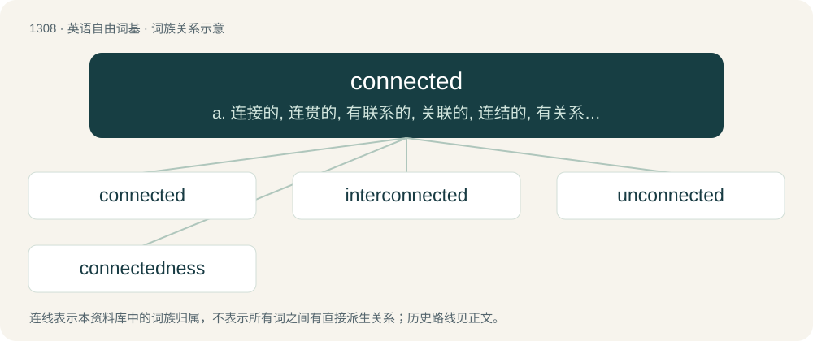

# 1394 · connected — a. 连接的, 连贯的, 有联系的, 关联的, 连结的, 有关系的；\[计\] 连接的

[总目录](../00_总目录_按常用程度.md)

**类型**：英语自由词基　｜　**来源语言**：见词源记录

## 核心含义与来源

- 核心含义：a. 连接的, 连贯的, 有联系的, 关联的, 连结的, 有关系的；\[计\] 连接的
- 英文含义：Having favorable rapport with a powerful entity.
- 词形：connected

**来源记录 1**（形容词；Having favorable rapport with a powerful entity.）

From connect + -ed.

## 词族图

## 单词速览（常用到不常用）

| 单词 | 音标 | 释义 |
|---|---|---|
| [connected](#w-1) | /kəˈnɛktɪd/ | a. 连接的, 连贯的, 有联系的, 关联的, 连结的, 有关系的；\[计\] 连接的 |
| [interconnected](#w-2) | /,intəkəˈnektid/ | v. 互相连接, 互相联系( interconnect的过去式和过去分词) |
| [unconnected](#w-3) | /ˈʌnkəˈnektid/ | a. 不连接的, 分离的, 不连贯的, 无亲属关系的；\[计\] 非连通的 |
| [connectedness](#w-4) |  | \[计\] 连通性 |

## 逐词详解

### 1. connected

**词性**：形容词　｜　**音标**：/kəˈnɛktɪd/

**中文释义**：a. 连接的, 连贯的, 有联系的, 关联的, 连结的, 有关系的；\[计\] 连接的

**英文义项**：Having favorable rapport with a powerful entity. / Having relationships; involved with others.

**构词拆分**：connect + -ed

**词源与演化**：

From connect + -ed.

**例句**：

> In a connected graph, there is no section (proper subset that includes all edges from each vertex in said subset) of the graph that is isolated from the rest.

该用例对应义项：Having a path, either directed or undirected, connecting every pair of vertices.

### 2. interconnected

**词性**：形容词　｜　**音标**：/,intəkəˈnektid/

**中文释义**：v. 互相连接, 互相联系( interconnect的过去式和过去分词)

**英文义项**：Intertwined; connected at multiple points or levels.

**构词拆分**：inter- + connected

**词源与演化**：

From inter- + connected.

**例句**：

> Thanks to its countless highways, Algeria is now a large interconnected village.

### 3. unconnected

**词性**：形容词　｜　**音标**：/ˈʌnkəˈnektid/

**中文释义**：a. 不连接的, 分离的, 不连贯的, 无亲属关系的；\[计\] 非连通的

**英文义项**：Not connected or joined. / Confused or disconnected.

**构词拆分**：un- + connected

**词源与演化**：

From un- + connected.

**例句**：

> The light wouldn't work because the cable was unconnected.

该用例对应义项：Not connected or joined.

### 4. connectedness

**词性**：名词

**中文释义**：\[计\] 连通性

**英文义项**：The state or quality of being connected.

**构词拆分**：connected + -ness

**词源与演化**：

From connected + -ness.

**例句**：

> Connectedness is very important for suicide prevention.
