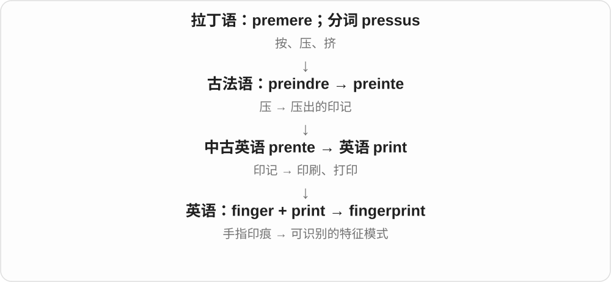

# 1395 · finger — 手指与触摸、指认；手指组成的名称

[逐词精讲目录](../00_逐词精讲目录.md) · [总目录](../00_总目录_按常用程度.md)

## 核心词根与来源

手指能摸、能指、能按弦，还会留下指纹。复合词大多很直观，但 finger 自己末尾的 -er 不表做事的人。

**FINGER：先看一根手指，再看它做什么**

finger → fingered；finger + nail/tip/print；forefinger 指前面的食指；fingerless 手套让手指出来。

- **基本词与动作**：finger · fingered
- **指的部位、编号与痕迹**：fingernail · fingertip · forefinger · fingerprint
- **工具和衣物**：fingerboard · fingerless
- **finger → fingers：手指与用手触弄**：finger · fingers

## 词形与演化规律

finger 古英语旧词；finger + -ed/-less；finger + nail/tip/print/board；fore- + finger。

fingers 可说多个手指，也可说某人用手指触弄；ng 后常见 g 音，词尾读 z。

## 单词速览（按词族由简到繁）

同一基础词的相关扩展放在一起，先读基础形式，再读扩展；各组之间优先读常用的。具体词源关系见各词讲解。

| 单词 | 音标 | 核心意思 |
|---|---|---|
| [finger](#w-1) | 英 /ˈfɪŋɡə/；美 /ˈfɪŋɡər/ | 手指；用手指触摸；指出、指认 |
| [fingers](#w-9) | 英 /ˈfɪŋɡəz/；美 /ˈfɪŋɡərz/ | 手指〔复数〕；用手指触弄；指认〔finger 的第三人称单数〕 |
| [fingerprint](#w-2) | 英 /ˈfɪŋɡəprɪnt/；美 /ˈfɪŋɡərprɪnt/ | 指纹；识别特征；采集指纹 |
| [fingered](#w-3) | 英 /ˈfɪŋɡəd/；美 /ˈfɪŋɡərd/ | 用手指摸过、指认了；有某种手指的 |
| [fingernail](#w-4) | 英 /ˈfɪŋɡəneɪl/；美 /ˈfɪŋɡərneɪl/ | 手指甲 |
| [fingertip](#w-5) | 英 /ˈfɪŋɡətɪp/；美 /ˈfɪŋɡərtɪp/ | 指尖；at your fingertips 随手可得、了如指掌 |
| [fingerboard](#w-7) | 英 /ˈfɪŋɡəbɔːd/；美 /ˈfɪŋɡərbɔːrd/ | 弦乐器指板；手指滑板 |
| [fingerless](#w-8) | 英 /ˈfɪŋɡələs/；美 /ˈfɪŋɡərləs/ | 无手指的；露指的〔手套〕 |
| [forefinger](#w-6) | 英 /ˈfɔːˌfɪŋɡə/；美 /ˈfɔːrˌfɪŋɡər/ | 食指 |

## 逐词讲解

### 1. finger — 手指；用手指触摸；指出、指认

**音标**：英 /ˈfɪŋɡə/；美 /ˈfɪŋɡər/

**先抓住这个画面**

手上能弯曲的一根指头；作动词就把手指的动作借出来：摸弄东西，或指着某人说就是他。

**怎么拆**

接古英语 finger，是旧日耳曼语词。更远常被联系到表示五的印欧材料，但关系有不确定性；现代 -er 不是人后缀，不能拆成 fing + 做事的人。

**怎么变成今天的意思**

**古英语 finger → 中古英语 finger/fynger**  
手指，日耳曼语旧词

↓

**英语 finger**  
手指 → 用手指触摸、演奏、指出某人

an index finger 食指，run your fingers through your hair 用手指梳过头发，finger a suspect 指认嫌疑人。日常有时把 thumb 拇指和其余 fingers 分开算。

**常见搭配与例句**

an index finger；run your fingers through；finger someone as。

> She ran her fingers through her hair.

她用手指梳了梳头发。

> A witness fingered him as the man at the door.

一名证人指认他就是当时在门口的人。

**别混淆**

finger 常说手指，toe 是脚趾；digit 是更宽的指、趾及数字用词。finger someone 指认不自动等于已经证明有罪。

### 2. fingers — 手指〔复数〕；用手指触弄；指认〔finger 的第三人称单数〕

**音标**：英 /ˈfɪŋɡəz/；美 /ˈfɪŋɡərz/

**先抓住这个画面**

手上细长、能握住和触碰东西的 fingers，转作动词就能说用手指摸、拨弄；在调查语境里还可说指认某人。

**怎么拆**

finger + -s，词尾读 /z/，ng 后的 /ɡ/ 在常见标准读音中保留。finger 接古英语手指名，现代动词与用手指触碰、指向的动作相连。

**怎么变成今天的意思**

**古英语 finger → finger**  
手指名称

↓

**名词、动词 finger + -s → fingers**  
多个手指；单数主语触弄、指认

cross your fingers 交叉手指祈求好运；run your fingers through your hair 用手指梳过头发；fingers the ribbon 用手指拨弄丝带。

**常见搭配与例句**

cold fingers；keep your fingers crossed。

> She ran her fingers through her hair.

她用手指梳了梳头发。

> He fingers the edge of the ribbon while he waits.

等候时，他用手指拨弄着丝带边缘。

**别混淆**

日常细分时 fingers 常与 thumb 拇指分开说；较宽的用法也会统指手部各指。句中有后接宾语时，要考虑 fingers 是动词。

### 3. fingerprint — 指纹；识别特征；采集指纹

**音标**：英 /ˈfɪŋɡəprɪnt/；美 /ˈfɪŋɡərprɪnt/

**先抓住这个画面**

手指留下的纹路像一组特征，也使这个词能比喻辨认某个来源的独特模式。

**怎么拆**

finger 手指 + print 印痕；名词后来也转为动词。

**怎么变成今天的意思**

实际指纹是皮肤纹路留下的图样；digital fingerprint 等技术表达强调用于识别的一组特征，不是电脑真有手指。

**常见搭配与例句**

fingerprint recognition；leave fingerprints；a chemical fingerprint。

> The glass was covered with fingerprints.

玻璃上满是指纹。

> The laboratory compared the samples’ chemical fingerprints.

实验室比较了这些样品的化学特征图谱。

**别混淆**

fingermark 常泛指手指留下的污迹；fingerprint 更强调纹路或识别特征。

### 4. fingered — 用手指摸过、指认了；有某种手指的

**音标**：英 /ˈfɪŋɡəd/；美 /ˈfɪŋɡərd/

**先抓住这个画面**

先看结构：He fingered the fabric 是他用手指摸布；形容词里的 fingered 则可说长着某种手指。

**怎么拆**

动词 finger + -ed 可成过去式、过去分词；另有 finger + -ed 具有……手指的形容词构造，常与前面描述一起出现。

**怎么变成今天的意思**

**古英语 finger → 中古英语 finger/fynger**  
手指，日耳曼语旧词

↓

**英语 finger**  
手指 → 用手指触摸、演奏、指出某人

↓

**finger + -ed**  
过去触摸、被指认；另一构造表有相应手指

fingered the material 摸了摸布料，was fingered as 被指认为；long-fingered hands 手指修长的双手。形容词构造不必表示过去发生。

**常见搭配与例句**

fingered the fabric；was fingered as；long-fingered hands。

> He fingered the edge of the fabric while thinking.

他一边思考，一边用手指摸着布边。

> Her long-fingered hands moved across the piano keys.

她修长的手指在钢琴键上移动。

**别混淆**

-ed 读 /d/；fingered 不像 needed 那样加出 /ɪd/ 音节。动词过去式与具有某种特征的形容词，要靠句子分。

### 5. fingernail — 手指甲

**音标**：英 /ˈfɪŋɡəneɪl/；美 /ˈfɪŋɡərneɪl/

**先抓住这个画面**

手指尖那片硬硬的甲；finger 先把部位限定在手上，再由 nail 说是哪种东西。

**怎么拆**

finger + nail，中古英语已有组合。nail 在此是指甲，不是钉子；同一个 nail 的不同义靠搭配分。

**怎么变成今天的意思**

**古英语 finger → 中古英语 finger/fynger**  
手指，日耳曼语旧词

↓

**finger + nail → fingernail**  
手指上的甲

trim your fingernails 修剪手指甲，a broken fingernail 断裂的指甲，under your fingernails 指甲缝里。

**常见搭配与例句**

trim your fingernails；a broken fingernail；under your fingernails。

> There was paint under his fingernails.

他的指甲缝里有油漆。

> She caught a broken fingernail on the wool.

她断裂的指甲勾住了毛线。

**别混淆**

fingernail 手指甲，toenail 脚趾甲；fingertip 指尖还包括皮肤部位，不只那片甲。

### 6. fingertip — 指尖；at your fingertips 随手可得、了如指掌

**音标**：英 /ˈfɪŋɡətɪp/；美 /ˈfɪŋɡərtɪp/

**先抓住这个画面**

手指最末端就是 fingertip；信息就在指尖下，伸手可用，于是比喻随时能拿到、运用。

**怎么拆**

finger 手指 + tip 末端，复合词直接限定哪个部位的尖端。at one’s fingertips 后来借给知识、工具的易获得。

**怎么变成今天的意思**

**中古英语 tippe、tip 等 → tip〔端点〕**  
尖端、末端；更远来源不定

↓

**finger + tip → fingertip**  
手指末端

↓

**at one’s fingertips 的空间比喻**  
伸手可用、随时掌握

touch with a fingertip 用指尖碰，at your fingertips 触手可及，fingertip control 指尖控制。

**常见搭配与例句**

at your fingertips；touch with a fingertip；fingertip control。

> She touched the screen with a fingertip.

她用指尖碰了碰屏幕。

> The app puts the timetable at your fingertips.

应用让你随手就能查到时间表。

**别混淆**

fingertip 指尖，fingerprint 指纹是不同东西；information at your fingertips 不保证你已经真正理解全部内容。

### 7. fingerboard — 弦乐器指板；手指滑板

**音标**：英 /ˈfɪŋɡəbɔːd/；美 /ˈfɪŋɡərbɔːrd/

**先抓住这个画面**

拉琴或弹琴时，手指在琴弦下方那条板上按出不同音；另一用法是用手指玩的迷你滑板。

**怎么拆**

finger 手指 + board 板；乐器中按使用部位命名，玩具中按手指操作的滑板命名，两种对象分开理解。

**怎么变成今天的意思**

**finger 手指；board 板**  
并列构词部分

↓

**fingerboard**  
手指按弦的板；以手指操控的小滑板

a violin fingerboard 小提琴指板；a toy fingerboard 玩具手指滑板。先看乐器还是玩具的场景。

**常见搭配与例句**

a violin fingerboard；press a string against the fingerboard；a toy fingerboard。

> She moved her fingers along the violin’s fingerboard.

她的手指沿小提琴指板移动。

> He practised tricks with a tiny fingerboard on his desk.

他在书桌上用迷你手指滑板练动作。

**别混淆**

fingerboard 指板这一部件；fretboard 特别指有品丝的指板，不能把所有指板都假定有金属品丝。

### 8. fingerless — 无手指的；露指的〔手套〕

**音标**：英 /ˈfɪŋɡələs/；美 /ˈfɪŋɡərləs/

**先抓住这个画面**

手套把手掌裹住，却把手指留在外面；fingerless gloves 是常见画面。说人时也可直接表示没有手指。

**怎么拆**

finger + -less，没有。修饰手套时说手套没有完整覆盖手指的部分，不是穿手套的人没手指。

**怎么变成今天的意思**

**古英语 finger → 中古英语 finger/fynger**  
手指，日耳曼语旧词

↓

**finger + -less → fingerless**  
没有手指；手套缺少完整指部覆盖

fingerless gloves 露指手套，常方便敲键盘、抓握等；有些款式留半截指套，也照样这样称呼。

**常见搭配与例句**

fingerless gloves；a pair of fingerless gloves。

> She wore fingerless gloves while typing in the cold room.

她在冷房间里戴着露指手套打字。

> The shop sells both mittens and fingerless gloves.

店里既卖连指手套，也卖露指手套。

**别混淆**

fingerless gloves 露着手指，mittens 连指手套是把多数手指放在同一袋里；两个设计关注点不同。

### 9. forefinger — 食指

**音标**：英 /ˈfɔːˌfɪŋɡə/；美 /ˈfɔːrˌfɪŋɡər/

**先抓住这个画面**

伸出去指东西时，常在前面带头的那根手指；名称选中了“前面的手指”，不是整只手最远端的总称。

**怎么拆**

fore- 在前 + finger 手指，中古英语已有 forefynger 等形式。是食指名称，与 index finger 指同一根。

**怎么变成今天的意思**

**古英语 fore- → 中古英语 fore- → 英语 fore-**  
在前：位置在前，或时间较早

↓

**fore- + finger → forefinger**  
食指这一身体部位名称

thumb and forefinger 拇指和食指，point with your forefinger 用食指指，a raised forefinger 举起的食指。

**常见搭配与例句**

thumb and forefinger；raise a forefinger；point with a forefinger。

> She held the coin between her thumb and forefinger.

她用拇指和食指夹着硬币。

> He raised a forefinger to ask for silence.

他举起一根食指，示意大家安静。

**别混淆**

forefinger/index finger 常同义；middle finger 是中指，不能按谁伸得最远就临时叫 forefinger。

## 这一组要分清什么

finger/toe 手指与脚趾；fingernail/fingertip 指甲与整个指尖；fingerless gloves 不等于 mittens。

## 串起来练习

She touched the fingerboard with her fingertips, leaving faint fingerprints.

她用指尖碰了指板，留下淡淡的指纹。
