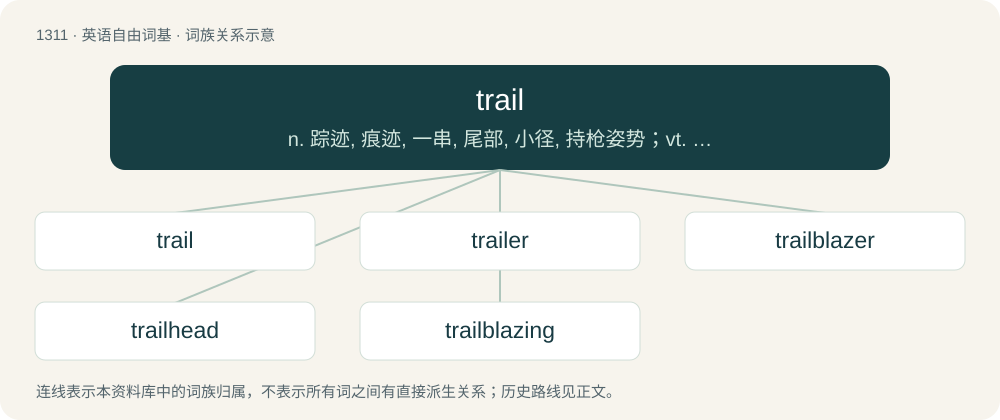

# 1397 · trail — n. 踪迹, 痕迹, 一串, 尾部, 小径, 持枪姿势；vt. 拖, 尾随, 追踪, 落后于, 开出路；vi. 拖曳, 垂下, 落后, 飘出, 蔓生

[总目录](../00_总目录_按常用程度.md)

**类型**：英语自由词基　｜　**来源语言**：见词源记录

## 核心含义与来源

- 核心含义：n. 踪迹, 痕迹, 一串, 尾部, 小径, 持枪姿势；vt. 拖, 尾随, 追踪, 落后于, 开出路；vi. 拖曳, 垂下, 落后, 飘出, 蔓生
- 英文含义：To follow behind (someone or something); to tail (someone or something).
- 词形：trail

**来源记录 1**（动词；To follow behind (someone or something); to tail (someone or something).）

From Middle English trailen, from Old French trailler (“to tow; pick up the scent of a quarry”), from Vulgar Latin \*tragulāre (“to drag”), from Latin tragula (“dragnet, javelin thrown by a strap”), probably related to Latin trahere (“to pull, drag along”).

## 词族图

## 单词速览（常用到不常用）

| 单词 | 音标 | 释义 |
|---|---|---|
| [trail](#w-1) | /tɹeɪl/ | n. 踪迹, 痕迹, 一串, 尾部, 小径, 持枪姿势；vt. 拖, 尾随, 追踪, 落后于, 开出路；vi. 拖曳, 垂下, 落后, 飘出, 蔓生 |
| [trailer](#w-2) | 英 /ˈtɹeɪlə(ɹ)/；美 /ˈtɹeɪlɚ/ | n. 追踪者, 拖车；\[电\] 拖车 |
| [trailblazer](#w-3) | 英 /ˈtɹeɪlbleɪzə/；美 /ˈtɹeɪlˌbleɪzəɹ/ | n. 开路的人, 开拓者 |
| [trailhead](#w-4) | /ˈtreilhed/ | n. 小道的起点 |
| [trailblazing](#w-5) | /ˈtreil,bleiziŋ/ | 领导性的, 带头的 |

## 逐词详解

### 1. trail

**词性**：动词　｜　**音标**：/tɹeɪl/

**中文释义**：n. 踪迹, 痕迹, 一串, 尾部, 小径, 持枪姿势；vt. 拖, 尾随, 追踪, 落后于, 开出路；vi. 拖曳, 垂下, 落后, 飘出, 蔓生

**英文义项**：To follow behind (someone or something); to tail (someone or something). / To drag (something) behind on the ground.

**词源与演化**：

From Middle English trailen, from Old French trailler (“to tow; pick up the scent of a quarry”), from Vulgar Latin \*tragulāre (“to drag”), from Latin tragula (“dragnet, javelin thrown by a strap”), probably related to Latin trahere (“to pull, drag along”).

**例句**：

> He walked into the house, soaking wet, and trailed water all over the place.

该用例对应义项：To leave (a trail of).

### 2. trailer

**词性**：名词　｜　**音标**：英 /ˈtɹeɪlə(ɹ)/；美 /ˈtɹeɪlɚ/

**中文释义**：n. 追踪者, 拖车；\[电\] 拖车

**英文义项**：Someone who or something that trails (follows behind); something that is trailing. / Part of an object which extends some distance beyond the main body of the object.

**构词拆分**：trail + -er

**词源与演化**：

From trail + -er. The film sense derives from the fact that previews were formerly shown after the main feature, rather than before as is usual today, that is trailing after the main feature.

**例句**：

> The encapsulation layer adds an eight-byte header and a two-byte trailer to each packet.

该用例对应义项：The last part of a packet, often containing a check sequence.

### 3. trailblazer

**词性**：名词　｜　**音标**：英 /ˈtɹeɪlbleɪzə/；美 /ˈtɹeɪlˌbleɪzəɹ/

**中文释义**：n. 开路的人, 开拓者

**英文义项**：One who discovers or makes a new path or way through an untraversed region. / One who is the first to do something in a particular field; an innovator, a pioneer.

**构词拆分**：trail (noun) + blazer (noun)

**词源与演化**：

From trail (noun) + blazer (noun).

**例句**：

> Jane Goodall is a trailblazer for women in science.

### 4. trailhead

**词性**：名词　｜　**音标**：/ˈtreilhed/

**中文释义**：n. 小道的起点

**英文义项**：The beginning of a trail, often specifically a hiking trail. / The initial clue that leads to an alternate reality game.

**构词拆分**：trail + head

**词源与演化**：

From trail + head.

**例句**：

> The western state of Wyoming was once a trailhead for cattle about to be shipped east.

### 5. trailblazing

**词性**：形容词　｜　**音标**：/ˈtreil,bleiziŋ/

**中文释义**：领导性的, 带头的

**英文义项**：Resembling a trailblazer; innovative or pioneering.

**构词拆分**：trail + blazing

**词源与演化**：

From trail + blazing.

**例句**：

> Lest the maturing children implement designs trailblazing and unequalled, the ample nipples of their motherland burst with debilitating liquor.
