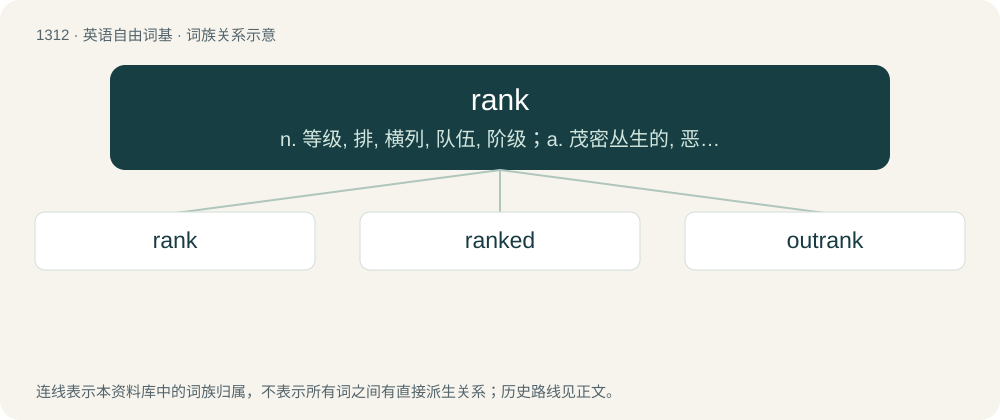

# 1398 · rank — n. 等级, 排, 横列, 队伍, 阶级；a. 茂密丛生的, 恶臭的, 十足的, 粗俗的；vt. 排列, 归类于, 把...分等

[总目录](../00_总目录_按常用程度.md)

**类型**：英语自由词基　｜　**来源语言**：见词源记录

## 核心含义与来源

- 核心含义：n. 等级, 排, 横列, 队伍, 阶级；a. 茂密丛生的, 恶臭的, 十足的, 粗俗的；vt. 排列, 归类于, 把...分等
- 英文含义：Having a very strong, bad taste or odor.
- 词形：rank

**多个词源／构词路径**：同一拼写可能有不同来源；以下按词性和含义分别列出。

**来源记录 1**（形容词；Having a very strong, bad taste or odor.）

From Middle English rank (“strong, proud”), from Old English ranc (“proud, haughty, arrogant, insolent, forward, overbearing, showy, ostentatious, splendid, bold, valiant, noble, brave, strong, full-grown, mature”), from Proto-West Germanic \*rank, from Proto-Germanic \*rankaz (“straight”), from Proto-Indo-European \*h₃reǵ- (“straight, direct”). Cognate with Dutch rank (“slender, slim”), Low German rank (“slender, projecting, lank”), Danish rank (“straight, erect, slender”), Swedish rank (“slender, shaky, wonky”), Icelandic rakkur (“straight, slender, bold, valiant”). The sense referring to taste or odor is possibly influenced by rancor.

**来源记录 2**（名词；A row of people or things organized in a grid pattern, often soldiers.）

From Middle English rank (“line, row”), from Old French ranc, rang, reng (“line, row, rank”) (Modern French rang), from Frankish \*hring (“ring”), from Proto-Germanic \*hringaz (“something bent or curved”). Displaced native Old English hād (“rank, status”). Akin to Old High German (h)ring, Old Frisian hring, Old English hring, hrincg (“ring”), Old Norse hringr (“ring, circle, queue, sword; ship”). Doublet of ring and rink.

## 词族图

## 单词速览（常用到不常用）

| 单词 | 音标 | 释义 |
|---|---|---|
| [rank](#w-1) | 美 /ˈɹeɪ̯ŋk/；/ˈɹæŋk/ | n. 等级, 排, 横列, 队伍, 阶级；a. 茂密丛生的, 恶臭的, 十足的, 粗俗的；vt. 排列, 归类于, 把...分等 |
| [ranked](#w-2) | /ɹæŋkt/ | vt.& vi. 排列, 使成横排（rank的过去式与过去分词形式） |
| [outrank](#w-3) | 美 /aʊtˈɹæŋk/；/aʊtˈɹeɪ̯ŋk/ | vt. 在级别方面比...高, 在地位方面比...高, 在身分方面比...高 |

## 逐词详解

### 1. rank

**词性**：形容词　｜　**音标**：美 /ˈɹeɪ̯ŋk/；/ˈɹæŋk/

**中文释义**：n. 等级, 排, 横列, 队伍, 阶级；a. 茂密丛生的, 恶臭的, 十足的, 粗俗的；vt. 排列, 归类于, 把...分等

**英文义项**：Having a very strong, bad taste or odor. / complete, unmitigated, utter.

**词源与演化**：

From Middle English rank (“strong, proud”), from Old English ranc (“proud, haughty, arrogant, insolent, forward, overbearing, showy, ostentatious, splendid, bold, valiant, noble, brave, strong, full-grown, mature”), from Proto-West Germanic \*rank, from Proto-Germanic \*rankaz (“straight”), from Proto-Indo-European \*h₃reǵ- (“straight, direct”). Cognate with Dutch rank (“slender, slim”), Low German rank (“slender, projecting, lank”), Danish rank (“straight, erect, slender”), Swedish rank (“slender, shaky, wonky”), Icelandic rakkur (“straight, slender, bold, valiant”). The sense referring to taste or odor is possibly influenced by rancor.

**例句**：

> Your gym clothes are rank, bro – when'd you last wash 'em?

该用例对应义项：Having a very strong, bad taste or odor.

### 2. ranked

**词性**：名词　｜　**音标**：/ɹæŋkt/

**中文释义**：vt.& vi. 排列, 使成横排（rank的过去式与过去分词形式）

**英文义项**：As a whole, the modes of a video game in which players are divided in ranks based on their skill level, and are matched against other players of the same rank.

**构词拆分**：rank + -ed

**词源与演化**：

From rank + -ed.

**例句**：

> I hate playing ranked.

该用例对应义项：As a whole, the modes of a video game in which players are divided in ranks based on their skill level, and are matched against other players of the same rank.

### 3. outrank

**词性**：动词　｜　**音标**：美 /aʊtˈɹæŋk/；/aʊtˈɹeɪ̯ŋk/

**中文释义**：vt. 在级别方面比...高, 在地位方面比...高, 在身分方面比...高

**英文义项**：To be of a higher rank than. / To be more important than.

**构词拆分**：out- + rank

**词源与演化**：

From out- + rank.
