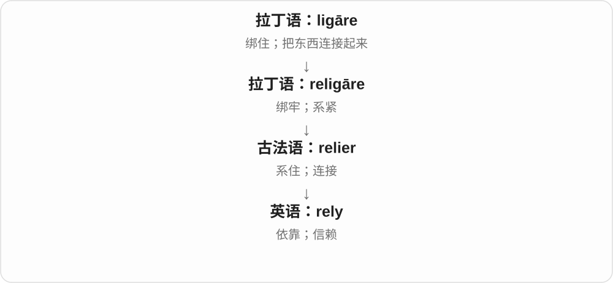
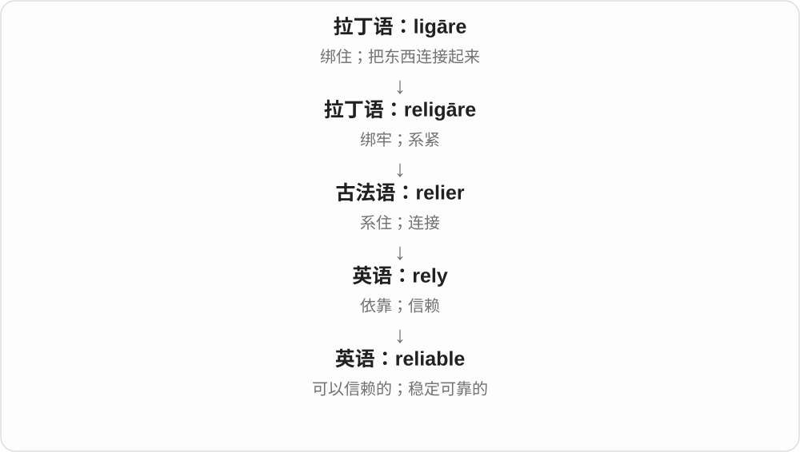
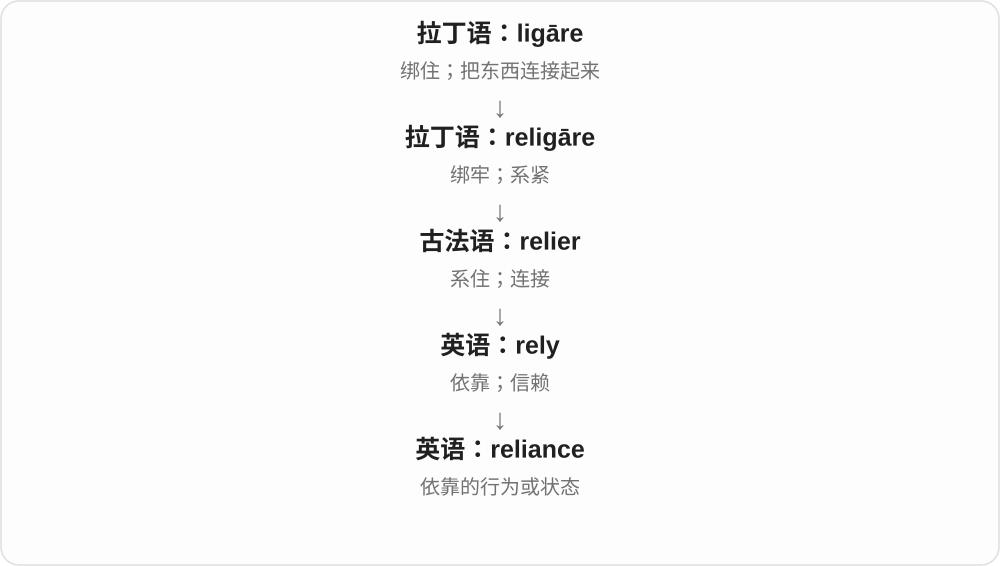
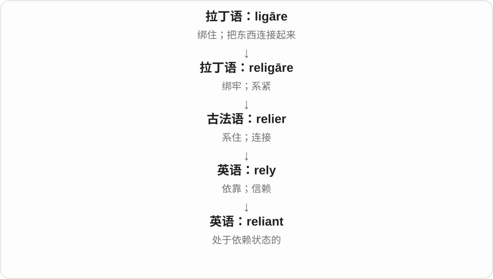

# 1399 · rely — 依赖；信赖

[逐词精讲目录](../00_逐词精讲目录.md) · [总目录](../00_总目录_按常用程度.md)

## 核心词根与来源

rely 经法语 relier 的联结一支发展出依靠、信赖。reliance 是依赖或信赖，reliant 是依赖的，reliable 是可靠的。

**RELY：把支持或判断建立在另一方上**

知道有人会帮忙，或相信一份数据足够可靠。

- **依靠与关系**：rely · reliance · reliant
- **值得信赖**：reliable
- **rely：把信任系上去，现代依靠的常用变化**：rely · relies · relied · relying

## 词形与演化规律

rely on；rely → relies／relied；reliable 结尾是 -able，reliance、reliant 与之相应，但现代用法职责不同。

拉丁 religare 系牢经法语 relier 到英语；现代介词 on、upon 接依靠对象，不能按再次躺下解释。

## 单词速览（按词族由简到繁）

同一基础词的相关扩展放在一起，先读基础形式，再读扩展；各组之间优先读常用的。具体词源关系见各词讲解。

| 单词 | 音标 | 核心意思 |
|---|---|---|
| [rely](#w-2) | /rɪˈlaɪ/ | 依靠；信赖 |
| [reliable](#w-1) | /rɪˈlaɪəbəl/ | 可靠的；可信赖的 |
| [relied](#w-5) | /rɪˈlaɪd/ | 依靠、信赖了；曾依赖 |
| [relies](#w-6) | /rɪˈlaɪz/ | 依靠、信赖〔第三人称单数〕 |
| [relying](#w-7) | /rɪˈlaɪɪŋ/ | 正在依靠、信赖；依赖的活动 |
| [reliance](#w-3) | /rɪˈlaɪəns/ | 依赖；信赖 |
| [reliant](#w-4) | /rɪˈlaɪənt/ | 依赖……的 |

## 逐词讲解

### 1. rely — 依靠；信赖

**音标**：/rɪˈlaɪ/

**先抓住这个画面**

rely 描述把事情的成败、需要或期待托付给某个人或事物。You can rely on me 不只是“你喜欢我”，而是说需要我兑现承诺时，我靠得住。

**怎么拆**

历史上与 re- + ligāre 有关，这里的 re- 可加强“绑牢”的意思。词经古法语 relier 进入英语；不是 re- + lie“再次躺下”。过去式 relied，进行时 relying。

**怎么变成今天的意思**

早期词义包含连接、聚集，后来发展为依附和信赖。把“将自己的信任系在某人身上”当作理解这层抽象意义的画面很有帮助；但它是解释语感的比喻，不意味着现代人使用 rely 时想到绳子。

**常见搭配与例句**

rely on / upon someone；rely on someone to do something；rely on doing something。

> You can rely on Maya to keep her promise.

你可以相信玛雅会遵守承诺。

> The village relies on the river for drinking water.

这个村庄依靠河流获取饮用水。

**别混淆**

depend on 更容易中性地说明条件关系；rely on 常包含依赖或信任。不能说 rely someone，通常需要 on 或 upon。

### 2. reliable — 可靠的；可信赖的

**音标**：/rɪˈlaɪəbəl/

**先抓住这个画面**

reliable 描述在需要的时候表现稳定、能够让人放心依靠的对象。人、消息来源、设备和服务都可以 reliable。一次表现很好，不一定就证明长期可靠。

**怎么拆**

rely + -able；y 在派生中变 i。这里 -able 表示“可以被依靠的”，不是简单给 rely 加“能够”就译成“能够依靠别人的”。

**怎么变成今天的意思**

rely 是“依靠”的动作，reliable 把目光转向依靠的对象：它是否值得被信任。英语在本土构词阶段形成这个形容词，不能把整词当作拉丁语直接借词。

**常见搭配与例句**

a reliable source（可靠来源）；a reliable car（可靠的汽车）；reliable information（可信的信息）。

> We need a reliable source before publishing the story.

刊发这则报道前，我们需要可靠的消息来源。

> This old car is still surprisingly reliable.

这辆旧车仍然出人意料地可靠。

**别混淆**

reliable 强调可依赖的表现；accurate 强调具体内容准确。一把每次都偏同样数值的尺可能重复性好，却不准确。

### 3. relied — 依靠、信赖了；曾依赖

**音标**：/rɪˈlaɪd/

**先抓住这个画面**

过去的工作、生活靠着某个人或办法进行，用 relied on。

**怎么拆**

rely 把 y 改为 i，加完整 -ed；词尾读 /d/。不是 lie 的不规则过去式，不能照着躺下的词形变化。

**怎么变成今天的意思**

**拉丁 ligare → religare → 古法语 relier**  
绑、连接 → 系牢、聚到一起

↓

**英语 rely**  
早有聚集等义，后发展出依靠、信赖

↓

**rely → relied〔y 改 i，加 -ed〕**  
过去依靠、信赖

relied on her advice 是过去依靠她的建议；could be relied on 是可以信赖、靠得住。

**常见搭配与例句**

relied heavily on 很依赖；relied on memory 靠记忆。

> We relied on her local knowledge to find the path.

我们靠她对当地的了解找到那条路。

> He relied on memory instead of writing things down.

他依靠记忆，没有把事情记下来。

**别混淆**

relied 是 rely 的规则变化；laid 是 lay 的过去式、过去分词，lain 是 lie 躺下的过去分词，历史和句式都不同。

### 4. relies — 依靠、信赖〔第三人称单数〕

**音标**：/rɪˈlaɪz/

**先抓住这个画面**

需要某种资源才能运转，或把完成事情的把握放在某人身上，就是 relies on。

**怎么拆**

rely 的辅音字母加 y 结尾，三单把 y 改为 i，加 -es；读音仍保留 /aɪ/。古代系牢材料与今天的词尾变化分开看。

**怎么变成今天的意思**

**拉丁 ligare → religare → 古法语 relier**  
绑、连接 → 系牢、聚到一起

↓

**英语 rely**  
早有聚集等义，后发展出依靠、信赖

↓

**rely → relies〔y 改 i，加 -es〕**  
他、她、它依靠

relies on someone to do 是依靠某人做事，relies on something for... 是靠某物获得所需。

**常见搭配与例句**

relies on public transport 依靠公共交通；relies on her experience 靠她的经验。

> The village relies on the river for water.

这个村庄靠河流取水。

> She relies on her notes when giving a talk.

她讲话时依靠笔记。

**别混淆**

relies 通常需要 on 或 upon 来接对象；不能像 trusts her 那样直接说 relies her。

### 5. relying — 正在依靠、信赖；依赖的活动

**音标**：/rɪˈlaɪɪŋ/

**先抓住这个画面**

把这件事交给谁、靠什么来办成，正处在这种依赖关系里，就是 relying on。

**怎么拆**

rely + 完整 -ing，保留 y；不是先改成 reli 再接 -ing。/aɪ/ 后继续接 /ɪŋ/。

**怎么变成今天的意思**

**拉丁 ligare → religare → 古法语 relier**  
绑、连接 → 系牢、聚到一起

↓

**英语 rely**  
早有聚集等义，后发展出依靠、信赖

↓

**rely + -ing → relying**  
正在依靠、信赖

relying on you to help 是正指望你帮忙；without relying on... 是不依靠某人、某物。

**常见搭配与例句**

relying on others 依靠别人；relying entirely on notes 完全靠笔记。

> I am relying on you to check the final version.

我正指望你核对最终版本。

> She learned to cook without relying on a recipe.

她学会了不照食谱也能做饭。

**别混淆**

relying on someone 常有依靠、指望的关系；waiting for someone 只是等待，不一定把事情交给他负责。

### 6. reliance — 依赖；信赖

**音标**：/rɪˈlaɪəns/

**先抓住这个画面**

reliance 指正在依靠某人或某物的关系和状态，特别适合讨论依赖程度。它把焦点放在“依赖者”，而 reliability 评价“被依赖者”。

**怎么拆**

rely + -ance，y 变 i，-ance 构成状态名词。它与 alliance 的结尾相同，但前面的历史词形和现代意义不同。

**怎么变成今天的意思**

由“我依靠它”转成“我对它的依赖”，句子里的动作就变成可讨论的名词。常用的 on 也随之保留下来：rely on → reliance on。

**常见搭配与例句**

heavy reliance on…（高度依赖……）；reduce reliance on…（减少对……的依赖）。

> The city wants to reduce its reliance on private cars.

这座城市希望减少对私家车的依赖。

> Her reliance on the team grew as the project became more complex.

随着项目变得更复杂，她对团队的依赖增加了。

**别混淆**

reliance 可以是中性的，也可以暗示依赖过多；reliability 通常直接评价可靠程度。不要把 reliance on technology 译成“技术的可靠性”。

### 7. reliant — 依赖……的

**音标**：/rɪˈlaɪənt/

**先抓住这个画面**

reliant 描述一个人或系统需要某种支持才能运行的状态。它通常和 on 连用，后面交代依赖什么。

**怎么拆**

rely + -ant；-ant 构成表示状态的形容词。与 reliable 的方向不同：reliant 是“依靠别人的”，reliable 是“可让别人依靠的”。

**怎么变成今天的意思**

词义仍围绕依靠，只是从动作变为主语的状态。a country reliant on imports 就是一个依赖进口的国家，不表示这个国家本身值得信赖。

**常见搭配与例句**

be reliant on…；heavily reliant on…；less reliant on outside help。

> The business is heavily reliant on one supplier.

这家企业高度依赖一家供应商。

> She became less reliant on others as her confidence grew.

随着信心增强，她对他人的依赖减少了。

**别混淆**

reliant ≠ reliable。可以把两者放在一句话里理解：一个 reliant on others 的人，依赖的是 reliable people。

## 这一组要分清什么

reliant 是依赖别人的，reliable 是别人能依赖的；一个字尾差别改变角色方向。

## 串起来练习

We rely on reliable data and try to reduce reliance on guesswork.

我们依靠可靠数据，尽量减少对猜测的依赖。
