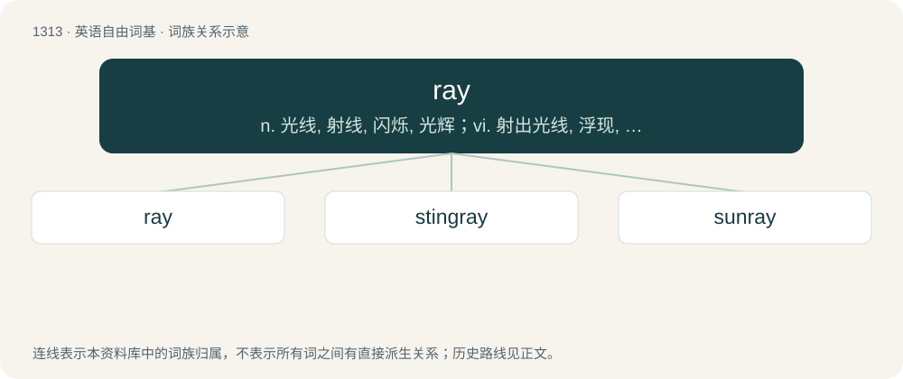

# 1400 · ray — n. 光线, 射线, 闪烁, 光辉；vi. 射出光线, 浮现, 放射光线；vt. 放射, 显出

[总目录](../00_总目录_按常用程度.md)

**类型**：英语自由词基　｜　**来源语言**：见词源记录

## 核心含义与来源

- 核心含义：n. 光线, 射线, 闪烁, 光辉；vi. 射出光线, 浮现, 放射光线；vt. 放射, 显出
- 英文含义：A beam of light or radiation.
- 词形：ray

**多个词源／构词路径**：同一拼写可能有不同来源；以下按词性和含义分别列出。

**来源记录 1**（名词；A beam of light or radiation.）

Via Middle English, borrowed from Old French rai, from Latin radius (“staff, stake, spoke”). Doublet of radius.

**来源记录 2**（名词；Any of the superorder Batoidea of marine fish with flat bodies, large wing-like fins, and whip-like tails.）

From Middle English raye, rayȝe, from Old French raie, from Latin raia, of uncertain origin. Compare Middle English reyhhe, reihe, reȝge (“ray, skate”), from Old English reohhe (“ray”).

**来源记录 3**（名词；The letter ⟨/⟩, one of two which represent the r sound in Pitman shorthand.）

From its sound, by analogy with the letters chay, jay, gay, kay, which it resembles graphically.

## 词族图

## 单词速览（常用到不常用）

| 单词 | 音标 | 释义 |
|---|---|---|
| [ray](#w-1) | 英 /ɹeɪ/ | n. 光线, 射线, 闪烁, 光辉；vi. 射出光线, 浮现, 放射光线；vt. 放射, 显出 |
| [stingray](#w-2) | /ˈstɪŋˌɹeɪ/ | n. \[鱼\]黄貂鱼 |
| [sunray](#w-3) | /ˈsʌnrei/ | n. 太阳光线, 紫外线, 光线 |

## 逐词详解

### 1. ray

**词性**：名词　｜　**音标**：英 /ɹeɪ/

**中文释义**：n. 光线, 射线, 闪烁, 光辉；vi. 射出光线, 浮现, 放射光线；vt. 放射, 显出

**英文义项**：A beam of light or radiation. / A rib-like reinforcement of bone or cartilage in a fish's fin.

**词源与演化**：

Via Middle English, borrowed from Old French rai, from Latin radius (“staff, stake, spoke”). Doublet of radius.

**例句**：

> I saw a ray of light through the clouds.

该用例对应义项：A beam of light or radiation.

### 2. stingray

**词性**：名词　｜　**音标**：/ˈstɪŋˌɹeɪ/

**中文释义**：n. \[鱼\]黄貂鱼

**英文义项**：Any of various large, venomous rays, of the orders Rajiformes and Myliobatiformes, having a barbed, whiplike tail. / A device that simulates a cell tower, used to intercept cell phone communications.

**构词拆分**：sting + ray

**词源与演化**：

From sting + ray.

**例句**：

> I was surprised to learn that a stingray can actually regenerate its stinger if it gets broken off.

### 3. sunray

**词性**：名词　｜　**音标**：/ˈsʌnrei/

**中文释义**：n. 太阳光线, 紫外线, 光线

**英文义项**：A beam of sunlight; a sunbeam. / A beam of artificial light, especially one rich in ultraviolet.

**构词拆分**：sun + ray

**词源与演化**：

From sun + ray.
