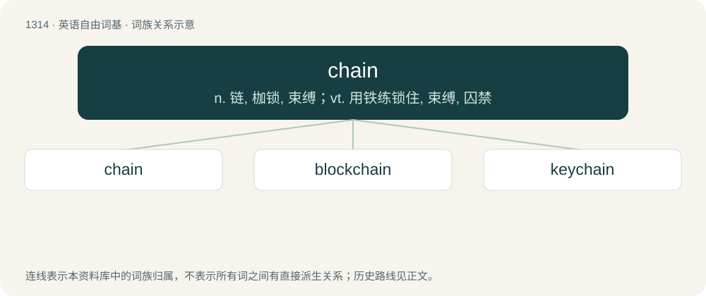

# 1401 · chain — n. 链, 枷锁, 束缚；vt. 用铁练锁住, 束缚, 囚禁

[总目录](../00_总目录_按常用程度.md)

**类型**：英语自由词基　｜　**来源语言**：见词源记录

## 核心含义与来源

- 核心含义：n. 链, 枷锁, 束缚；vt. 用铁练锁住, 束缚, 囚禁
- 英文含义：A series of interconnected rings or links usually made of metal.
- 词形：chain

**来源记录 1**（名词；A series of interconnected rings or links usually made of metal.）

From Middle English cheyne, chaine, from Old French chaeine, chaene (“chain”), from Latin catēna (“chain”), from Proto-Indo-European \*kat- (“to braid, twist; hut, shed”). Doublet of catena. Displaced native Middle English rakil and rakent (from Old English racente (“chain”)); see rackan.

## 词族图

## 单词速览（常用到不常用）

| 单词 | 音标 | 释义 |
|---|---|---|
| [chain](#w-1) | /ˈt͡ʃeɪn/ | n. 链, 枷锁, 束缚；vt. 用铁练锁住, 束缚, 囚禁 |
| [blockchain](#w-2) |  | 【英文】A shared record of past transactions in a distributed network, typically used for cryptocurrency. |
| [keychain](#w-3) | /ˈkiːˌt͡ʃeɪn/ | n. 钥匙链 |

## 逐词详解

### 1. chain

**词性**：名词　｜　**音标**：/ˈt͡ʃeɪn/

**中文释义**：n. 链, 枷锁, 束缚；vt. 用铁练锁住, 束缚, 囚禁

**英文义项**：A series of interconnected rings or links usually made of metal. / An accessory, adornment or insignia comprising, containing or depicting a series of links.

**词源与演化**：

From Middle English cheyne, chaine, from Old French chaeine, chaene (“chain”), from Latin catēna (“chain”), from Proto-Indo-European \*kat- (“to braid, twist; hut, shed”). Doublet of catena. Displaced native Middle English rakil and rakent (from Old English racente (“chain”)); see rackan.

**例句**：

> The anchor is connected to the boat with a 100-metre long chain.

该用例对应义项：A series of interconnected rings or links usually made of metal.

### 2. blockchain

**词性**：名词

**英文义项**：A shared record of past transactions in a distributed network, typically used for cryptocurrency.

**构词拆分**：block + chain

**词源与演化**：

From block + chain, from earlier “block chain”. In the 2008 Bitcoin paper block and chain are used separately; the concept is referred to as “chain of hash-based proof-of-work” or “chain of digital signatures”.

**例句**：

> Tom created an AI that uses blockchain technology to attract venture capital.

### 3. keychain

**词性**：名词　｜　**音标**：/ˈkiːˌt͡ʃeɪn/

**中文释义**：n. 钥匙链

**英文义项**：A chain or ring to which a key may be attached. / An ornamental piece holding such a chain or ring.

**构词拆分**：key + chain

**词源与演化**：

From key + chain.

**例句**：

> Tom keeps multiple 20-sided dice on his keychain.
