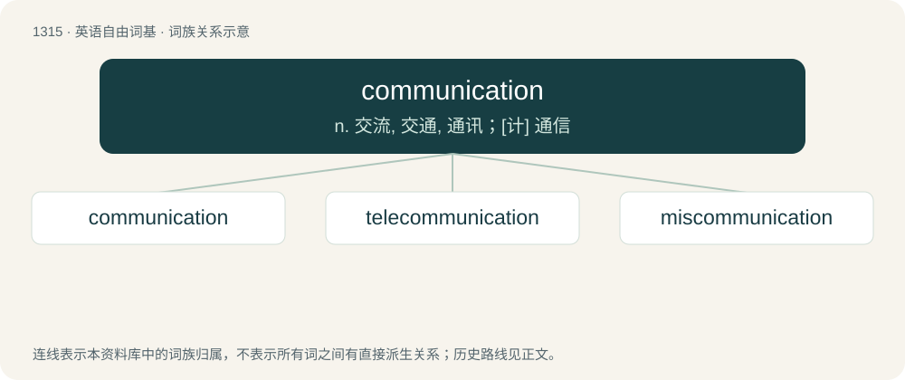

# 1402 · communication — n. 交流, 交通, 通讯；\[计\] 通信

[总目录](../00_总目录_按常用程度.md)

**类型**：英语自由词基　｜　**来源语言**：见词源记录

## 核心含义与来源

- 核心含义：n. 交流, 交通, 通讯；\[计\] 通信
- 英文含义：The act or fact of communicating anything; transmission.
- 词形：communication

**来源记录 1**（名词；The act or fact of communicating anything; transmission.）

Inherited from Middle English comunicacioun, communicacion (“discussion, association”), from Old French communicacion, from Latin commūnicātiōnem, accusative singular of commūnicātiō (“imparting, communicating”), from commūnicō (“to share, to impart”). Morphologically communicate + -ion.

## 词族图

## 单词速览（常用到不常用）

| 单词 | 音标 | 释义 |
|---|---|---|
| [communication](#w-1) | 英 /kəˌmjuː.nɪˈkeɪ.ʃən/；美 /kəˌmju.nɪˈkeɪ.ʃən/ | n. 交流, 交通, 通讯；\[计\] 通信 |
| [telecommunication](#w-2) | 英 /ˌtɛlɪkəˌmjuːnɪˈkeɪʃən/；美 /ˌtɛləkəˌmjunɪˈkeɪʃən/ | n. 电讯, 远距离通讯, 无线电通讯；\[计\] 远程通信, 电信 |
| [miscommunication](#w-3) | /,miskə,mjuːniˈkeiʃən/ | n. 错误传达 |

## 逐词详解

### 1. communication

**词性**：名词　｜　**音标**：英 /kəˌmjuː.nɪˈkeɪ.ʃən/；美 /kəˌmju.nɪˈkeɪ.ʃən/

**中文释义**：n. 交流, 交通, 通讯；\[计\] 通信

**英文义项**：The act or fact of communicating anything; transmission. / The concept or state of exchanging data or information between entities.

**构词拆分**：communicate + -ion

**词源与演化**：

Inherited from Middle English comunicacioun, communicacion (“discussion, association”), from Old French communicacion, from Latin commūnicātiōnem, accusative singular of commūnicātiō (“imparting, communicating”), from commūnicō (“to share, to impart”). Morphologically communicate + -ion.

**例句**：

> A round archway at the far end of the hallway provided communication to the main chamber.

该用例对应义项：A passageway or opening between two locations; connection.

### 2. telecommunication

**词性**：名词　｜　**音标**：英 /ˌtɛlɪkəˌmjuːnɪˈkeɪʃən/；美 /ˌtɛləkəˌmjunɪˈkeɪʃən/

**中文释义**：n. 电讯, 远距离通讯, 无线电通讯；\[计\] 远程通信, 电信

**英文义项**：The science and technology of the communication of messages over a distance using electric, electronic or electromagnetic impulses. / A message so transmitted.

**构词拆分**：tele- + communication

**词源与演化**：

From French télécommunication. Equivalent to tele- + communication.

### 3. miscommunication

**词性**：名词　｜　**音标**：/,miskə,mjuːniˈkeiʃən/

**中文释义**：n. 错误传达

**英文义项**：An interaction between two parties in which information is/was not communicated as desired.

**构词拆分**：mis- + communication

**词源与演化**：

From mis- + communication.
