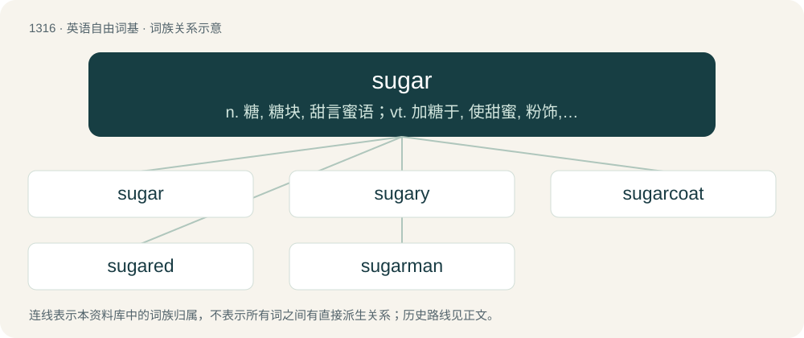

# 1403 · sugar — n. 糖, 糖块, 甜言蜜语；vt. 加糖于, 使甜蜜, 粉饰, 美化；vi. 制成糖

[总目录](../00_总目录_按常用程度.md)

**类型**：英语自由词基　｜　**来源语言**：见词源记录

## 核心含义与来源

- 核心含义：n. 糖, 糖块, 甜言蜜语；vt. 加糖于, 使甜蜜, 粉饰, 美化；vi. 制成糖
- 英文含义：A food consisting of small, sweet crystals, principally of sucrose, obtained from sugar cane or sugar beet and used as sweetener and preservative.
- 词形：sugar

**来源记录 1**（名词；A food consisting of small, sweet crystals, principally of sucrose, obtained from sugar cane or sugar beet and used as sweetener and preservative.）

Inherited from Middle English sugre, borrowed from Old French çucre, borrowed from Old Italian zucchero, borrowed from Arabic سُكَّر (sukkar), borrowed from Middle Persian 𐭱𐭪𐭥 (šakar), borrowed from Gandhari 𐨭𐨐𐨪 (śakara), from Sanskrit शर्क॑रा (śárkarā), from Proto-Indo-Aryan \*śárkaraH, from Proto-Indo-Iranian \*ćárkaraH, from Proto-Indo-European \*ḱorkeh₂ (“gravel”). Akin to Ancient Greek κρόκη (krókē, “pebble”), whence the words crocodile and krokodil are derived. Doublet of jaggery and sucro-. The verb is from Middle English sugren, from the noun.

## 词族图

## 单词速览（常用到不常用）

| 单词 | 音标 | 释义 |
|---|---|---|
| [sugar](#w-1) | 英 /ˈʃʊɡə/；美 /ˈʃʊɡɚ/ | n. 糖, 糖块, 甜言蜜语；vt. 加糖于, 使甜蜜, 粉饰, 美化；vi. 制成糖 |
| [sugary](#w-2) | 英 /ˈʃʊɡəɹi/ | a. 含糖的, 糖一般的, 甜的 |
| [sugarcoat](#w-3) | 英 /ˈʃʊɡəˌkəʊt/；美 /ˈʃʊɡɚˌkoʊt/ | n. 糖衣；vt. 裹以糖衣, 粉饰 |
| [sugared](#w-4) | /ˈʃuɡəd/ | a. 加了糖的；甜蜜的 |
| [sugarman](#w-5) |  | \[人名\] 休格曼 |

## 逐词详解

### 1. sugar

**词性**：名词　｜　**音标**：英 /ˈʃʊɡə/；美 /ˈʃʊɡɚ/

**中文释义**：n. 糖, 糖块, 甜言蜜语；vt. 加糖于, 使甜蜜, 粉饰, 美化；vi. 制成糖

**英文义项**：A food consisting of small, sweet crystals, principally of sucrose, obtained from sugar cane or sugar beet and used as sweetener and preservative. / Any specific variety of sugar.

**词源与演化**：

Inherited from Middle English sugre, borrowed from Old French çucre, borrowed from Old Italian zucchero, borrowed from Arabic سُكَّر (sukkar), borrowed from Middle Persian 𐭱𐭪𐭥 (šakar), borrowed from Gandhari 𐨭𐨐𐨪 (śakara), from Sanskrit शर्क॑रा (śárkarā), from Proto-Indo-Aryan \*śárkaraH, from Proto-Indo-Iranian \*ćárkaraH, from Proto-Indo-European \*ḱorkeh₂ (“gravel”). Akin to Ancient Greek κρόκη (krókē, “pebble”), whence the words crocodile and krokodil are derived. Doublet of jaggery and sucro-. The verb is from Middle English sugren, from the noun.

**例句**：

> Sugar of lead (lead acetate) is a poisonous white crystalline substance with a sweet taste.

该用例对应义项：Anything resembling sugar in taste or appearance, especially in chemistry.

### 2. sugary

**词性**：形容词　｜　**音标**：英 /ˈʃʊɡəɹi/

**中文释义**：a. 含糖的, 糖一般的, 甜的

**英文义项**：Of food, drink, etc., containing or covered with a large amount of sugar. / Exaggeratedly sweet and pleasant, often to the point of aversion.

**构词拆分**：sugar + -y

**词源与演化**：

From sugar + -y.

**例句**：

> He eats too much sugary food.

该用例对应义项：containing sugar

### 3. sugarcoat

**词性**：动词　｜　**音标**：英 /ˈʃʊɡəˌkəʊt/；美 /ˈʃʊɡɚˌkoʊt/

**中文释义**：n. 糖衣；vt. 裹以糖衣, 粉饰

**英文义项**：To coat with sugar. / To make superficially more attractive; to give a falsely pleasant appearance to.

**构词拆分**：sugar + coat

**词源与演化**：

From sugar + coat; figurative sense from the practice of coating medicinal tablets or pills with sugar in order to disguise their unpleasant taste (sugarcoating the pill).

**例句**：

> There's no way to sugarcoat the loss of the space shuttle; it was an unmitigated disaster.

该用例对应义项：To make superficially more attractive; to give a falsely pleasant appearance to.

### 4. sugared

**词性**：形容词　｜　**音标**：/ˈʃuɡəd/

**中文释义**：a. 加了糖的；甜蜜的

**英文义项**：Of food or drink: containing sugar. / Sweet, pleasant.

**构词拆分**：sugar + -ed

**词源与演化**：

From sugar + -ed.

**例句**：

> Since starting my diet, I’ve stopped eating sugared breakfast cereals.

该用例对应义项：Of food or drink: containing sugar.

### 5. sugarman

**词性**：名词

**中文释义**：\[人名\] 休格曼

**英文义项**：A worker in sugar production.

**构词拆分**：sugar + -man

**词源与演化**：

From sugar + -man.
