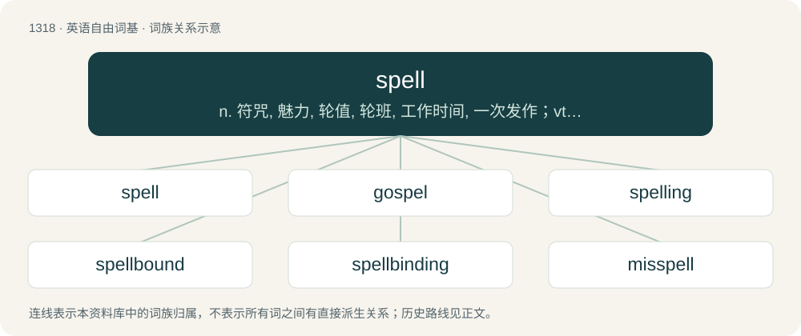

# 1404 · spell — n. 符咒, 魅力, 轮值, 轮班, 工作时间, 一次发作；vt. 拼写, 拼成, 琢磨, 理解, 招致, 轮换, 迷住；vi. 轮换, 拼字

[总目录](../00_总目录_按常用程度.md)

**类型**：英语自由词基　｜　**来源语言**：见词源记录

## 核心含义与来源

- 核心含义：n. 符咒, 魅力, 轮值, 轮班, 工作时间, 一次发作；vt. 拼写, 拼成, 琢磨, 理解, 招致, 轮换, 迷住；vi. 轮换, 拼字
- 英文含义：Words or a formula supposed to have magical powers.
- 词形：spell

**多个词源／构词路径**：同一拼写可能有不同来源；以下按词性和含义分别列出。

**来源记录 1**（名词；Words or a formula supposed to have magical powers.）

From Middle English spell, spel, from Old English spell (“news, story”), from Proto-Germanic \*spellą (“speech, account, tale”), from Proto-Indo-European \*(s)pel- (“to tell”) or from Proto-Indo-European \*bʰel- (“to speak, to sound”) with the s-mobile prefix. Cognate with dialectal German Spill, Icelandic spjall (“discussion, talk”), spjalla (“to discuss, to talk”), guðspjall (“gospel”) and Albanian fjalë (“word”).

**来源记录 2**（动词；To write or say the letters that form a word or part of a word.）

From Middle English spellen, from Anglo-Norman espeler, espeleir, Old French espeller, espeler (compare Modern French épeler), from Frankish \*spelōn, merged with native Old English spellian (“to tell, speak”), both eventually from Proto-Germanic \*spellōną (“to speak”). Related with etymology 1. The sense “indicate a future event” probably in part a backformation from forespell (literally “to tell in advance”).

**来源记录 3**（动词；To work in place of (someone).）

From Middle English spelen, from Old English spelian (“to represent, take or stand in the place of another, act as a representative of another”), akin to Middle English spale (“a rest or break”), Old English spala (“representative, substitute”).

**来源记录 4**（名词；A splinter, usually of wood; a spelk.）

From Middle English spel (“a thin piece of wood”), from Old Norse \[Term?\].

## 词族图

## 单词速览（常用到不常用）

| 单词 | 音标 | 释义 |
|---|---|---|
| [spell](#w-1) | /spɛl/ | n. 符咒, 魅力, 轮值, 轮班, 工作时间, 一次发作；vt. 拼写, 拼成, 琢磨, 理解, 招致, 轮换, 迷住；vi. 轮换, 拼字 |
| [gospel](#w-2) | 英 /ˈɡɒspəl/；美 /ˈɡɑspəl/ | n. 福音, 信仰, 真理 |
| [spelling](#w-3) | 英 /ˈspɛl.ɪŋ/ | n. 拼, 拼字, 拼法；\[计\] 拼写检查 |
| [spellbound](#w-4) | 美 /ˈspɛlˌbaʊnd/ | a. 被咒语所镇住的, 被迷住的 |
| [spellbinding](#w-5) | /ˈspɛlˌbaɪndɪŋ/ | v. 用符咒迷惑, 迷住, 使入迷( spellbind的现在分词 ) |
| [misspell](#w-6) | /mɪsˈspɛl/ | vt. 拼错 |
| [speller](#w-7) | /ˈspɛ.lə(ɹ)/ | n. 拼字者, 缀字课本 |

## 逐词详解

### 1. spell

**词性**：名词　｜　**音标**：/spɛl/

**中文释义**：n. 符咒, 魅力, 轮值, 轮班, 工作时间, 一次发作；vt. 拼写, 拼成, 琢磨, 理解, 招致, 轮换, 迷住；vi. 轮换, 拼字

**英文义项**：Words or a formula supposed to have magical powers. / A magical effect or influence induced by an incantation or formula.

**词源与演化**：

From Middle English spell, spel, from Old English spell (“news, story”), from Proto-Germanic \*spellą (“speech, account, tale”), from Proto-Indo-European \*(s)pel- (“to tell”) or from Proto-Indo-European \*bʰel- (“to speak, to sound”) with the s-mobile prefix. Cognate with dialectal German Spill, Icelandic spjall (“discussion, talk”), spjalla (“to discuss, to talk”), guðspjall (“gospel”) and Albanian fjalë (“word”).

**例句**：

> He cast a spell to cure warts.

该用例对应义项：Words or a formula supposed to have magical powers.

### 2. gospel

**词性**：名词　｜　**音标**：英 /ˈɡɒspəl/；美 /ˈɡɑspəl/

**中文释义**：n. 福音, 信仰, 真理

**英文义项**：The first section of the Christian New Testament scripture, comprising the books of Matthew, Mark, Luke and John, concerned with the birth, ministry, passion, and resurrection of Jesus. / An account of those aspects of Jesus' life, generally written during the first several centuries of the Common Era.

**构词拆分**：God + spell (“talk, tale, story”)

**词源与演化**：

From Middle English gospel, gospell, godspel, godspell, goddspell, from Old English godspell (“gospel”), corresponding to God + spell (“talk, tale, story”), literally “the message of God”, believed to be an alteration of earlier \*gōdspell (literally “good news”), used to translate ecclesiastical Latin bona annūntiātiō, itself a translation of Ecclesiastical Latin ēvangelium / Ancient Greek εὐαγγέλιον (euangélion, “evangel”, literally “good news”) (English evangel). Compare Old Saxon gōdspel and godspell (“gospel”), Old High German and Middle High German gotspel (“gospel”), Icelandic guðspjall (“gospel”), and the modern calque Malayalam സുവിശേഷം (suviśēṣaṁ).

**例句**：

> The Gospel of John was probably written about fifty years after its predecessor.

### 3. spelling

**词性**：名词　｜　**音标**：英 /ˈspɛl.ɪŋ/

**中文释义**：n. 拼, 拼字, 拼法；\[计\] 拼写检查

**英文义项**：The act, practice, ability, or subject of forming words with letters, or of reading the letters of words; orthography. / The manner of spelling of words; correct spelling.

**构词拆分**：spell (verb) + -ing

**词源与演化**：

1400s, from spell (verb) + -ing.

**例句**：

> Many words are pronounced according to the spelling, but some are not.

### 4. spellbound

**词性**：形容词　｜　**音标**：美 /ˈspɛlˌbaʊnd/

**中文释义**：a. 被咒语所镇住的, 被迷住的

**英文义项**：Under the influence of a magical spell; enchanted, bewitched, or supernaturally constrained. / Fascinated by something; entranced as if by a spell; captivated.

**构词拆分**：spell + bound

**词源与演化**：

From spell + bound.

**例句**：

> The story left the children spellbound.

该用例对应义项：Fascinated by something; entranced as if by a spell; captivated.

### 5. spellbinding

**词性**：形容词　｜　**音标**：/ˈspɛlˌbaɪndɪŋ/

**中文释义**：v. 用符咒迷惑, 迷住, 使入迷( spellbind的现在分词 )

**英文义项**：Engrossing; fascinating; gaining rapt attention; captivating. / Having the power to bind magically through the agency of a spell.

**构词拆分**：spell + binding

**词源与演化**：

From spell + binding.

**例句**：

> A spellbinding description of life in ancient Rome.

该用例对应义项：attracting and holding interest as if by a spell

### 6. misspell

**词性**：动词　｜　**音标**：/mɪsˈspɛl/

**中文释义**：vt. 拼错

**英文义项**：To spell incorrectly.

**构词拆分**：mis- + spell

**词源与演化**：

From mis- + spell.

**例句**：

> I think they misspelled "crab" on the menu, because it says "crap soup".

该用例对应义项：To spell incorrectly.

### 7. speller

**词性**：名词　｜　**音标**：/ˈspɛ.lə(ɹ)/

**中文释义**：n. 拼字者, 缀字课本

**英文义项**：A person who spells. / A participant in a spelling bee.

**构词拆分**：From spell + -er.

**词源与演化**：

From spell + -er.

**例句**：

> I'm a slow reader but a good speller.

该用例对应义项：A person who spells.
