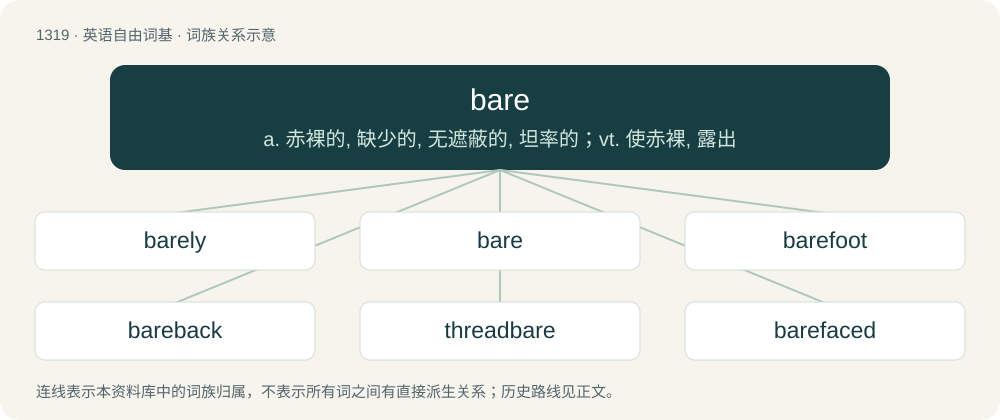

# 1405 · bare — a. 赤裸的, 缺少的, 无遮蔽的, 坦率的；vt. 使赤裸, 露出

[总目录](../00_总目录_按常用程度.md)

**类型**：英语自由词基　｜　**来源语言**：见词源记录

## 核心含义与来源

- 核心含义：a. 赤裸的, 缺少的, 无遮蔽的, 坦率的；vt. 使赤裸, 露出
- 英文含义：Minimal; that is or are just sufficient.
- 词形：bare

**多个词源／构词路径**：同一拼写可能有不同来源；以下按词性和含义分别列出。

**来源记录 1**（形容词；Minimal; that is or are just sufficient.）

From Middle English bare, bar, from Old English bær (“bare, naked, open”), from Proto-West Germanic \*baʀ, from Proto-Germanic \*bazaz (“bare, naked”), from Proto-Indo-European \*bʰosós, from \*bʰos- (“bare, barefoot”). Cognate with Scots bare, bair (“bare”), Saterland Frisian bar (“bare”), West Frisian baar (“bare”), Dutch bar (“bare”), German bar (“bare”), Swedish bar (“bare”), Icelandic ber (“bare”), Lithuanian basas (“barefoot, bare”), Polish bosy (“barefoot”).

**来源记录 2**（动词；To uncover; to reveal.）

From Middle English baren, from Old English barian, from Proto-Germanic \*bazōną (“to bare, make bare”).

## 词族图

## 单词速览（常用到不常用）

| 单词 | 音标 | 释义 |
|---|---|---|
| [barely](#w-1) | 英 /ˈbɛə.li/；美 /ˈbɛɹ.li/ | adv. 几乎不 |
| [bare](#w-2) | 英 /bɛə/；美 /bɛɹ/ | a. 赤裸的, 缺少的, 无遮蔽的, 坦率的；vt. 使赤裸, 露出 |
| [barefoot](#w-3) | 英 /ˈbɛəfʊt/；美 /ˈbɛɹfʊt/ | a. 赤脚的 |
| [bareback](#w-4) | 英 /ˈbɛəbæk/；美 /ˈbɛɚbæk/ | a. 不用鞍的；adv. 不用马鞍地 |
| [threadbare](#w-5) | 英 /ˈθɹɛdbɛə/；美 /ˈθɹɛdˌbɛ(ə)ɹ/ | a. 衣服磨薄了的, 穿旧了的, 衣着褴褛的, 俗套的, 乏味的 |
| [barefaced](#w-6) | 英 /ˈbeə(ɹ)feɪst/ | a. 公然的, 无耻的, 无面具的 |
| [barefooted](#w-7) | 英 /ˈbɛː(ə).fʊt.ɪd/；美 /ˈbɛɚ.fʊt.ɪd/ | a. 光着脚的；adv. 光着脚地 |

## 逐词详解

### 1. barely

**词性**：副词　｜　**音标**：英 /ˈbɛə.li/；美 /ˈbɛɹ.li/

**中文释义**：adv. 几乎不

**英文义项**：By a small margin. / Almost not at all.

**构词拆分**：bare + -ly

**词源与演化**：

From Middle English baarly, bareliche, barely, barly, from Old English bærlīċe, equivalent to bare + -ly. Compare Danish bare (“only, just”), Norwegian bare (“only, just”).

**例句**：

> I barely completed my homework. However, I got a score of 5 for it.

该用例对应义项：By a small margin.

### 2. bare

**词性**：形容词　｜　**音标**：英 /bɛə/；美 /bɛɹ/

**中文释义**：a. 赤裸的, 缺少的, 无遮蔽的, 坦率的；vt. 使赤裸, 露出

**英文义项**：Minimal; that is or are just sufficient. / Naked, uncovered.

**词源与演化**：

From Middle English bare, bar, from Old English bær (“bare, naked, open”), from Proto-West Germanic \*baʀ, from Proto-Germanic \*bazaz (“bare, naked”), from Proto-Indo-European \*bʰosós, from \*bʰos- (“bare, barefoot”). Cognate with Scots bare, bair (“bare”), Saterland Frisian bar (“bare”), West Frisian baar (“bare”), Dutch bar (“bare”), German bar (“bare”), Swedish bar (“bare”), Icelandic ber (“bare”), Lithuanian basas (“barefoot, bare”), Polish bosy (“barefoot”).

**例句**：

> The trees were left bare after the swarm of locusts devoured all the leaves.

该用例对应义项：Having had what usually covers (something) removed.

### 3. barefoot

**词性**：形容词　｜　**音标**：英 /ˈbɛəfʊt/；美 /ˈbɛɹfʊt/

**中文释义**：a. 赤脚的

**英文义项**：Wearing nothing on the feet. / Of a vehicle on an icy road: not using snow chains.

**构词拆分**：bare + foot

**词源与演化**：

From Middle English barefote, barfot, from Old English bærfōt (“barefoot”), from Proto-West Germanic \*baʀafōt, from Proto-Germanic \*bazafōts (“barefoot”) equivalent to bare + foot. Cognate with Scots barefit (“barefoot”), Old Frisian berfōt ("barefoot"; modern Saterland Frisian boarfouts (“barefoot”, adverb)), Dutch barrevoets (“barefoot”, adverb), German barfuß (“barefoot”), Danish barfodet (“barefoot”), Swedish barfota (“barefoot”, adverb), Icelandic berfættur (“barefoot”), Yiddish באָרוועס (borves, “barefoot”).

**例句**：

> After taking off their shoes, socks and sandals at the doorway, the kids were barefoot.

该用例对应义项：Wearing nothing on the feet.

### 4. bareback

**词性**：形容词　｜　**音标**：英 /ˈbɛəbæk/；美 /ˈbɛɚbæk/

**中文释义**：a. 不用鞍的；adv. 不用马鞍地

**英文义项**：Without a saddle. / Without a condom.

**构词拆分**：bare + back

**词源与演化**：

From bare + back.

**用法示例／搭配（非完整句）**：

> bareback riding

该用例对应义项：Without a saddle.

### 5. threadbare

**词性**：形容词　｜　**音标**：英 /ˈθɹɛdbɛə/；美 /ˈθɹɛdˌbɛ(ə)ɹ/

**中文释义**：a. 衣服磨薄了的, 穿旧了的, 衣着褴褛的, 俗套的, 乏味的

**英文义项**：Of cloth, clothing, furnishings, etc.: frayed and worn to an extent that the nap is damaged and the warp and weft threads show; shabby, worn-out. / In poor condition; damaged, shabby; also, poorly equipped or provided for, inadequate, meagre, scanty.

**构词拆分**：thread + bare

**词源与演化**：

From Middle English thred-bar, thred-bare (“of cloth, clothing, etc.: worn to such an extent that the warp and weft threads show, shabby, worn-out; (figurative) inadequate, poor”) \[and other forms\], from thred (“piece of textile twine”) (from Old English þrǣd (“thread”), from Proto-Germanic \*þrēduz (“thread; twisted fibre”), ultimately from Proto-Indo-European \*terh₁- (“to drill, pierce; to rub; to turn, twist”)) + bar, bare (“naked, unclothed, bare; not covered”) (from Old English bær (“naked, bare; unconcealed”), ultimately from Proto-Germanic \*bazaz (“naked, bare”), from Proto-Indo-European \*bʰosós (“bare; barefoot”)). The English word is analysable as thread + bare.

**例句**：

> The towels seem new enough, if slightly threadbare.

### 6. barefaced

**词性**：形容词　｜　**音标**：英 /ˈbeə(ɹ)feɪst/

**中文释义**：a. 公然的, 无耻的, 无面具的

**英文义项**：Undisguisedly offensive and bold; crude. / Open, undisguised.

**构词拆分**：bare + faced

**词源与演化**：

Perhaps an alteration of barefast (compare shamefast); or from bare + faced. Compare typologically cheeky; Italian sfacciato (&lt; Latin ex- + faciēs); French effronté, Italian sfrontato (&lt; Latin ex- + frōns), Polish czelny (&lt; czoło).

**例句**：

> How dare you tell such a barefaced lie?

### 7. barefooted

**词性**：形容词　｜　**音标**：英 /ˈbɛː(ə).fʊt.ɪd/；美 /ˈbɛɚ.fʊt.ɪd/

**中文释义**：a. 光着脚的；adv. 光着脚地

**英文义项**：Wearing nothing on the feet; barefoot.

**构词拆分**：bare + footed

**词源与演化**：

From bare + footed.

**例句**：

> He was barefooted, and his clothes were thin and raggy.
