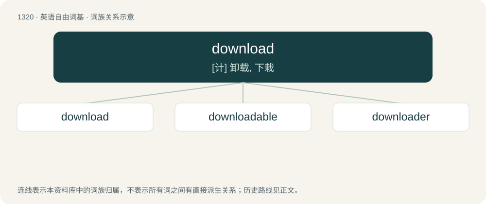

# 1406 · download — \[计\] 卸载, 下栽

[总目录](../00_总目录_按常用程度.md)

**类型**：英语自由词基　｜　**来源语言**：见词源记录

## 核心含义与来源

- 核心含义：\[计\] 卸载, 下栽
- 英文含义：A file transfer to a given computer or device from a remote one through a network connection.
- 词形：download

**来源记录 1**（名词；A file transfer to a given computer or device from a remote one through a network connection.）

From down- + load. Verbal form first appears c. 1962 in the Wichita Falls (Texas) Times. Nominal form first appears c. 1977 in Scientific American.

## 词族图

## 单词速览（常用到不常用）

| 单词 | 音标 | 释义 |
|---|---|---|
| [download](#w-1) | 美 /ˈdaʊnˌloʊd/；/ˈdaʊnˌləʊd/ | \[计\] 卸载, 下栽 |
| [downloadable](#w-2) | 英 /ˌdaʊnˈləʊd.ə.bl̩/；美 /ˌdaʊnˈloʊd.ə.bl̩/ | a. 可下载的 |
| [downloader](#w-3) |  | n. 下载器（病毒类型） |

## 逐词详解

### 1. download

**词性**：名词　｜　**音标**：美 /ˈdaʊnˌloʊd/；/ˈdaʊnˌləʊd/

**中文释义**：\[计\] 卸载, 下栽

**英文义项**：A file transfer to a given computer or device from a remote one through a network connection. / A file that has been or is intended to be transferred in this way.

**构词拆分**：down- + load

**词源与演化**：

From down- + load. Verbal form first appears c. 1962 in the Wichita Falls (Texas) Times. Nominal form first appears c. 1977 in Scientific American.

**例句**：

> I got the download but it wouldn't work on my computer.

该用例对应义项：A file that has been or is intended to be transferred in this way.

### 2. downloadable

**词性**：形容词　｜　**音标**：英 /ˌdaʊnˈləʊd.ə.bl̩/；美 /ˌdaʊnˈloʊd.ə.bl̩/

**中文释义**：a. 可下载的

**英文义项**：Capable of being downloaded.

**构词拆分**：download + -able

**词源与演化**：

From download + -able.

**例句**：

> Older games did not have downloadable content. They only had patches and expansion packs.

### 3. downloader

**词性**：名词

**中文释义**：n. 下载器（病毒类型）

**英文义项**：Someone who downloads files from the Internet. / A computer program that assists with the downloading of files.

**构词拆分**：download + -er

**词源与演化**：

From download + -er.

**例句**：

> The comic downloader that I wrote will be released this Sunday.
