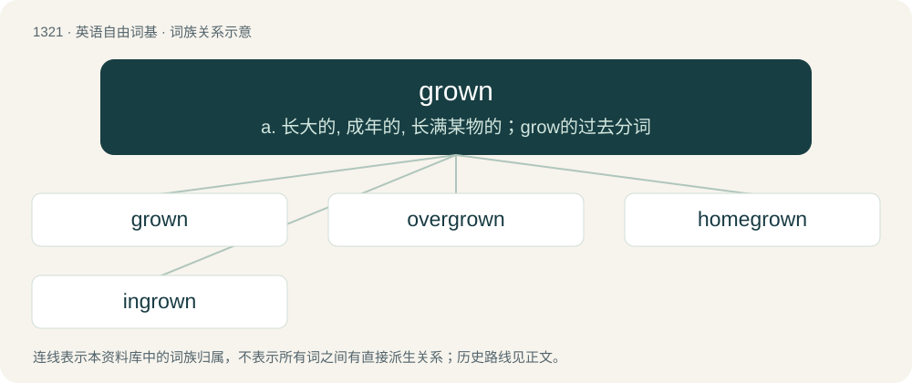

# 1407 · grown — a. 长大的, 成年的, 长满某物的；grow的过去分词

[总目录](../00_总目录_按常用程度.md)

**类型**：英语自由词基　｜　**来源语言**：见词源记录

## 核心含义与来源

- 核心含义：a. 长大的, 成年的, 长满某物的；grow的过去分词
- 英文含义：Covered by growth; overgrown.
- 词形：grown

**来源记录 1**（形容词；Covered by growth; overgrown.）

From Middle English growen. Morphologically grow + -n.

## 词族图

## 单词速览（常用到不常用）

| 单词 | 音标 | 释义 |
|---|---|---|
| [grown](#w-1) | 英 /ɡɹəʊn/；美 /ɡɹoʊn/ | a. 长大的, 成年的, 长满某物的；grow的过去分词 |
| [overgrown](#w-2) | /.əuvəˈgrəun/ | a. 发育过度的, 生长过大的, 不合身的, 植被蔓生的；overgrow的过去分词 |
| [homegrown](#w-3) | /həumˈgrəun/ | a. 自家种植的, 国产的 |
| [ingrown](#w-4) | 英 /ɪnˈɡɹəʊn/；美 /ɪnˈɡɹoʊn/ | a. 向内生长的, 生进肉内的, 天赋的 |

## 逐词详解

### 1. grown

**词性**：形容词　｜　**音标**：英 /ɡɹəʊn/；美 /ɡɹoʊn/

**中文释义**：a. 长大的, 成年的, 长满某物的；grow的过去分词

**英文义项**：Covered by growth; overgrown. / Of a person: adult.

**构词拆分**：grow + -n

**词源与演化**：

From Middle English growen. Morphologically grow + -n.

**例句**：

> Listen, I'm a grown woman, and I don't have time to deal with your petty teenage drama.

该用例对应义项：Of a person: adult.

### 2. overgrown

**词性**：形容词　｜　**音标**：/.əuvəˈgrəun/

**中文释义**：a. 发育过度的, 生长过大的, 不合身的, 植被蔓生的；overgrow的过去分词

**英文义项**：Having large numbers of plants which have become too big, and are hence spoiling the picturesqueness of a garden. / Having grown bigger without developing maturity or changing character.

**构词拆分**：over- + grown

**词源与演化**：

From over- + grown.

**例句**：

> He spends so much money on new technology: he's like an overgrown schoolboy buying toys.

该用例对应义项：Having grown bigger without developing maturity or changing character.

### 3. homegrown

**词性**：形容词　｜　**音标**：/həumˈgrəun/

**中文释义**：a. 自家种植的, 国产的

**英文义项**：Raised or cultivated at home, on one's own land, or in one's own country; domestic; indigenous. / Produced or coming from one's own country or a particular place; local; native; self-produced.

**构词拆分**：home + grown

**词源与演化**：

From home + grown.

**例句**：

> Each spring they planted a garden and each summer they enjoyed homegrown vegetables.

该用例对应义项：Raised or cultivated at home, on one's own land, or in one's own country; domestic; indigenous.

### 4. ingrown

**词性**：形容词　｜　**音标**：英 /ɪnˈɡɹəʊn/；美 /ɪnˈɡɹoʊn/

**中文释义**：a. 向内生长的, 生进肉内的, 天赋的

**英文义项**：That has grown inwards or abnormally towards (a part of the body)

**构词拆分**：in- + grown

**词源与演化**：

From in- + grown.

**用法示例／搭配（非完整句）**：

> an ingrown toenail

该用例对应义项：That has grown inwards or abnormally towards (a part of the body)
