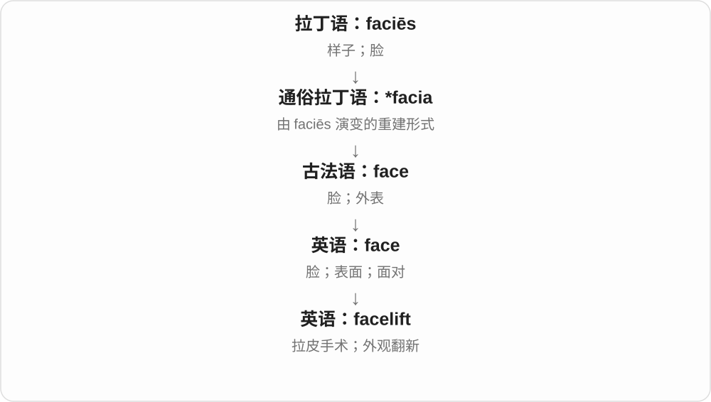

# 1407 · lift — 把东西抬起来；也把限制拿开、情绪托起

[逐词精讲目录](../00_逐词精讲目录.md) · [总目录](../00_总目录_按常用程度.md)

## 核心词根与来源

lift spirits 是精神上升，lift a ban 是限制被拿走，give a lift 是搭车；不能只用举起来一个中文覆盖所有场景。

**LIFT：向上抬，或从原处拿走**

lift → lifted、lifter；uplift 抬升振奋；airlift、forklift、chairlift、deadlift、facelift、shoplift 按运输、工具、动作等分。

- **基础、结果与执行者**：lift · lifted · lifter
- **向上提升与运输装置**：uplift · airlift · forklift · chairlift
- **锻炼、外观与偷拿**：deadlift · facelift · shoplift
- **lift → lifting：把东西往上提**：lift · lifting
- **向上移动 → lift → lifts**：lifts

## 词形与演化规律

lypta 经 liften → lift；lift + -ed/-er；up-/air-/fork-/chair-/dead-/face-/shop- + lift。

动词接北欧 lypta 的举升材料，ing 展示过程；限制被抬走也是常用比喻。

lift 接古北欧 lypta 提起，远连空气、上方的日耳曼词族。现代复数、动词第三人称同形，常用电梯、搭便车、提起、振奋等义。

## 单词速览（按词族由简到繁）

同一基础词的相关扩展放在一起，先读基础形式，再读扩展；各组之间优先读常用的。具体词源关系见各词讲解。

| 单词 | 音标 | 核心意思 |
|---|---|---|
| [lift](#w-1) | /lɪft/ | 抬起、升起；提高、振奋；解除；电梯〔英〕、搭车；偷拿〔口语〕 |
| [lifted](#w-2) | /ˈlɪftɪd/ | 被抬起的、升高的；被解除的；偷用、抄来的〔语境义〕 |
| [lifting](#w-11) | /ˈlɪftɪŋ/ | 举起、提升；解除〔现在分词、动名词〕 |
| [lifts](#w-12) | 英、美 /lɪfts/ | 电梯；搭便车、载送〔复数〕；抬起、提升、解除〔第三人称单数〕 |
| [lifter](#w-7) | 英 /ˈlɪftə/；美 /ˈlɪftər/ | 举起者；举重者；起重、举升器件 |
| [uplift](#w-3) | 名词 /ˈʌplɪft/；动词 /ˌʌpˈlɪft/ | 提升、振奋；上升、隆起；使振奋、抬升 |
| [facelift](#w-4) | /ˈfeɪsˌlɪft/ | 拉皮手术；外观翻新 |
| [airlift](#w-5) | 英 /ˈeəlɪft/；美 /ˈerlɪft/ | 空运；用飞机或直升机运送 |
| [forklift](#w-6) | 英 /ˈfɔːklɪft/；美 /ˈfɔːrklɪft/ | 叉车 |
| [deadlift](#w-8) | /ˈdedlɪft/ | 硬拉 |
| [chairlift](#w-9) | 英 /ˈtʃeəlɪft/；美 /ˈtʃerlɪft/ | 吊椅式缆车 |
| [shoplift](#w-10) | 英 /ˈʃɒplɪft/；美 /ˈʃɑːplɪft/ | 在商店行窃、偷拿商品 |

## 逐词讲解

### 1. lift — 抬起、升起；提高、振奋；解除；电梯〔英〕、搭车；偷拿〔口语〕

**音标**：/lɪft/

**先抓住这个画面**

先把东西往上抬，再把精神、限制等放进画面：lift spirits 振奋精神，lift a ban 把禁令拿开；give a lift 又是让人搭车。

**怎么拆**

常用动词接古诺斯语 lypta 经中古英语 liften。现代电梯、搭车等名词与举升、带送动作有关；另有古英语空气旧名词同形，不能直接当今天电梯的原义。

**怎么变成今天的意思**

**古诺斯语 lypta → 中古英语 liften → lift**  
往空中抬起、举起

↓

**动词与现代名词扩展**  
电梯、搭便车；情绪抬起；偷拿的口语义

↓

**up-、工具与专用组合**  
uplift 提升；lifter 举起者、器件；forklift 等按作用限定

lift a box 抬箱子，lift a ban 解除禁令，lift spirits 振奋精神，take the lift 乘电梯，give someone a lift 让某人搭车。

**常见搭配与例句**

lift a box；lift a ban；lift spirits；take the lift；give someone a lift。

> Could you help me lift this box?

能帮我抬一下这个箱子吗？

> She gave me a lift to the station.

她让我搭车去了车站。

> The news lifted everyone’s spirits.

消息让大家精神一振。

**别混淆**

lift 英式电梯常对应美式 elevator；lift a ban 解除不等于加严，lift a wallet 在特定口语里可能偷钱包。

### 2. lifted — 被抬起的、升高的；被解除的；偷用、抄来的〔语境义〕

**音标**：/ˈlɪftɪd/

**先抓住这个画面**

东西升起来、禁令拿掉，都可用 lifted；一句话从别处直接拿来，也可说 lifted from，需看有没有未经许可或抄袭意味。

**怎么拆**

lift + -ed，过去分词及形容词。lift 末尾 /t/，所以 -ed 另读 /ɪd/，不要压成一个 /t/。

**怎么变成今天的意思**

**古诺斯语 lypta → 中古英语 liften → lift**  
往空中抬起、举起

↓

**动词与现代名词扩展**  
电梯、搭便车；情绪抬起；偷拿的口语义

↓

**lift + -ed → lifted**  
抬起、解除等动作已发生；相应结果状态

a lifted ban 已解除的禁令，lifted restrictions 已取消的限制，lifted from a book 从书里拿来的。

**常见搭配与例句**

restrictions were lifted；lifted from；a lifted hand。

> The restrictions were lifted on Monday.

限制在周一取消了。

> The sentence was lifted from an earlier article.

那句话直接取自一篇较早的文章。

**别混淆**

lifted 是完成动作或结果，不是 lifted 越多便等级越高；lifted from 在文字语境常有直接拿用的含义。

### 3. lifting — 举起、提升；解除〔现在分词、动名词〕

**音标**：/ˈlɪftɪŋ/

**先抓住这个画面**

把原来压在下面、放在低处的东西提起来，是 lifting。限制被拿开，也像把压住人的盖子抬走。

**怎么拆**

lift + -ing，直接相加。常见举升动词接古诺尔斯语 lypta，经中古英语 liften 延续；现代解除、提升情绪等由举升画面扩展。

**怎么变成今天的意思**

**古诺尔斯语 lypta → 中古英语 liften → lift**  
往上抬、举起

↓

**lift + -ing → lifting**  
正在提起；举升过程及解除等用法

lifting a box 提起箱子；heavy lifting 繁重的搬运，也比喻艰苦的主要工作。

**常见搭配与例句**

lifting restrictions 解除限制；lifting spirits 使人振作。

> She is lifting the suitcase onto the shelf.

她正把行李箱举到架子上。

> The team did most of the heavy lifting.

团队承担了大部分艰苦工作。

**别混淆**

lifting 的现在分词不表示已经完成；lifted 才是过去形式。heavy lifting 有时说实际搬运，有时说最费力的工作，要看上下文。

### 4. lifts — 电梯；搭便车、载送〔复数〕；抬起、提升、解除〔第三人称单数〕

**音标**：英、美 /lɪfts/

**先抓住这个画面**

把东西往上带，是 lift 的核心方向。电梯把人升上楼，鼓励让心情提起来；某些限制被拿走，也能说 lifted、lifts。

**怎么拆**

lift + -s → lifts，末尾 /fts/。lift 接古北欧 lypta 提起，远连日耳曼空气、上方的词族；后来动词也发展出名词。

**怎么变成今天的意思**

**古北欧 lypta 提起 → 英语 lift**  
由向上运动扩展到提高心情、地位等

↓

**lift 转名词，发展出电梯、顺路载送等义 → lifts**  
现代名词复数与动词第三人称同形

lifts 在英式里常说电梯，美式常用 elevators；give people lifts 是让人搭便车；lifts the lid 是揭开盖子。

**常见搭配与例句**

the lifts in the building；gives people lifts；lifts the lid。

> Both lifts in the building were out of service.

楼里的两部电梯都停用了。

> She lifts the lid to see what is inside.

她揭开盖子看看里面有什么。

**别混淆**

a lift 不只是一段向上运动，搭便车的意思是顺路载一程。动词 lift a restriction 则是解除限制，方向感变成把压着的东西拿掉。

### 5. lifter — 举起者；举重者；起重、举升器件

**音标**：英 /ˈlɪftə/；美 /ˈlɪftər/

**先抓住这个画面**

执行举起动作的人或零件；健身房是举重的人，机器里可能是把部件顶起来的装置。

**怎么拆**

lift + -er，人物或工具后缀。-er 说明执行者，究竟是人还是机器要看前后文。

**怎么变成今天的意思**

**古诺斯语 lypta → 中古英语 liften → lift**  
往空中抬起、举起

↓

**lift + -er → lifter**  
举起的人；负责举升的器件

a weight lifter 举重者，an experienced lifter 有经验的举重者，a mechanical lifter 机械举升装置。

**常见搭配与例句**

an experienced lifter；a weight lifter；a mechanical lifter。

> The experienced lifter showed us the movement.

有经验的举重者向我们示范了动作。

> A mechanical lifter raised the heavy panel.

机械举升装置抬起了沉重的板材。

**别混淆**

lifter 可人可器件；lift 电梯通常不直接改叫 lifter，器物名要按实际搭配，不由 -er 随便替换。

### 6. uplift — 提升、振奋；上升、隆起；使振奋、抬升

**音标**：名词 /ˈʌplɪft/；动词 /ˌʌpˈlɪft/

**先抓住这个画面**

把高度、心情或整体处境往上带；a sense of uplift 是心情被托起来，地理里的 uplift 则可说地面隆起。

**怎么拆**

up- 向上 + lift，名词、动词都围绕抬升；常见名词前重音，动词后重音，也有词典记录读法变化。

**怎么变成今天的意思**

**古诺斯语 lypta → 中古英语 liften → lift**  
往空中抬起、举起

↓

**up- + lift → uplift**  
向上举起 → 身体、地面、情绪等的提升

a sense of uplift 振奋感，uplift the audience 使观众振奋，geological uplift 地质隆起。

**常见搭配与例句**

a sense of uplift；uplift the audience；geological uplift。

> The concert gave the audience a sense of uplift.

音乐会让观众感到振奋。

> The exhibit explained the uplift of the mountains.

展览解释了山体的抬升。

**别混淆**

uplift 提升、振奋，airlift 空运是交通方式，deadlift 硬拉是动作名，都是 lift 但前项给不同范围。

### 7. facelift — 拉皮手术；外观翻新

**音标**：/ˈfeɪsˌlɪft/

**先抓住这个画面**

把建筑外墙重新粉刷，招牌换新，整个地方看起来精神了，这种外观改造可叫 facelift。

**怎么拆**

face + lift，字面“把脸提起来”；先与面部整形相关，再作比喻。

**怎么变成今天的意思**

脸部皮肤提拉的名称扩展为让旧物外观更新。比喻义常暗示外表改善，内部结构未必大改。

**常见搭配与例句**

give something a facelift；a major facelift；have a facelift。

> The station received a much-needed facelift.

车站进行了急需的外观翻新。

> The article explains what a facelift involves.

文章介绍了拉皮手术涉及哪些内容。

**别混淆**

renovation 可深入修缮；facelift 更突出看得见的外观变化。

### 8. airlift — 空运；用飞机或直升机运送

**音标**：英 /ˈeəlɪft/；美 /ˈerlɪft/

**先抓住这个画面**

地面道路走不通，就把人或物资从空中抬过去。

**怎么拆**

air + lift 提起、运送；可作名词，也可作动词。

**怎么变成今天的意思**

**希腊 aer，属格 aeros**  
空气

↓

**拉丁 aer → 法语 air → 英语 air**  
空气

↓

**air + lift → airlift**  
通过空中提运 → 空运行动

an emergency airlift 是紧急空运；airlift supplies 是用飞机运送物资；airlift somebody to hospital 是用航空器把人转送到医院，常见于救援报道。

**常见搭配与例句**

airlift supplies；an emergency airlift；airlift people out of an area。

> Helicopters airlifted food to the isolated villages.

直升机把食物空运到了与外界隔绝的村庄。

> The airlift continued after the roads were cut off.

道路中断后，空运仍在继续。

**别混淆**

airlift 强调运输行动，尤其紧急或地面受阻时；ordinary flight 只说普通飞行或航班。

### 9. forklift — 叉车

**音标**：英 /ˈfɔːklɪft/；美 /ˈfɔːrklɪft/

**先抓住这个画面**

车头伸出两根长叉齿，插到货物下面把它抬起来。

**怎么拆**

英语 fork 叉 + lift 举起，按车辆的工作部件和动作组成名称。

**怎么变成今天的意思**

**英语 fork 叉形部件 + lift 举起**  
用叉形部件托举

↓

**forklift**  
叉车，常用于搬运托盘货物

仓库里那种把托盘抬起再搬走的小型工业车辆，就是 forklift。名称比中文更直接写出“叉”和“抬”两个动作线索。它不是普通升降机，也不是把任何东西举起来都叫 forklift。

**常见搭配与例句**

a forklift truck；a forklift operator；move a pallet with a forklift。

> A forklift moved the pallet into the warehouse.

一辆叉车把托盘运进仓库。

> The forklift operator placed the crates beside the loading bay.

叉车司机把货箱放在装卸区旁。

**别混淆**

crane 吊车多从上方吊起；forklift 通常从货物下方托起。两者都能搬重物，但结构与动作不同。

### 10. deadlift — 硬拉

**音标**：/ˈdedlɪft/

**先抓住这个画面**

健身中，把原本静止在地面的重量拉起来；名称抓住从静止状态起重这个特点。

**怎么拆**

dead 静止、不活动 + lift 举起，组合成为运动名词，也可作动词。这里不是抬死人，dead 对应静止的负重。

**怎么变成今天的意思**

**古英语 dēad → 中古英语 ded**  
死的；不活跃的

↓

**现代英语 dead**  
死亡状态 → 不运作、完全没有反应；也可加强语气

↓

**dead + lift → deadlift**  
从静止状态提起重量 → 硬拉

a deadlift 是一次硬拉动作，也可泛指该项目；a deadlift competition 是硬拉比赛。

**常见搭配与例句**

do a deadlift；a deadlift record；a deadlift competition。

> The competition ended with the deadlift event.

比赛以硬拉项目结束。

> She set a personal record in the deadlift.

她在硬拉项目中创造了个人纪录。

**别混淆**

lift 是广义举起，deadlift 是具体力量训练项目；weightlifting 在不同语境可泛称举重，也可指竞技举重项目。

### 11. chairlift — 吊椅式缆车

**音标**：英 /ˈtʃeəlɪft/；美 /ˈtʃerlɪft/

**先抓住这个画面**

不是把人装进整间车厢，而是让人坐在被机械带动的座椅上。

**怎么拆**

chair + lift“升降、运送装置”；用座椅与提升功能命名。

**怎么变成今天的意思**

**希腊 hédra**  
座位、底座；几何立体的面

↓

**希腊 katá + hédra → kathédra → 拉丁 cathedra**  
向下 + 座位 → 椅子、席位

↓

**古法语 chaiere → 中古英语 chayere → 英语 chair**  
椅子 → 权威席位 → 主持人、主席等职务

↓

**英语 chair + lift → chairlift**  
座椅式运送、升降装置

滑雪场的 chairlift 是吊在缆索上的座椅，沿线路把人送上坡。它可以有防护罩，但不像封闭缆车那样让人走进一个车厢。

**常见搭配与例句**

take a chairlift；a ski chairlift；the chairlift station；a chairlift ride。

> We took the chairlift to the top of the slope.

我们乘吊椅缆车到了雪坡顶部。

> The chairlift stopped briefly while the staff helped a passenger.

工作人员帮助一名乘客时，吊椅缆车短暂停了一下。

**别混淆**

cable car 常让人想到封闭或较大的缆车厢；chairlift 强调悬挂的座椅形式。

### 12. shoplift — 在商店行窃、偷拿商品

**音标**：英 /ˈʃɒplɪft/；美 /ˈʃɑːplɪft/

**先抓住这个画面**

假装正常购物，却把商品偷走；lift 在这里取偷的旧俚义。

**怎么拆**

可认出 shop + lift 偷，但现代动词由较早 shoplifting、shoplifter 等词逆构。不能按现代短词更简单，就断言动词一定先出生。

**怎么变成今天的意思**

**中古英语 shoppe；与古英语 sċoppa 等棚舍词相关**  
棚、摊位、做工或交易的地方；旧词细义有不确定处

↓

**现代 shop**  
商店、工场；由店铺名词发展购物动词

↓

**较早 shoplifter、shoplifting 等 → shoplift〔动词〕**  
商店行窃者、行为 → 对应动词

be caught shoplifting 行窃时被发现，shoplift goods 偷拿商品；不要按抬高店铺逐字理解。

**常见搭配与例句**

be caught shoplifting；shoplift goods；attempt to shoplift。

> The character is caught trying to shoplift a watch.

故事中的人物试图偷拿手表时被发现。

> The film shows why the teenager began to shoplift.

影片展现了这个少年为什么开始在商店行窃。

**别混淆**

shoplift 在店内偷商品，rob 更常以被抢的人、地方作对象；不是把任何偷东西都机械叫 shoplift。

## 这一组要分清什么

lift/elevator 英美电梯名称；lift a ban 解除；lifter 非所有电梯的替换名称；专用组合看前项作用。

## 串起来练习

The airlift brought supplies and lifted people’s spirits.

空运带来了物资，也让人们精神一振。
