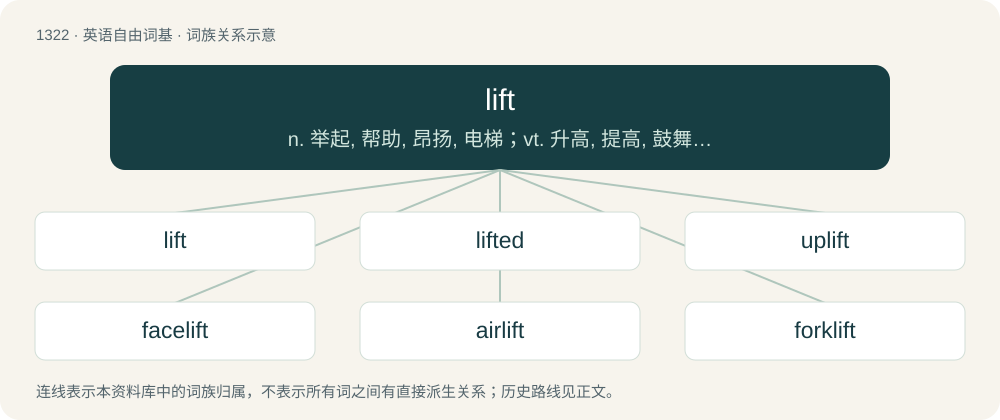

# 1408 · lift — n. 举起, 帮助, 昂扬, 电梯；vt. 升高, 提高, 鼓舞, 清偿, 空运, 举起, 剽窃；vi. 升起, 消散, 耸立

[总目录](../00_总目录_按常用程度.md)

**类型**：英语自由词基　｜　**来源语言**：见词源记录

## 核心含义与来源

- 核心含义：n. 举起, 帮助, 昂扬, 电梯；vt. 升高, 提高, 鼓舞, 清偿, 空运, 举起, 剽窃；vi. 升起, 消散, 耸立
- 英文含义：To raise or rise.
- 词形：lift

**多个词源／构词路径**：同一拼写可能有不同来源；以下按词性和含义分别列出。

**来源记录 1**（动词；To raise or rise.）

From Middle English liften, lyften, from Old Norse lypta (“to lift, air”, literally “to raise in the air”), from Proto-Germanic \*luftijaną (“to raise in the air”), related to \*luftuz (“roof, air”), perhaps from Proto-Indo-European \*lewp- (“to peel, break off, damage”) or from a root meaning roof (see \*luftuz). Cognate with Danish and Norwegian Bokmål løfte (“to lift”), Norwegian Nynorsk and Swedish lyfta (“to lift”), German lüften (“to air, lift”), Old English lyft (“air”). See above. 1851 for the noun sense "a mechanical device for vertical transport". (To steal): For this sense Cleasby suggests perhaps a relation to the root of Gothic 𐌷𐌻𐌹𐍆𐍄𐌿𐍃 (hliftus) "thief", cognate with Latin cleptus and Greek κλέπτω (kléptō)). But perhaps simply from the idea of removing an item from a surface.

**来源记录 2**（名词；Air.）

From Middle English lifte, luft, lefte (“air, sky, heaven”), from Old English lyft (“atmosphere, air”), from Proto-West Germanic \*luftu, from Proto-Germanic \*luftuz (“roof, sky, air”), from Proto-Indo-European \*lewp- (“to peel, break off, damage”). Cognate with Old High German luft (“air”) (German Luft), Dutch lucht (“air”), Old Norse lopt, loft (“upper room, sky, air”). Doublet of loft and luft.

## 词族图

## 单词速览（常用到不常用）

| 单词 | 音标 | 释义 |
|---|---|---|
| [lift](#w-1) | /lɪft/ | n. 举起, 帮助, 昂扬, 电梯；vt. 升高, 提高, 鼓舞, 清偿, 空运, 举起, 剽窃；vi. 升起, 消散, 耸立 |
| [lifted](#w-2) | 英 /ˈlɪftɪd/ | a. 提升的 |
| [uplift](#w-3) | /ʌpˈlɪft/ | n. 抬起, 道德的向上, 精神的高涨；vt. 提高, 抬起；vi. 上升 |
| [facelift](#w-4) | /ˈfeɪsˌlɪft/ | n. 除去面部皱纹的整容手术 |
| [airlift](#w-5) | 英 /ˈɛə.lɪft/ | n. 空运, 空中补给线, 空运物资；vt. 空运 |
| [forklift](#w-6) | /ˈfɔɹklɪft/ | n. 铲车, 叉式升降机 |
| [lifter](#w-7) | 英 /ˈlɪftə/ | n. 举起的人, 贼, 升降机；\[机\] 提砂钩, 夹钳, 升降杆 |
| [deadlift](#w-8) | /ˈdɛdlɪft/ | 【英文】A weight training exercise where one lifts a loaded barbell off the ground from a stabilized bent-over position. |
| [chairlift](#w-9) | /ˈtʃeəlɪft/ | n. （运送滑雪者或游客上, 下上的）升降机 |
| [shoplift](#w-10) | /ˈʃɒplɪft/ | vi.vt. 入店偷窃商品 |

## 逐词详解

### 1. lift

**词性**：动词　｜　**音标**：/lɪft/

**中文释义**：n. 举起, 帮助, 昂扬, 电梯；vt. 升高, 提高, 鼓舞, 清偿, 空运, 举起, 剽窃；vi. 升起, 消散, 耸立

**英文义项**：To raise or rise. / To cause to move upwards.

**词源与演化**：

From Middle English liften, lyften, from Old Norse lypta (“to lift, air”, literally “to raise in the air”), from Proto-Germanic \*luftijaną (“to raise in the air”), related to \*luftuz (“roof, air”), perhaps from Proto-Indo-European \*lewp- (“to peel, break off, damage”) or from a root meaning roof (see \*luftuz). Cognate with Danish and Norwegian Bokmål løfte (“to lift”), Norwegian Nynorsk and Swedish lyfta (“to lift”), German lüften (“to air, lift”), Old English lyft (“air”). See above. 1851 for the noun sense "a mechanical device for vertical transport". (To steal): For this sense Cleasby suggests perhaps a relation to the root of Gothic 𐌷𐌻𐌹𐍆𐍄𐌿𐍃 (hliftus) "thief", cognate with Latin cleptus and Greek κλέπτω (kléptō)). But perhaps simply from the idea of removing an item from a surface.

**例句**：

> The fog eventually lifted, leaving the streets clear.

该用例对应义项：To raise or rise.

### 2. lifted

**词性**：形容词　｜　**音标**：英 /ˈlɪftɪd/

**中文释义**：a. 提升的

**英文义项**：Raised up; held aloft. / Stolen.

**构词拆分**：From lift + -ed.

**词源与演化**：

From lift + -ed.

**例句**：

> He lifted her in his arms and carried her to her bed.

### 3. uplift

**词性**：动词　｜　**音标**：/ʌpˈlɪft/

**中文释义**：n. 抬起, 道德的向上, 精神的高涨；vt. 提高, 抬起；vi. 上升

**英文义项**：To raise something or someone to a higher physical, social, moral, intellectual, spiritual, or emotional level. / To raise (a nonsentient species) into sentience.

**构词拆分**：up- + lift

**词源与演化**：

From up- + lift.

**例句**：

> Tebboune is trying to uplift the living conditions of the people.

### 4. facelift

**词性**：名词　｜　**音标**：/ˈfeɪsˌlɪft/

**中文释义**：n. 除去面部皱纹的整容手术

**英文义项**：Plastic surgery to the face to remove wrinkles, fat or various signs of aging. / Any activity undertaken to renew, revamp, update, or improve the appearance of something.

**构词拆分**：face + lift

**词源与演化**：

From face + lift.

**例句**：

> The old building will get a facelift with new paint, carpet, and decoration.

该用例对应义项：Any activity undertaken to renew, revamp, update, or improve the appearance of something.

### 5. airlift

**词性**：动词　｜　**音标**：英 /ˈɛə.lɪft/

**中文释义**：n. 空运, 空中补给线, 空运物资；vt. 空运

**英文义项**：To transport (supplies, troops, etc) in an airlift.

**构词拆分**：air + lift

**词源与演化**：

From air + lift; compare sealift.

**例句**：

> Emergency food and bottled water were airlifted into the earthquake zone.

该用例对应义项：To transport (supplies, troops, etc) in an airlift.

### 6. forklift

**词性**：名词　｜　**音标**：/ˈfɔɹklɪft/

**中文释义**：n. 铲车, 叉式升降机

**英文义项**：A small industrial vehicle with a power-operated fork-like pronged platform that can be raised and lowered for insertion under a load, often on pallets, to be lifted and moved.

**构词拆分**：fork + lift

**词源与演化**：

From fork + lift.

**例句**：

> I thought that you didn't know how to drive a forklift.

### 7. lifter

**词性**：名词　｜　**音标**：英 /ˈlɪftə/

**中文释义**：n. 举起的人, 贼, 升降机；\[机\] 提砂钩, 夹钳, 升降杆

**英文义项**：A weightlifter. / A tappet.

**构词拆分**：lift + -er

**词源与演化**：

From lift + -er.

**用法示例／搭配（非完整句）**：

> an inveterate lifter

该用例对应义项：A thief.

### 8. deadlift

**词性**：名词　｜　**音标**：/ˈdɛdlɪft/

**英文义项**：A weight training exercise where one lifts a loaded barbell off the ground from a stabilized bent-over position. / Any lift performed without help or leverage.

**构词拆分**：dead + lift

**词源与演化**：

From dead + lift.

**例句**：

> The deadlift is a compound movement that trains the gluteus maximus, hamstrings, and other muscles in the posterior chain such as the erector spinae.

### 9. chairlift

**词性**：名词　｜　**音标**：/ˈtʃeəlɪft/

**中文释义**：n. （运送滑雪者或游客上, 下上的）升降机

**英文义项**：A continuously moving series of open seats, slung from overhead cables, used to transport people (especially skiers) up the sides of mountains.

**构词拆分**：chair + lift

**词源与演化**：

From chair + lift.

**例句**：

> Benedito will ride the chairlift to the top of the ski slope.

### 10. shoplift

**词性**：动词　｜　**音标**：/ˈʃɒplɪft/

**中文释义**：vi.vt. 入店偷窃商品

**英文义项**：To steal something from a shop or store during business hours, usually by means of hiding merchandise. / To steal from shops / stores during trading hours.

**构词拆分**：shop + lift (“to steal”)

**词源与演化**：

From shop + lift (“to steal”), after shoplifting, shoplifter, and shoplift (noun).

**例句**：

> It was simply caprice that led them to shoplift.
