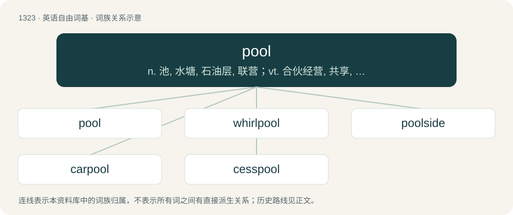

# 1410 · pool — n. 池, 水塘, 石油层, 联营；vt. 合伙经营, 共享, 采掘, 汇聚成；vi. 汇合成塘, 淤积, 联营

[总目录](../00_总目录_按常用程度.md)

**类型**：英语自由词基　｜　**来源语言**：见词源记录

## 核心含义与来源

- 核心含义：n. 池, 水塘, 石油层, 联营；vt. 合伙经营, 共享, 采掘, 汇聚成；vi. 汇合成塘, 淤积, 联营
- 英文含义：A small and rather deep area of (usually) fresh water, as one supplied by a spring, or occurring in the course of a stream or river; a reservoir for water.
- 词形：pool

**多个词源／构词路径**：同一拼写可能有不同来源；以下按词性和含义分别列出。

**来源记录 1**（名词；A small and rather deep area of (usually) fresh water, as one supplied by a spring, or occurring in the course of a stream or river; a reservoir for water.）

From Middle English pool, pole, pol, from Old English pōl (“pool”), from Proto-West Germanic pōl, from Proto-Germanic \*pōlaz (“pool, pond”), from Proto-Indo-European \*bōlos (“bog, marsh”). Cognate with Scots puil (“pool”), Saterland Frisian Pol (“pool”), West Frisian poel (“pool”), Dutch poel (“pool”), German Low German Pohl, Pool, Pul (“pool”), German Pfuhl (“quagmire, mudhole”), Danish pøl (“puddle”), Swedish pöl (“puddle, pool”), Icelandic pollur (“puddle”), Lithuanian bala (“puddle”), Latvian bala (“a muddly, treeless depression”), Russian боло́то (bolóto, “swamp, bog, marsh”). For the meaning development to a supply of resources compare typologically Russian пруд пруди́ (prud prudí) (&lt; пруд (prud)).

**来源记录 2**（名词；A supply of resources.）

1. From French poule (“collective stakes in a game”). The French word "poule" in this context is an abbreviation of "poulain, pouliche" (foal, filly), and referred to races with female horses under 3 years old. It then became used by punters to designate bets on that race, and started to be used from the racetrack to the stadiums. 2. The OED suggests that this may be a transferred use of poule (“hen”), which has been explained anecdotally as deriving from an old informal betting game in France - 'jeu de poule' - Game of Chicken (or Hen, literally) in which poule became synonymous with the combined money pot claimed by the winner.

## 词族图

## 单词速览（常用到不常用）

| 单词 | 音标 | 释义 |
|---|---|---|
| [pool](#w-1) | 英 /puːl/；美 /pul/ | n. 池, 水塘, 石油层, 联营；vt. 合伙经营, 共享, 采掘, 汇聚成；vi. 汇合成塘, 淤积, 联营 |
| [whirlpool](#w-2) | 英 /ˈwɜːlpuːl/；美 /ˈwɝlpul/ | n. 漩涡, 涡流；\[化\] 涡流 |
| [poolside](#w-3) | /ˈpuːlsaid/ | n. 游泳池边 ；a. 在游泳池边的 |
| [carpool](#w-4) | /ˈkɑːpuːl/ | v. 合伙使用汽车 |
| [cesspool](#w-5) | /ˈsɛsˌpuːl/ | n. 污水坑, 化粪池；\[医\] 污水坑, 粪坑 |

## 逐词详解

### 1. pool

**词性**：名词　｜　**音标**：英 /puːl/；美 /pul/

**中文释义**：n. 池, 水塘, 石油层, 联营；vt. 合伙经营, 共享, 采掘, 汇聚成；vi. 汇合成塘, 淤积, 联营

**英文义项**：A small and rather deep area of (usually) fresh water, as one supplied by a spring, or occurring in the course of a stream or river; a reservoir for water. / Any small body of standing or stagnant water; a puddle.

**词源与演化**：

From Middle English pool, pole, pol, from Old English pōl (“pool”), from Proto-West Germanic pōl, from Proto-Germanic \*pōlaz (“pool, pond”), from Proto-Indo-European \*bōlos (“bog, marsh”). Cognate with Scots puil (“pool”), Saterland Frisian Pol (“pool”), West Frisian poel (“pool”), Dutch poel (“pool”), German Low German Pohl, Pool, Pul (“pool”), German Pfuhl (“quagmire, mudhole”), Danish pøl (“puddle”), Swedish pöl (“puddle, pool”), Icelandic pollur (“puddle”), Lithuanian bala (“puddle”), Latvian bala (“a muddly, treeless depression”), Russian боло́то (bolóto, “swamp, bog, marsh”). For the meaning development to a supply of resources compare typologically Russian пруд пруди́ (prud prudí) (&lt; пруд (prud)).

**用法示例／搭配（非完整句）**：

> the pools of Solomon

该用例对应义项：A small and rather deep area of (usually) fresh water, as one supplied by a spring, or occurring in the course of a stream or river; a reservoir for water.

### 2. whirlpool

**词性**：名词　｜　**音标**：英 /ˈwɜːlpuːl/；美 /ˈwɝlpul/

**中文释义**：n. 漩涡, 涡流；\[化\] 涡流

**英文义项**：A swirling body of water. / A hot tub, a jacuzzi.

**构词拆分**：whirl + pool

**词源与演化**：

From earlier whirlpoole, whirlpole, apparently from Middle English \*whirlpole, potentially coalescing Old English hwierfel (“whirlpool”) and Old English hwierfepōl (“whirlpool”). Equivalent to whirl + pool. Cognate with Scots quhirlepole, whirle-pule (“whirlpool”). Compare also English whirlpit. Eclipsed non-native Middle English gurges (“whirlpool”), borrowed from Latin gurges (“whirlpool”).

**例句**：

> A whirlpool is an instance of a vortex produced by ocean tides, or by a hole underneath where the water would drain out, such as in a bathtub.

该用例对应义项：A swirling body of water.

### 3. poolside

**词性**：形容词　｜　**音标**：/ˈpuːlsaid/

**中文释义**：n. 游泳池边 ；a. 在游泳池边的

**英文义项**：By the side of a pool.

**构词拆分**：pool + -side

**词源与演化**：

From pool + -side.

**例句**：

> She was sunbathing on the poolside deckchair.

该用例对应义项：By the side of a pool.

### 4. carpool

**词性**：名词　｜　**音标**：/ˈkɑːpuːl/

**中文释义**：v. 合伙使用汽车

**英文义项**：An arrangement whereby several people travel together in the same car in order to save costs, reduce pollution etc. / The group of people who participate in such a pool.

**构词拆分**：car + pool

**词源与演化**：

From car + pool.

**例句**：

> The neighbors decided on a carpool to get their kids to school, so that they wouldn't each have to drive every day.

该用例对应义项：An arrangement whereby several people travel together in the same car in order to save costs, reduce pollution etc.

### 5. cesspool

**词性**：名词　｜　**音标**：/ˈsɛsˌpuːl/

**中文释义**：n. 污水坑, 化粪池；\[医\] 污水坑, 粪坑

**英文义项**：An underground pit where sewage is held. / A filthy place.

**构词拆分**：suss, soss (“a puddle; mire”) + pool

**词源与演化**：

From earlier sesspool. Origin uncertain. Perhaps from Italian cesso (“privy, a toilet”) + English pool. Alternatively, an alteration of English dialectal suspool, from suss, soss (“a puddle; mire”) + pool. Another possible derivation is from a folk etymology (influence from pool) from earlier cesperalle, alteration of Middle English suspiral, from Middle French souspirail (“an air hole”), from soupirer, souspirer (“to sigh, breathe”), from Latin suspirare.

**例句**：

> He fell into the cesspool and got covered from head to toe.
