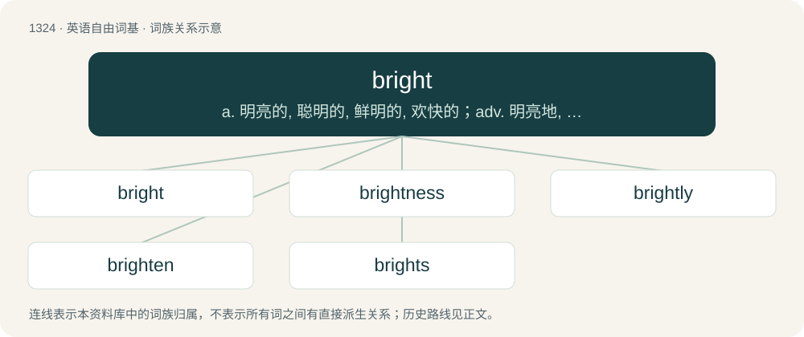

# 1412 · bright — a. 明亮的, 聪明的, 鲜明的, 欢快的；adv. 明亮地, 欢快地

[总目录](../00_总目录_按常用程度.md)

**类型**：英语自由词基　｜　**来源语言**：见词源记录

## 核心含义与来源

- 核心含义：a. 明亮的, 聪明的, 鲜明的, 欢快的；adv. 明亮地, 欢快地
- 英文含义：Emitting much light; visually dazzling; luminous, lucent, radiant.
- 词形：bright

**多个词源／构词路径**：同一拼写可能有不同来源；以下按词性和含义分别列出。

**来源记录 1**（形容词；Emitting much light; visually dazzling; luminous, lucent, radiant.）

The adjective is from Middle English bright, from Old English berht, beorht, bryht, byrht, from Proto-West Germanic \*berht, from Proto-Germanic \*berhtaz (“bright”), ultimately from Proto-Indo-European \*bʰerHǵ- (“to gleam, shine, whiten”). The noun is derived from Middle English bright (“brightness, brilliance; daylight; light”), from bright (adjective): see above. Cognates Cognate with Scots bricht (“bright”), Danish bjært (“bright”), Faroese and Icelandic bjartur (“bright”), Norwegian Nynorsk bjart (“bright”), Swedish bjärt (“bright”), Gothic 𐌱𐌰𐌹𐍂𐌷𐍄𐍃 (bairhts, “bright, clear; evident”); also Welsh berth (“beautiful, fair, fine”), Albanian bardhë (“white”), Lithuanian brėkšti (“to dawn”), Polish brzeżdżyć (“to dawn”), Russian бре́зжить (brézžitʹ, “to dawn”), Persian برازیدن (barâzidan, “to beautify; to befit”).

**来源记录 2**（副词；In a bright manner; brightly, glowingly, luminously, lustrously.）

From Middle English brighte (“brightly; (figuratively) brilliantly, lustrously; of colour: boldly, vividly; clearly, distinctly; of voice: loudly”) \[and other forms\], from Old English breohte, beorhte (West Saxon) \[and other forms\], ultimately from Proto-Germanic \*berhtaz (“bright, shining”); see further at etymology 1.

**来源记录 3**（动词；Often followed by up: to cast light on (someone or something); to brighten, to illuminate.）

From Middle English brighten (“to illuminate; to become light, dawn; (figuratively) to cleanse, purify; to clarify, explain”) \[and other forms\], from Old English beorhtian (“to brighten, shine; to sound clearly or loudly”) \[and other forms\], probably from beorht (“bright, clear”, adjective) (see further at etymology 1) + -ian (suffix forming verbs from adjectives and nouns). Later uses of the word are probably also derived from the adjective.

## 词族图

## 单词速览（常用到不常用）

| 单词 | 音标 | 释义 |
|---|---|---|
| [bright](#w-1) | 英 /ˈbɹaɪ̯t/；/ˈbɹɐɪ̯t/ | a. 明亮的, 聪明的, 鲜明的, 欢快的；adv. 明亮地, 欢快地 |
| [brightness](#w-2) | /ˈbɹaɪtnəs/ | n. 光亮, 明亮, 聪明；\[计\] 亮度 |
| [brightly](#w-3) | /ˈbɹaɪtli/ | adv. 生辉地, 明亮地, 鲜明地 |
| [brighten](#w-4) | /ˈbɹaɪtən/ | vi. 变亮, 活跃；vt. 使生辉, 使快活 |
| [brights](#w-5) | 英 /bɹaɪts/ | \[地质\]亮煤 |

## 逐词详解

### 1. bright

**词性**：形容词　｜　**音标**：英 /ˈbɹaɪ̯t/；/ˈbɹɐɪ̯t/

**中文释义**：a. 明亮的, 聪明的, 鲜明的, 欢快的；adv. 明亮地, 欢快地

**英文义项**：Emitting much light; visually dazzling; luminous, lucent, radiant. / Of light: brilliant, intense.

**词源与演化**：

The adjective is from Middle English bright, from Old English berht, beorht, bryht, byrht, from Proto-West Germanic \*berht, from Proto-Germanic \*berhtaz (“bright”), ultimately from Proto-Indo-European \*bʰerHǵ- (“to gleam, shine, whiten”). The noun is derived from Middle English bright (“brightness, brilliance; daylight; light”), from bright (adjective): see above. Cognates Cognate with Scots bricht (“bright”), Danish bjært (“bright”), Faroese and Icelandic bjartur (“bright”), Norwegian Nynorsk bjart (“bright”), Swedish bjärt (“bright”), Gothic 𐌱𐌰𐌹𐍂𐌷𐍄𐍃 (bairhts, “bright, clear; evident”); also Welsh berth (“beautiful, fair, fine”), Albanian bardhë (“white”), Lithuanian brėkšti (“to dawn”), Polish brzeżdżyć (“to dawn”), Russian бре́зжить (brézžitʹ, “to dawn”), Persian برازیدن (barâzidan, “to beautify; to befit”).

**例句**：

> I woke up today feeling so bright that I decided to have a little dance.

该用例对应义项：In good spirits; happy, optimistic.

### 2. brightness

**词性**：名词　｜　**音标**：/ˈbɹaɪtnəs/

**中文释义**：n. 光亮, 明亮, 聪明；\[计\] 亮度

**英文义项**：The quality of being bright. / The perceived luminance of an object.

**构词拆分**：bright + -ness

**词源与演化**：

From Middle English bryghtnes, brightnesse, from Old English beorhtnes (“brightness, splendor”), from Proto-West Germanic \*berhtnassī, equivalent to bright + -ness. Cognate with Old High German berahtnessī, berahtnessi (“brightness”).

**例句**：

> The noonday sun beat down with dazzling brightness on the tennis court.

### 3. brightly

**词性**：副词　｜　**音标**：/ˈbɹaɪtli/

**中文释义**：adv. 生辉地, 明亮地, 鲜明地

**英文义项**：In a bright manner.

**构词拆分**：bright + -ly

**词源与演化**：

From Middle English brightliche, from Old English beorhtlice, equivalent to bright + -ly.

**例句**：

> The sun was shining brightly, making me squint.

该用例对应义项：In a bright manner.

### 4. brighten

**词性**：动词　｜　**音标**：/ˈbɹaɪtən/

**中文释义**：vi. 变亮, 活跃；vt. 使生辉, 使快活

**英文义项**：To make bright or brighter in color. / To make illustrious, or more distinguished; to add luster or splendor to

**构词拆分**：From bright + -en.

**词源与演化**：

From bright + -en.

**例句**：

> Having Mark around the place really brightens things up.

该用例对应义项：To make more cheerful and pleasant; to enliven

### 5. brights

**词性**：名词　｜　**音标**：英 /bɹaɪts/

**中文释义**：\[地质\]亮煤

**英文义项**：Bold or vivid colours; also, clothes, cosmetics, etc., with such colours. / Household utensils (such as cutlery, ornaments, and plate) made of shiny metal.

**构词拆分**：bright (adjective) + -s (suffix forming pluralia tantum)

**词源与演化**：

From bright (adjective) + -s (suffix forming pluralia tantum).

**例句**：

> Your brights are on.

该用例对应义项：Synonym of high-beams.
