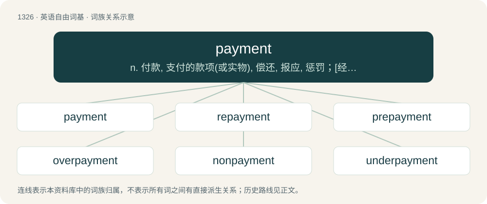

# 1413 · payment — n. 付款, 支付的款项(或实物), 偿还, 报应, 惩罚；\[经\] 支付, 缴纳, 支付款额

[总目录](../00_总目录_按常用程度.md)

**类型**：英语自由词基　｜　**来源语言**：见词源记录

## 核心含义与来源

- 核心含义：n. 付款, 支付的款项(或实物), 偿还, 报应, 惩罚；\[经\] 支付, 缴纳, 支付款额
- 英文含义：The act of paying.
- 词形：payment

**来源记录 1**（名词；The act of paying.）

From Old French paiement. Equivalent to pay + -ment.

## 词族图

## 单词速览（常用到不常用）

| 单词 | 音标 | 释义 |
|---|---|---|
| [payment](#w-1) | /ˈpeɪmənt/ | n. 付款, 支付的款项(或实物), 偿还, 报应, 惩罚；\[经\] 支付, 缴纳, 支付款额 |
| [repayment](#w-2) | /riˈpeimənt/ | n. 付还, 偿还, 报复, 付还的钱；\[经\] 偿还, 付还 |
| [prepayment](#w-3) | /ˌpɹiːˈpeɪ.mənt/ | \[经\] 预付, 提前偿付 |
| [overpayment](#w-4) |  | \[法\] 多付, 过付, 逾额付款 |
| [nonpayment](#w-5) | /nɒnˈpeimənt/ | n. 不支付 |
| [underpayment](#w-6) |  | n. 缴付不足；不足工资 |

## 逐词详解

### 1. payment

**词性**：名词　｜　**音标**：/ˈpeɪmənt/

**中文释义**：n. 付款, 支付的款项(或实物), 偿还, 报应, 惩罚；\[经\] 支付, 缴纳, 支付款额

**英文义项**：The act of paying. / An instance of that act; a sum of money paid in exchange for goods or services, or the transaction that conveys it.

**构词拆分**：pay + -ment

**词源与演化**：

From Old French paiement. Equivalent to pay + -ment.

**例句**：

> Payment will be made at the end of the month.

该用例对应义项：The act of paying.

### 2. repayment

**词性**：名词　｜　**音标**：/riˈpeimənt/

**中文释义**：n. 付还, 偿还, 报复, 付还的钱；\[经\] 偿还, 付还

**英文义项**：The act of repaying. / The money or other item that is repaid.

**构词拆分**：repay + -ment；re- + payment

**词源与演化**：

From repay + -ment, also equivalent to re- + payment.

**例句**：

> Student loan repayment begins next month.

### 3. prepayment

**词性**：名词　｜　**音标**：/ˌpɹiːˈpeɪ.mənt/

**中文释义**：\[经\] 预付, 提前偿付

**英文义项**：A payment in advance. / A cost paid in a fiscal year prior to the fiscal year in which the cost is recognized

**构词拆分**：pre- + payment

**词源与演化**：

From pre- + payment.

### 4. overpayment

**词性**：名词

**中文释义**：\[法\] 多付, 过付, 逾额付款

**英文义项**：Payment exceeding the amount actually due.

**构词拆分**：over- + payment

**词源与演化**：

From over- + payment.

**例句**：

> The employer sued to recover overpayment of wages.

该用例对应义项：Payment exceeding the amount actually due.

### 5. nonpayment

**词性**：名词　｜　**音标**：/nɒnˈpeimənt/

**中文释义**：n. 不支付

**英文义项**：The failure to make a payment.

**构词拆分**：non- (“no”, adjective) + payment

**词源与演化**：

From Middle English nonpayement, nonpaiement, nounpaiement, non paiement, equivalent to non- (“no”, adjective) + payment.

### 6. underpayment

**词性**：名词

**中文释义**：n. 缴付不足；不足工资

**英文义项**：An insufficient payment / The act of making such a payment

**构词拆分**：under- + payment

**词源与演化**：

From under- + payment.
