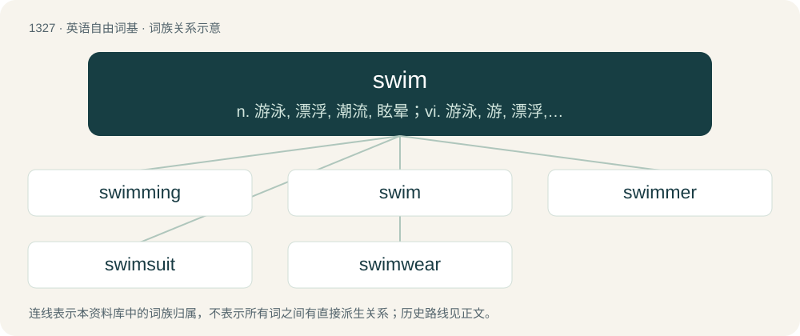

# 1414 · swim — n. 游泳, 漂浮, 潮流, 眩晕；vi. 游泳, 游, 漂浮, 浸, 覆盖, 充溢, 大量拥有, 旋转, 眩晕；vt. 游过, 使浮起

[总目录](../00_总目录_按常用程度.md)

**类型**：英语自由词基　｜　**来源语言**：见词源记录

## 核心含义与来源

- 核心含义：n. 游泳, 漂浮, 潮流, 眩晕；vi. 游泳, 游, 漂浮, 浸, 覆盖, 充溢, 大量拥有, 旋转, 眩晕；vt. 游过, 使浮起
- 英文含义：To move through the water, without touching the bottom; to propel oneself in water by natural means.
- 词形：swim

**多个词源／构词路径**：同一拼写可能有不同来源；以下按词性和含义分别列出。

**来源记录 1**（动词；To move through the water, without touching the bottom; to propel oneself in water by natural means.）

From Middle English swymmen, from Old English swimman (“to swim, float”) (class III strong verb; past tense swamm, past participle geswummen), from Proto-West Germanic \*swimman, from Proto-Germanic \*swimmaną (“to swim”), from Proto-Indo-European \*swem(bʰ)- (“to be unsteady, move, swim”). Cognates Cognate with North Frisian sweem, swome, swume, swumi, swumme, swääm (“to swim”), Saterland Frisian and West Frisian swimme (“to swim”), Dutch zwemmen (“to swim”), German schwimmen (“to swim”), Limburgish schwämme, zwömme (“to swim”), Low German swimmen (“to swim”), Luxembourgish schwammen (“to swim”), Vilamovian švymma, śwyma, śwymma (“to swim”), Yiddish שווימען (shvimen, “to swim”), Danish and Norwegian Bokmål svømme (“to swim”), Faroese svimja (“to swim”), Norn suma (“to swim”), Norwegian Nynorsk svemja, svemje, svømma, svømme, symja, symje (“to swim”), Swedish simma (“to swim”).

**来源记录 2**（名词；A dizziness; swoon.）

From Middle English swime, sweme, swaime (“a dizziness, swoon, trance”), from Old English swīma (“a swoon, swimming in the head”). Cognate with Swedish svimma (“to swoon, faint”) and Danish svime (“to swoon, faint”) / Danish besvime (“to swoon, faint”).

## 词族图

## 单词速览（常用到不常用）

| 单词 | 音标 | 释义 |
|---|---|---|
| [swimming](#w-1) | /ˈswɪmɪŋ/ | n. 游泳, 眩晕 |
| [swim](#w-2) | 英 /swɪm/ | n. 游泳, 漂浮, 潮流, 眩晕；vi. 游泳, 游, 漂浮, 浸, 覆盖, 充溢, 大量拥有, 旋转, 眩晕；vt. 游过, 使浮起 |
| [swimmer](#w-3) | 英 /ˈswɪm.ə/；美 /ˈswɪm.ɚ/ | n. 游泳者 |
| [swimsuit](#w-4) | /ˈswɪm.s(j)ut/ | n. 游泳衣 |
| [swimwear](#w-5) | /ˈswɪmweə(r)/ | n. 游泳衣 |

## 逐词详解

### 1. swimming

**词性**：名词　｜　**音标**：/ˈswɪmɪŋ/

**中文释义**：n. 游泳, 眩晕

**英文义项**：The act or art of sustaining and propelling the body in water.

**构词拆分**：swim (“to move through water”, verb) + -ing (suffix forming gerunds)

**词源与演化**：

From Middle English swymmynge. Equivalent to swim (“to move through water”, verb) + -ing (suffix forming gerunds).

**例句**：

> Triathlon competitors take part in open water swimming.

该用例对应义项：The act or art of sustaining and propelling the body in water.

### 2. swim

**词性**：动词　｜　**音标**：英 /swɪm/

**中文释义**：n. 游泳, 漂浮, 潮流, 眩晕；vi. 游泳, 游, 漂浮, 浸, 覆盖, 充溢, 大量拥有, 旋转, 眩晕；vt. 游过, 使浮起

**英文义项**：To move through the water, without touching the bottom; to propel oneself in water by natural means. / To become immersed in, or as if in, or flooded with, or as if with, a liquid.

**词源与演化**：

From Middle English swymmen, from Old English swimman (“to swim, float”) (class III strong verb; past tense swamm, past participle geswummen), from Proto-West Germanic \*swimman, from Proto-Germanic \*swimmaną (“to swim”), from Proto-Indo-European \*swem(bʰ)- (“to be unsteady, move, swim”). Cognates Cognate with North Frisian sweem, swome, swume, swumi, swumme, swääm (“to swim”), Saterland Frisian and West Frisian swimme (“to swim”), Dutch zwemmen (“to swim”), German schwimmen (“to swim”), Limburgish schwämme, zwömme (“to swim”), Low German swimmen (“to swim”), Luxembourgish schwammen (“to swim”), Vilamovian švymma, śwyma, śwymma (“to swim”), Yiddish שווימען (shvimen, “to swim”), Danish and Norwegian Bokmål svømme (“to swim”), Faroese svimja (“to swim”), Norn suma (“to swim”), Norwegian Nynorsk svemja, svemje, svømma, svømme, symja, symje (“to swim”), Swedish simma (“to swim”).

**例句**：

> I want to swim the 200-yard breaststroke in the finals.

该用例对应义项：To traverse (a specific body of water, or a specific distance) by swimming; or, to use a specific swimming stroke; or, to compete in a specific swimming event.

### 3. swimmer

**词性**：名词　｜　**音标**：英 /ˈswɪm.ə/；美 /ˈswɪm.ɚ/

**中文释义**：n. 游泳者

**英文义项**：One who swims. / A protuberance on the leg of a horse.

**构词拆分**：swim + -er

**词源与演化**：

From Middle English swimmere, equivalent to swim + -er. The dumplings are so called because they are often served in stew.

**例句**：

> He is not a good swimmer.

该用例对应义项：a person who travels through the water by swimming

### 4. swimsuit

**词性**：名词　｜　**音标**：/ˈswɪm.s(j)ut/

**中文释义**：n. 游泳衣

**英文义项**：A garment worn for swimming. / A tight-fitting one-piece garment worn by women and girls.

**构词拆分**：swim + suit

**词源与演化**：

From swim + suit.

**例句**：

> Jade refused to go swimming with her brother until he helped her find her favorite swimsuit.

该用例对应义项：A tight-fitting one-piece garment worn by women and girls.

### 5. swimwear

**词性**：名词　｜　**音标**：/ˈswɪmweə(r)/

**中文释义**：n. 游泳衣

**英文义项**：Items of clothing appropriate for swimming.

**构词拆分**：swim + -wear

**词源与演化**：

From swim + -wear.

**例句**：

> Tom is a designer of swimwear.
