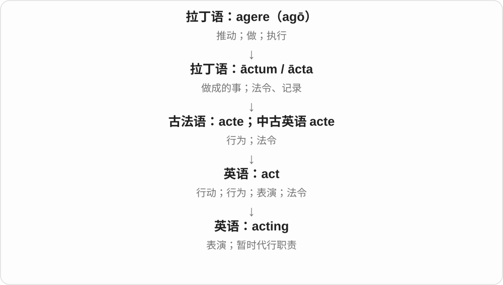

# 1415 · acting — 表演；代理、暂代

[逐词精讲目录](../00_逐词精讲目录.md) · [总目录](../00_总目录_按常用程度.md)

## 核心词根与来源

acting 来自 act 的 -ing 形式，已形成表演的名词义和代理的形容词义。两者都联系执行某种角色，不是所有 acting 都在构成进行时。

**ACTING：正在行动或表演，也可能暂代职位**

演员在演戏，副手也可以暂时坐到负责人的位置。

- **表演与代理角色**：acting

## 词形与演化规律

acting 可作名词，an acting director 中作形容词；He is acting 中才可能作为动词短语的一部分。

## 单词速览（按词族由简到繁）

同一基础词的相关扩展放在一起，先读基础形式，再读扩展；各组之间优先读常用的。具体词源关系见各词讲解。

| 单词 | 音标 | 核心意思 |
|---|---|---|
| [acting](#w-1) | /ˈæktɪŋ/ | 表演；临时代理职务的 |

## 逐词讲解

### 1. acting — 表演；临时代理职务的

**音标**：/ˈæktɪŋ/

**先抓住这个画面**

acting 一边是扮演角色，另一边是暂时替某个职位做它该做的事。

**怎么拆**

act + -ing；作名词表示表演，作形容词可表示代理职务。

**怎么变成今天的意思**

acting manager 是临时履行经理职责的人，不是在“假装当经理”。是否最终正式任命另当别论。

**常见搭配与例句**

an acting career；acting skills；the acting director。

> Her acting made the character believable.

她的表演让这个角色显得可信。

> He served as acting manager for two months.

他担任了两个月的代理经理。

**别混淆**

acting director 是代理主管；an actor 是演员，两者的“角色”并非同一种制度身份。

## 这一组要分清什么

acting manager 通常是代理经理，不等于正在表演经理；acting class 则是表演课。

## 串起来练习

比较 an acting teacher、an acting manager 和 He is acting，结合上下文判断语法角色。
