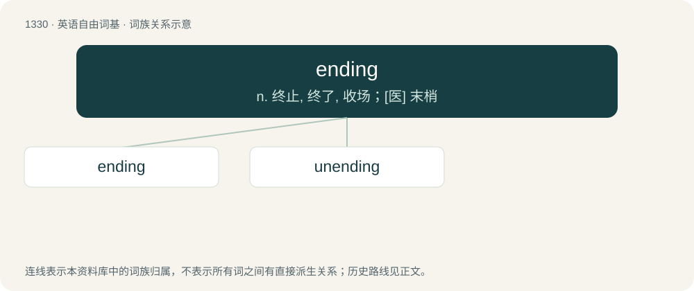

# 1418 · ending — n. 终止, 终了, 收场；\[医\] 末梢

[总目录](../00_总目录_按常用程度.md)

**类型**：英语自由词基　｜　**来源语言**：见词源记录

## 核心含义与来源

- 核心含义：n. 终止, 终了, 收场；\[医\] 末梢
- 英文含义：A termination or conclusion.
- 词形：ending

**来源记录 1**（名词；A termination or conclusion.）

From Middle English endynge, endyng, endinge, from Old English endung, ġeendung (“ending”), equivalent to end + -ing. Cognate with Dutch ending (“ending”), German Endung (“ending”).

## 词族图

## 单词速览（常用到不常用）

| 单词 | 音标 | 释义 |
|---|---|---|
| [ending](#w-1) | /ˈɛndɪŋ/ | n. 终止, 终了, 收场；\[医\] 末梢 |
| [unending](#w-2) | /.ʌnˈendiŋ/ | a. 无穷尽的, 无止境的, 不停的 |

## 逐词详解

### 1. ending

**词性**：名词　｜　**音标**：/ˈɛndɪŋ/

**中文释义**：n. 终止, 终了, 收场；\[医\] 末梢

**英文义项**：A termination or conclusion. / The last part of something.

**构词拆分**：end + -ing

**词源与演化**：

From Middle English endynge, endyng, endinge, from Old English endung, ġeendung (“ending”), equivalent to end + -ing. Cognate with Dutch ending (“ending”), German Endung (“ending”).

**例句**：

> Spanish verb forms have different endings depending on the tense, mood and person.

该用例对应义项：The last morpheme of a word, added to some base to make an inflected form (such as -s in "dogs").

### 2. unending

**词性**：形容词　｜　**音标**：/.ʌnˈendiŋ/

**中文释义**：a. 无穷尽的, 无止境的, 不停的

**英文义项**：Not ending; having no end; eternal.

**构词拆分**：un- + ending

**词源与演化**：

From un- + ending.

**例句**：

> I have been in a continuous, unending, hopeless pursuit to prove myself.
