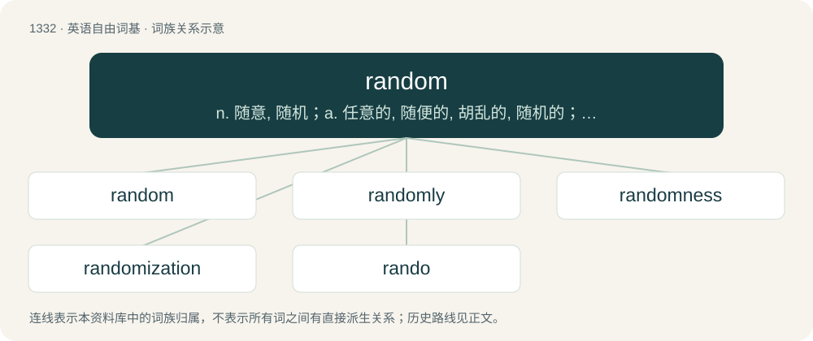

# 1422 · random — n. 随意, 随机；a. 任意的, 随便的, 胡乱的, 随机的；adv. 胡乱地

[总目录](../00_总目录_按常用程度.md)

**类型**：英语自由词基　｜　**来源语言**：见词源记录

## 核心含义与来源

- 核心含义：n. 随意, 随机；a. 任意的, 随便的, 胡乱的, 随机的；adv. 胡乱地
- 英文含义：A roving motion; course without definite direction; lack of rule or method; chance.
- 词形：random

**来源记录 1**（名词；A roving motion; course without definite direction; lack of rule or method; chance.）

From earlier randon, from Middle English randoun, raundon, from Old French randon, from randir (“to run, gallop”) (whence French randonnée (“long walk, hike”)), from Frankish \*randiju (“a run, race”) or Old Norse rend (“a run, race”), both from Proto-Germanic \*randijō, from \*rinnaną (“run”, verb), from Proto-Indo-European \*(H)r̥-nw- (“to flow, move, run”). Cognate with Middle Low German uprinden (“to jump up”), Danish rende (“to run”). See run.

## 词族图

## 单词速览（常用到不常用）

| 单词 | 音标 | 释义 |
|---|---|---|
| [random](#w-1) | /ˈɹændəm/ | n. 随意, 随机；a. 任意的, 随便的, 胡乱的, 随机的；adv. 胡乱地 |
| [randomly](#w-2) | /ˈɹændm̩li/ | adv. 偶然, 胡乱, 无目的, 任意, 随便, 任取, 无规则, 机遇, 胡乱地, 任意地, 随便地；\[计\] 随机地 |
| [randomness](#w-3) | /ˈɹæn.dəm.nəs/ | \[计\] 随机性 |
| [randomization](#w-4) | 英 /ˌɹændəməˈzeɪt͡ʃən/；美 /ˌɹændəməˈzeɪt͡ʃən/ | \[计\] 随机性；\[化\] 随机化; 无规则分布 |
| [rando](#w-5) | 英 /ˈɹændəʊ/；美 /ˈɹændoʊ/ | abbr. radiotherapy analog dosimeter 放射疗法模拟剂量计 |

## 逐词详解

### 1. random

**词性**：名词　｜　**音标**：/ˈɹændəm/

**中文释义**：n. 随意, 随机；a. 任意的, 随便的, 胡乱的, 随机的；adv. 胡乱地

**英文义项**：A roving motion; course without definite direction; lack of rule or method; chance. / An undefined, unknown or unimportant person; a person of no consequence.

**词源与演化**：

From earlier randon, from Middle English randoun, raundon, from Old French randon, from randir (“to run, gallop”) (whence French randonnée (“long walk, hike”)), from Frankish \*randiju (“a run, race”) or Old Norse rend (“a run, race”), both from Proto-Germanic \*randijō, from \*rinnaną (“run”, verb), from Proto-Indo-European \*(H)r̥-nw- (“to flow, move, run”). Cognate with Middle Low German uprinden (“to jump up”), Danish rende (“to run”). See run.

**例句**：

> The party was boring. It was full of randoms.

该用例对应义项：An undefined, unknown or unimportant person; a person of no consequence.

### 2. randomly

**词性**：副词　｜　**音标**：/ˈɹændm̩li/

**中文释义**：adv. 偶然, 胡乱, 无目的, 任意, 随便, 任取, 无规则, 机遇, 胡乱地, 任意地, 随便地；\[计\] 随机地

**英文义项**：In a random manner. / By random access; at any point at a given time; not sequentially.

**构词拆分**：random + -ly

**词源与演化**：

From random + -ly.

**例句**：

> I just randomly remembered this dream from 2 years ago.

该用例对应义项：In a random manner.

### 3. randomness

**词性**：名词　｜　**音标**：/ˈɹæn.dəm.nəs/

**中文释义**：\[计\] 随机性

**英文义项**：The property of all possible outcomes being equally likely. / A type of circumstance or event that is described by a probability distribution.

**构词拆分**：random + -ness

**词源与演化**：

From random + -ness.

**例句**：

> There was no randomness in the teacher's selection of the class representative.

该用例对应义项：A measure of the lack of purpose, logic, or objectivity of an event.

### 4. randomization

**词性**：名词　｜　**音标**：英 /ˌɹændəməˈzeɪt͡ʃən/；美 /ˌɹændəməˈzeɪt͡ʃən/

**中文释义**：\[计\] 随机性；\[化\] 随机化; 无规则分布

**英文义项**：The process of making random.

**构词拆分**：random + -ization

**词源与演化**：

From random + -ization.

### 5. rando

**词性**：名词　｜　**音标**：英 /ˈɹændəʊ/；美 /ˈɹændoʊ/

**中文释义**：abbr. radiotherapy analog dosimeter 放射疗法模拟剂量计

**英文义项**：An arbitrary person with whom one has no shared social connection. / A person going to a party without being invited.

**构词拆分**：random + -o (“(colloquial); person with characteristic”)

**词源与演化**：

From random + -o (“(colloquial); person with characteristic”); compare sicko, weirdo. From early 2000s.

**例句**：

> I accidentally took some rando's luggage from the airport carousel.

该用例对应义项：An arbitrary person with whom one has no shared social connection.
