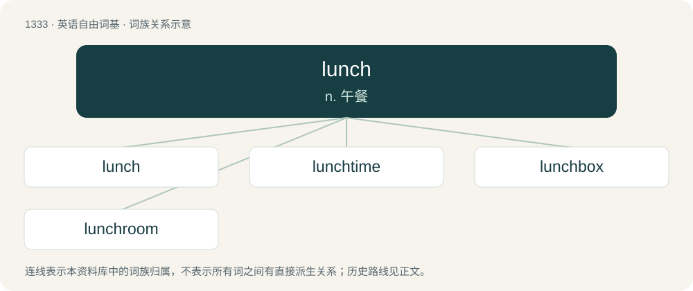

# 1423 · lunch — n. 午餐

[总目录](../00_总目录_按常用程度.md)

**类型**：英语自由词基　｜　**来源语言**：见词源记录

## 核心含义与来源

- 核心含义：n. 午餐
- 英文含义：A light meal usually eaten around midday, notably when not as main meal of the day.
- 词形：lunch

**来源记录 1**（名词；A light meal usually eaten around midday, notably when not as main meal of the day.）

Recorded since 1580 in the sense “piece, hunk”. The word luncheon with the same meaning is presumably an extension on the pattern of puncheon (“cask”) and truncheon (“cudgel”). But earliest found forms of luncheon include lunshin and lunching, which are equivalent to lunch + -ing, with the suffix -ing possibly later modified to imitate a French origin. In contrast, the more common sense “light meal” is first attested for luncheon in 1652 and for lunch in 1829, so in this sense the latter is probably a shortening of the former. Lunch is possibly a derivative of lump (as hunch is from hump. See hunch for more), or represents an alteration of nuncheon, from Middle English nonechenche (“light midday meal”) (see nuncheon) and altered by northern English dialect lunch (“hunk of bread or cheese”) (1590), which perhaps is from lump or from Spanish lonja (“a slice”, literally “loin”).

## 词族图

## 单词速览（常用到不常用）

| 单词 | 音标 | 释义 |
|---|---|---|
| [lunch](#w-1) | 英 /lʌnt͡ʃ/ | n. 午餐 |
| [lunchtime](#w-2) | /ˈlʌnt͡ʃtaɪm/ | n. 午餐时间 |
| [lunchbox](#w-3) | /ˈlʌntʃˌbɒks/ | n. 饭盒；便当 |
| [lunchroom](#w-4) | 美 /ˈlʌnt͡ʃˌɹum/ | n. 便餐厅 |

## 逐词详解

### 1. lunch

**词性**：名词　｜　**音标**：英 /lʌnt͡ʃ/

**中文释义**：n. 午餐

**英文义项**：A light meal usually eaten around midday, notably when not as main meal of the day. / A break in play between the first and second sessions.

**词源与演化**：

Recorded since 1580 in the sense “piece, hunk”. The word luncheon with the same meaning is presumably an extension on the pattern of puncheon (“cask”) and truncheon (“cudgel”). But earliest found forms of luncheon include lunshin and lunching, which are equivalent to lunch + -ing, with the suffix -ing possibly later modified to imitate a French origin. In contrast, the more common sense “light meal” is first attested for luncheon in 1652 and for lunch in 1829, so in this sense the latter is probably a shortening of the former. Lunch is possibly a derivative of lump (as hunch is from hump. See hunch for more), or represents an alteration of nuncheon, from Middle English nonechenche (“light midday meal”) (see nuncheon) and altered by northern English dialect lunch (“hunk of bread or cheese”) (1590), which perhaps is from lump or from Spanish lonja (“a slice”, literally “loin”).

**例句**：

> After the funeral there was a lunch for those who didn't go to the cemetery.

该用例对应义项：Any small meal, especially one eaten at a social gathering.

### 2. lunchtime

**词性**：名词　｜　**音标**：/ˈlʌnt͡ʃtaɪm/

**中文释义**：n. 午餐时间

**英文义项**：The time or hour at or around which lunch is normally eaten. / A break in work or school to eat lunch.

**构词拆分**：lunch + time

**词源与演化**：

From lunch + time.

**例句**：

> It's almost lunchtime, so I think I'll finish up later this afternoon.

该用例对应义项：A break in work or school to eat lunch.

### 3. lunchbox

**词性**：名词　｜　**音标**：/ˈlʌntʃˌbɒks/

**中文释义**：n. 饭盒；便当

**英文义项**：A container for transporting meals, especially lunch. / The penis when enclosed in clothing.

**构词拆分**：lunch + box

**词源与演化**：

From lunch + box.

**例句**：

> Jack was carrying his lunchbox with him.

该用例对应义项：A lunch packaged in a disposable box to be taken away to eat.

### 4. lunchroom

**词性**：名词　｜　**音标**：美 /ˈlʌnt͡ʃˌɹum/

**中文释义**：n. 便餐厅

**英文义项**：A room designated as a place to eat lunch. / A diner or small restaurant that serves lunch.

**构词拆分**：lunch + room

**词源与演化**：

From lunch + room.

**例句**：

> I don't know how they stay in business serving only lunch, but the lunchroom on the corner is cheap and fast so I like it.

该用例对应义项：A diner or small restaurant that serves lunch.
