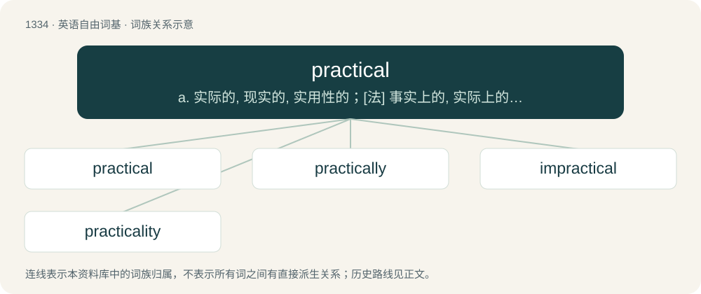

# 1424 · practical — a. 实际的, 现实的, 实用性的；\[法\] 事实上的, 实际上的, 接近...的

[总目录](../00_总目录_按常用程度.md)

**类型**：英语自由词基　｜　**来源语言**：见词源记录

## 核心含义与来源

- 核心含义：a. 实际的, 现实的, 实用性的；\[法\] 事实上的, 实际上的, 接近...的
- 英文含义：Relating to, or based on, practice or action rather than theory or hypothesis.
- 词形：practical

**来源记录 1**（形容词；Relating to, or based on, practice or action rather than theory or hypothesis.）

From Middle English practical, practicale, praktycall, from Medieval Latin practicālis.

## 词族图

## 单词速览（常用到不常用）

| 单词 | 音标 | 释义 |
|---|---|---|
| [practical](#w-1) | 英 /ˈpɹæk.tɪ.kəl/ | a. 实际的, 现实的, 实用性的；\[法\] 事实上的, 实际上的, 接近...的 |
| [practically](#w-2) | /ˈpɹæk.tɪ.k(ə.)li/ | adv. 几乎, 差不多, 事实上 |
| [impractical](#w-3) | /ɪmˈpɹæktɪkəl/ | a. 不切实际的, 不能实行的, 不现实的, 不合情理的 |
| [practicality](#w-4) | /.præktiˈkæliti/ | n. 实际性, 实用性, 实际事物 |

## 逐词详解

### 1. practical

**词性**：形容词　｜　**音标**：英 /ˈpɹæk.tɪ.kəl/

**中文释义**：a. 实际的, 现实的, 实用性的；\[法\] 事实上的, 实际上的, 接近...的

**英文义项**：Relating to, or based on, practice or action rather than theory or hypothesis. / Being likely to be effective and applicable to a real situation; able to be put to use.

**词源与演化**：

From Middle English practical, practicale, praktycall, from Medieval Latin practicālis.

**例句**：

> Jack didn't get an engineering degree, but has practical knowledge of metalworking.

该用例对应义项：Relating to, or based on, practice or action rather than theory or hypothesis.

### 2. practically

**词性**：副词　｜　**音标**：/ˈpɹæk.tɪ.k(ə.)li/

**中文释义**：adv. 几乎, 差不多, 事实上

**英文义项**：In practice; in effect or in actuality, though possibly not officially, technically, or legally. / Almost completely; almost entirely.

**构词拆分**：practical + -ly

**词源与演化**：

From practical + -ly.

**例句**：

> Stalin was not technically or legally the head of state but was practically so.

该用例对应义项：In practice; in effect or in actuality, though possibly not officially, technically, or legally.

### 3. impractical

**词性**：形容词　｜　**音标**：/ɪmˈpɹæktɪkəl/

**中文释义**：a. 不切实际的, 不能实行的, 不现实的, 不合情理的

**英文义项**：Not practical; impracticable.

**构词拆分**：in- + practical

**词源与演化**：

From im- + practical.

**例句**：

> Refloating the ship proved impractical because of the expense.

该用例对应义项：not practical; not workable or not given to practical matters

### 4. practicality

**词性**：名词　｜　**音标**：/.præktiˈkæliti/

**中文释义**：n. 实际性, 实用性, 实际事物

**英文义项**：The state of being practical or feasible. / The practical aspect of something.

**构词拆分**：practical + -ity

**词源与演化**：

From practical + -ity.

**例句**：

> He is inclined to look at everything from the standpoint of its practicality and is neither stingy nor extravagant.
