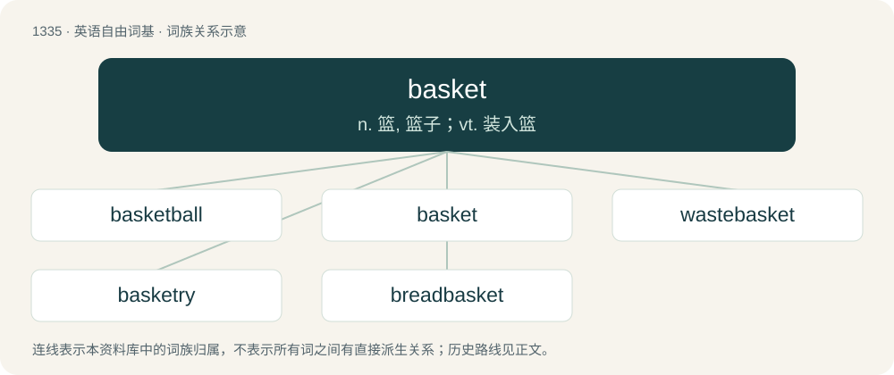

# 1425 · basket — n. 篮, 篮子；vt. 装入篮

[总目录](../00_总目录_按常用程度.md)

**类型**：英语自由词基　｜　**来源语言**：见词源记录

## 核心含义与来源

- 核心含义：n. 篮, 篮子；vt. 装入篮
- 英文含义：A lightweight woven container, generally round, open at the top, and tapering toward the bottom.
- 词形：basket

**来源记录 1**（名词；A lightweight woven container, generally round, open at the top, and tapering toward the bottom.）

From Middle English basket, from Anglo-Norman baschet, basket, bascat, from latin bascauda. Displaced native Old English mand. One theory is that it derives from Late Latin bascauda (“kettle, table-vessel”), from Proto-Brythonic (in Breton baskodenn), from Proto-Celtic \*baskis (“bundle, load”), from purported Proto-Indo-European \*bʰask- (“bundle”), but this is now widely viewed as a substrate word for phonetic reasons. Related to Latin fascis (“bundle, package, load”) (whence English fasces), Albanian bokshe (“bundle”), Breton bac'h (“bundle, load”), Ancient Greek φάκελος (phákelos) and βάσκιοι (báskioi) (“bundle (of sticks)”); see also faggot (“(originally) bundle of sticks”).

## 词族图

## 单词速览（常用到不常用）

| 单词 | 音标 | 释义 |
|---|---|---|
| [basketball](#w-1) | 英 /ˈbɑːs.kɪt.bɔːl/；美 /ˈbæs.kɪt.bɔl/ | n. 篮球 |
| [basket](#w-2) | 英 /ˈbɑːskɪt/；美 /ˈbæskɪt/ | n. 篮, 篮子；vt. 装入篮 |
| [wastebasket](#w-3) | /ˈweist.bæskit/ | n. 废纸篓；\[计\] 废纸篓 |
| [basketry](#w-4) | /ˈbɑːkitri/ | n. 篮子编织技艺 |
| [breadbasket](#w-5) | 英 /ˈbɹɛdbɑːskɪt/；美 /ˈbɹɛdˌbæskɪt/ | n. &lt;俚&gt;胃, 腹 |

## 逐词详解

### 1. basketball

**词性**：名词　｜　**音标**：英 /ˈbɑːs.kɪt.bɔːl/；美 /ˈbæs.kɪt.bɔl/

**中文释义**：n. 篮球

**英文义项**：A sport in which two opposing teams of five players strive to put a ball through a hoop. / The particular kind of ball used in the sport of basketball.

**构词拆分**：basket + ball

**词源与演化**：

From basket + ball.

**例句**：

> He pursued basketball as his career.

该用例对应义项：A sport in which two opposing teams of five players strive to put a ball through a hoop.

### 2. basket

**词性**：名词　｜　**音标**：英 /ˈbɑːskɪt/；美 /ˈbæskɪt/

**中文释义**：n. 篮, 篮子；vt. 装入篮

**英文义项**：A lightweight woven container, generally round, open at the top, and tapering toward the bottom. / A bed for a cat.

**词源与演化**：

From Middle English basket, from Anglo-Norman baschet, basket, bascat, from latin bascauda. Displaced native Old English mand. One theory is that it derives from Late Latin bascauda (“kettle, table-vessel”), from Proto-Brythonic (in Breton baskodenn), from Proto-Celtic \*baskis (“bundle, load”), from purported Proto-Indo-European \*bʰask- (“bundle”), but this is now widely viewed as a substrate word for phonetic reasons. Related to Latin fascis (“bundle, package, load”) (whence English fasces), Albanian bokshe (“bundle”), Breton bac'h (“bundle, load”), Ancient Greek φάκελος (phákelos) and βάσκιοι (báskioi) (“bundle (of sticks)”); see also faggot (“(originally) bundle of sticks”).

**例句**：

> The last-second basket sealed the victory.

该用例对应义项：The act of putting the ball through the basket, thereby scoring points.

### 3. wastebasket

**词性**：名词　｜　**音标**：/ˈweist.bæskit/

**中文释义**：n. 废纸篓；\[计\] 废纸篓

**英文义项**：A usually small indoor receptacle for items that are to be discarded; a rubbish bin. / Any region or grouping that is worthless or meaningless.

**构词拆分**：waste + basket

**词源与演化**：

From waste + basket.

**例句**：

> Give me the wrapper, so that I can throw it in the wastebasket already.

### 4. basketry

**词性**：名词　｜　**音标**：/ˈbɑːkitri/

**中文释义**：n. 篮子编织技艺

**英文义项**：The process of weaving unspun vegetable fibers to make a basket. / Baskets collectively.

**构词拆分**：basket + -ry

**词源与演化**：

From basket + -ry.

### 5. breadbasket

**词性**：名词　｜　**音标**：英 /ˈbɹɛdbɑːskɪt/；美 /ˈbɹɛdˌbæskɪt/

**中文释义**：n. &lt;俚&gt;胃, 腹

**英文义项**：A basket used for storing or carrying bread. / A region which has favourable conditions to produce a large quantity of grain or, by extension, other food products; a food bowl.

**构词拆分**：bread + basket

**词源与演化**：

From bread + basket.

**例句**：

> Algeria needs to create a breadbasket in its high plateaus.
