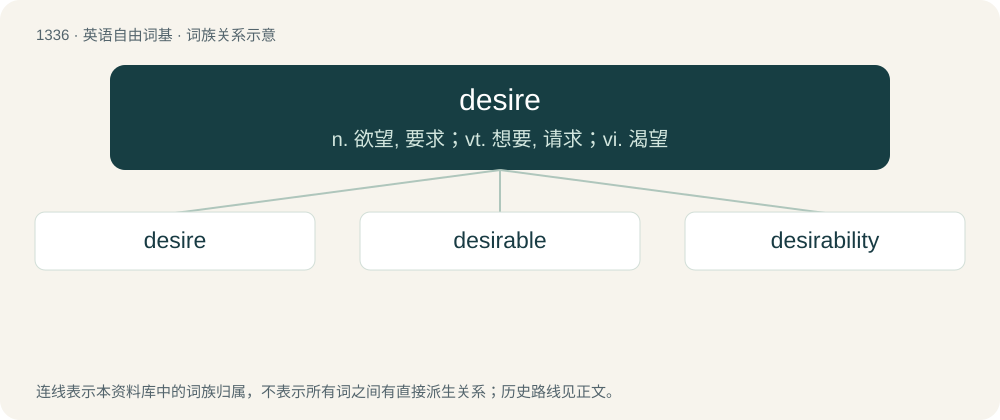

# 1426 · desire — n. 欲望, 要求；vt. 想要, 请求；vi. 渴望

[总目录](../00_总目录_按常用程度.md)

**类型**：英语自由词基　｜　**来源语言**：见词源记录

## 核心含义与来源

- 核心含义：n. 欲望, 要求；vt. 想要, 请求；vi. 渴望
- 英文含义：To want; to wish for earnestly.
- 词形：desire

**来源记录 1**（动词；To want; to wish for earnestly.）

From Middle English desir, desire (noun) and desiren (verb), from Old French desirer, desirrer, from Latin dēsīderō (“to long for, desire, feel the want of, miss, regret”), apparently from de- + sidus (in the phrase de sidere, "from the stars") in connection with astrological hopes. Compare consider and desiderate. The verb, along with Old Norse derived want (verb), has mostly replaced native will in modern English.

## 词族图

## 单词速览（常用到不常用）

| 单词 | 音标 | 释义 |
|---|---|---|
| [desire](#w-1) | 英 /dɪˈzaɪə/；美 /dɪˈzaɪɹ/ | n. 欲望, 要求；vt. 想要, 请求；vi. 渴望 |
| [desirable](#w-2) | 英 /dɪˈzaɪəɹəbəl/；美 /dɪˈzaɪɹəbəl/ | a. 令人想望的, 可取的 |
| [desirability](#w-3) | /di.zairəˈbiliti/ | n. 值得想望, 可取；\[经\] 合意性, 可用性 |

## 逐词详解

### 1. desire

**词性**：动词　｜　**音标**：英 /dɪˈzaɪə/；美 /dɪˈzaɪɹ/

**中文释义**：n. 欲望, 要求；vt. 想要, 请求；vi. 渴望

**英文义项**：To want; to wish for earnestly. / To put a request to (someone); to entreat.

**词源与演化**：

From Middle English desir, desire (noun) and desiren (verb), from Old French desirer, desirrer, from Latin dēsīderō (“to long for, desire, feel the want of, miss, regret”), apparently from de- + sidus (in the phrase de sidere, "from the stars") in connection with astrological hopes. Compare consider and desiderate. The verb, along with Old Norse derived want (verb), has mostly replaced native will in modern English.

**例句**：

> I desire to speak with you.

该用例对应义项：To want; to wish for earnestly.

### 2. desirable

**词性**：形容词　｜　**音标**：英 /dɪˈzaɪəɹəbəl/；美 /dɪˈzaɪɹəbəl/

**中文释义**：a. 令人想望的, 可取的

**英文义项**：Worthy to be desired; pleasing; agreeable. / Sexually attractive.

**构词拆分**：desire + -able

**词源与演化**：

From Old French desirable. Morphologically desire + -able.

**例句**：

> This applicant has almost all desirable properties.

该用例对应义项：Worthy to be desired; pleasing; agreeable.

### 3. desirability

**词性**：名词　｜　**音标**：/di.zairəˈbiliti/

**中文释义**：n. 值得想望, 可取；\[经\] 合意性, 可用性

**英文义项**：The state of being desirable.

**构词拆分**：desirable + -ity；desire + -ability

**词源与演化**：

Morphologically desirable + -ity and desire + -ability.

**例句**：

> Scads of online daters constantly check their desirability.
