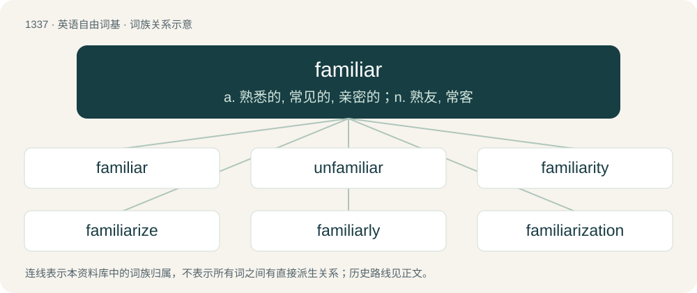

# 1427 · familiar — a. 熟悉的, 常见的, 亲密的；n. 熟友, 常客

[总目录](../00_总目录_按常用程度.md)

**类型**：英语自由词基　｜　**来源语言**：见词源记录

## 核心含义与来源

- 核心含义：a. 熟悉的, 常见的, 亲密的；n. 熟友, 常客
- 英文含义：Known to one, or generally known; commonplace.
- 词形：familiar

**来源记录 1**（形容词；Known to one, or generally known; commonplace.）

From Middle English familiar, familier, from Latin familiāris (“pertaining to servants; pertaining to the household”). By surface analysis, family + -ar. Piecewise doublet of familial. Displaced native Old English hīwcūþ.

## 词族图

## 单词速览（常用到不常用）

| 单词 | 音标 | 释义 |
|---|---|---|
| [familiar](#w-1) | 英 /fəˈmɪl.i.ə/；美 /fəˈmɪl.jəɹ/ | a. 熟悉的, 常见的, 亲密的；n. 熟友, 常客 |
| [unfamiliar](#w-2) | /ˌʌnfəˈmɪli.ə(ɹ)/ | a. 不熟悉的 |
| [familiarity](#w-3) | 英 /fəmɪliˈæɹɪti/ | n. 熟悉, 精通, 亲密 |
| [familiarize](#w-4) | /fəˈmɪliəɹaɪ̯z/ | vt. 使熟悉, 使熟知, 使通俗化 |
| [familiarly](#w-5) | 美 /fəˈmɪl.jɚ.li/ | adv. 不拘礼地, 亲密地, 随意地 |
| [familiarization](#w-6) |  | n. 亲密, 精通, 熟悉 |

## 逐词详解

### 1. familiar

**词性**：形容词　｜　**音标**：英 /fəˈmɪl.i.ə/；美 /fəˈmɪl.jəɹ/

**中文释义**：a. 熟悉的, 常见的, 亲密的；n. 熟友, 常客

**英文义项**：Known to one, or generally known; commonplace. / Acquainted.

**词源与演化**：

From Middle English familiar, familier, from Latin familiāris (“pertaining to servants; pertaining to the household”). By surface analysis, family + -ar. Piecewise doublet of familial. Displaced native Old English hīwcūþ.

**例句**：

> I'm quite familiar with this system; she's not familiar with manual gears.

该用例对应义项：Acquainted.

### 2. unfamiliar

**词性**：形容词　｜　**音标**：/ˌʌnfəˈmɪli.ə(ɹ)/

**中文释义**：a. 不熟悉的

**英文义项**：Strange, not familiar.

**构词拆分**：un- + familiar

**词源与演化**：

From un- + familiar.

**例句**：

> A name unfamiliar to most.

该用例对应义项：not known or well known

### 3. familiarity

**词性**：名词　｜　**音标**：英 /fəmɪliˈæɹɪti/

**中文释义**：n. 熟悉, 精通, 亲密

**英文义项**：The state of being extremely friendly; intimacy. / Undue intimacy; inappropriate informality, impertinence.

**构词拆分**：familiar + -ity

**词源与演化**：

From Middle French familiarité, from Latin familiāritātem. Displaced native Old English hīwcūþnes. Morphologically familiar + -ity.

**例句**：

> Our company's visual identity was designed to evoke a sense of trust and familiarity.

### 4. familiarize

**词性**：动词　｜　**音标**：/fəˈmɪliəɹaɪ̯z/

**中文释义**：vt. 使熟悉, 使熟知, 使通俗化

**英文义项**：To make or become familiar with something or someone.

**构词拆分**：familiar + -ize

**词源与演化**：

From familiar + -ize.

**例句**：

> I took some time to familiarize myself with the layout of her kitchen before I got to cooking for her.

该用例对应义项：To make or become familiar with something or someone.

### 5. familiarly

**词性**：副词　｜　**音标**：美 /fəˈmɪl.jɚ.li/

**中文释义**：adv. 不拘礼地, 亲密地, 随意地

**英文义项**：In a casual or informal manner, as with a close acquaintance; especially when such behavior may be considered inappropriate. / In an inappropriately sexual or romantic manner.

**构词拆分**：familiar + -ly

**词源与演化**：

From Middle English familierly, equivalent to familiar + -ly.

**例句**：

> The instructor spoke familiarly about the dangerous conditions on the mountain during the winter.

该用例对应义项：In a manner expressing comprehensive or intimate knowledge.

### 6. familiarization

**词性**：名词

**中文释义**：n. 亲密, 精通, 熟悉

**英文义项**：The act, process or result of familiarizing.

**构词拆分**：familiar + -ization；familiarize + -ation

**词源与演化**：

From familiar + -ization or familiarize + -ation.
