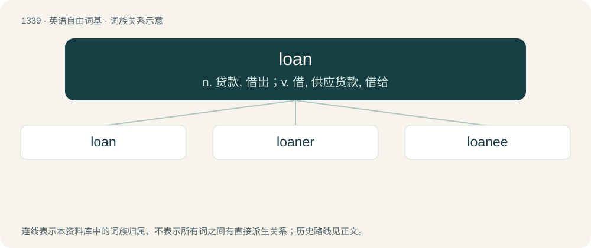

# 1429 · loan — n. 贷款, 借出；v. 借, 供应货款, 借给

[总目录](../00_总目录_按常用程度.md)

**类型**：英语自由词基　｜　**来源语言**：见词源记录

## 核心含义与来源

- 核心含义：n. 贷款, 借出；v. 借, 供应货款, 借给
- 英文含义：An act or instance of lending, an act or instance of granting something for temporary use.
- 词形：loan

**多个词源／构词路径**：同一拼写可能有不同来源；以下按词性和含义分别列出。

**来源记录 1**（名词；An act or instance of lending, an act or instance of granting something for temporary use.）

From Middle English lone, lane, from Old Norse lán, from Proto-Germanic \*laihną, from Proto-Indo-European \*leykʷ- (“to leave (over)”). Cognate with Icelandic lán, Swedish lån, Danish lån, German Lehen (“fief”), Dutch leen (“fief”), West Frisian lien, North Frisian leen (“fief; loan; office”), Scots lane, lain, len, Old English lǣn. More at lend.

**来源记录 2**（名词；An area of uncultivated ground near a village or farmhouse.）

From Scottish Gaelic lòn (“marshy meadow”) (compare lèana (“wet meadow, marsh, meadow”)).

## 词族图

## 单词速览（常用到不常用）

| 单词 | 音标 | 释义 |
|---|---|---|
| [loan](#w-1) | 英 /ləʊn/；美 /loʊn/ | n. 贷款, 借出；v. 借, 供应货款, 借给 |
| [loaner](#w-2) | 美 /ˈloʊ.nɚ/ | n. 借出者, 债权人；\[法\] 借出者, 债权人 |
| [loanee](#w-3) | /ləuˈniː/ | n. 借入者, 债务人；\[法\] 借入者, 债务人 |

## 逐词详解

### 1. loan

**词性**：名词　｜　**音标**：英 /ləʊn/；美 /loʊn/

**中文释义**：n. 贷款, 借出；v. 借, 供应货款, 借给

**英文义项**：An act or instance of lending, an act or instance of granting something for temporary use. / A sum of money or other property that a natural or legal person borrows from another with the condition that it be returned or repaid over time or at a later date (sometimes with interest).

**词源与演化**：

From Middle English lone, lane, from Old Norse lán, from Proto-Germanic \*laihną, from Proto-Indo-European \*leykʷ- (“to leave (over)”). Cognate with Icelandic lán, Swedish lån, Danish lån, German Lehen (“fief”), Dutch leen (“fief”), West Frisian lien, North Frisian leen (“fief; loan; office”), Scots lane, lain, len, Old English lǣn. More at lend.

**例句**：

> All loans from the library, whether books or audio material, must be returned within two weeks.

该用例对应义项：A sum of money or other property that a natural or legal person borrows from another with the condition that it be returned or repaid over time or at a later date (sometimes with interest).

### 2. loaner

**词性**：名词　｜　**音标**：美 /ˈloʊ.nɚ/

**中文释义**：n. 借出者, 债权人；\[法\] 借出者, 债权人

**英文义项**：One who loans; a lender. / Something that is given as a loan.

**构词拆分**：From loan + -er.

**词源与演化**：

From loan + -er.

**例句**：

> I am driving a loaner while my car is in the shop.

该用例对应义项：Something that is given as a loan.

### 3. loanee

**词性**：名词　｜　**音标**：/ləuˈniː/

**中文释义**：n. 借入者, 债务人；\[法\] 借入者, 债务人

**英文义项**：borrower; someone who is loaned something / Someone who is being loaned, someone playing for another club on loan.

**构词拆分**：loan + -ee

**词源与演化**：

From loan + -ee.
