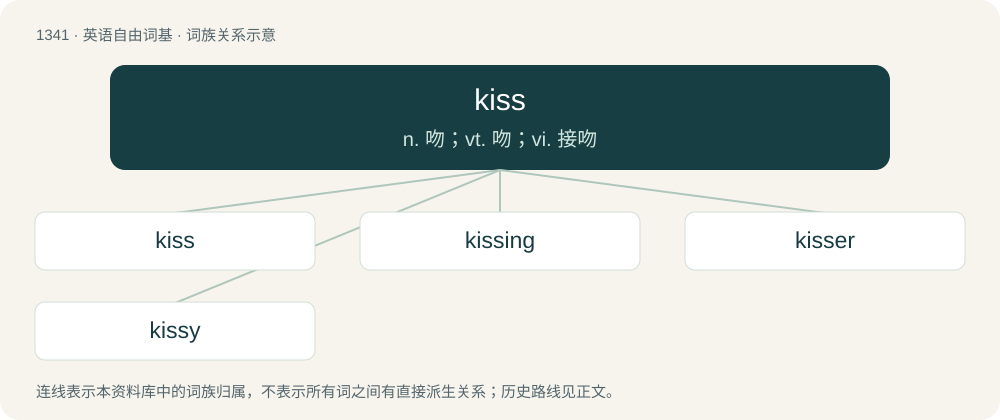

# 1432 · kiss — n. 吻；vt. 吻；vi. 接吻

[总目录](../00_总目录_按常用程度.md)

**类型**：英语自由词基　｜　**来源语言**：见词源记录

## 核心含义与来源

- 核心含义：n. 吻；vt. 吻；vi. 接吻
- 英文含义：To touch with the lips or press the lips against, usually to show love or affection or passion, or as part of a greeting.
- 词形：kiss

**多个词源／构词路径**：同一拼写可能有不同来源；以下按词性和含义分别列出。

**来源记录 1**（动词；To touch with the lips or press the lips against, usually to show love or affection or passion, or as part of a greeting.）

From Middle English kissen, kussen, from Old English cyssan (“to kiss”), from Proto-West Germanic \*kussijan, from Proto-Germanic \*kussijaną (“to kiss”). Cognates include Saterland Frisian küsje, Dutch kussen, German Low German küssen, German küssen, Danish and Norwegian Bokmål kysse, Faroese, Icelandic, Norwegian Nynorsk, and Swedish kyssa. Compare Proto-Indo-European \*ku-, \*kus- (probably imitative), with descendants including Ancient Greek κύσσω (kússō), poetic form of κύσω (kúsō, “to kiss”), and Hittite \[script needed\] (kuwassanzi, “they kiss”).

**来源记录 2**（名词；A touch with the lips, usually to express love or affection, or as a greeting.）

From Middle English kis, kys, kus, forms of cos influenced by kissen, from Old English coss, from Proto-West Germanic \*koss, from Proto-Germanic \*kussaz.

## 词族图

## 单词速览（常用到不常用）

| 单词 | 音标 | 释义 |
|---|---|---|
| [kiss](#w-1) | /kɪs/ | n. 吻；vt. 吻；vi. 接吻 |
| [kissing](#w-2) | 英 /ˈkɪsɪŋ/ | a. 接吻的 |
| [kisser](#w-3) | 英 /ˈkɪsə(ɹ)/；美 /ˈkɪsɚ/ | n. 接吻的人 |
| [kissy](#w-4) | /ˈkisi/ | a. 想要接吻的 |

## 逐词详解

### 1. kiss

**词性**：动词　｜　**音标**：/kɪs/

**中文释义**：n. 吻；vt. 吻；vi. 接吻

**英文义项**：To touch with the lips or press the lips against, usually to show love or affection or passion, or as part of a greeting. / To (cause to) touch lightly or slightly; to come into contact.

**词源与演化**：

From Middle English kissen, kussen, from Old English cyssan (“to kiss”), from Proto-West Germanic \*kussijan, from Proto-Germanic \*kussijaną (“to kiss”). Cognates include Saterland Frisian küsje, Dutch kussen, German Low German küssen, German küssen, Danish and Norwegian Bokmål kysse, Faroese, Icelandic, Norwegian Nynorsk, and Swedish kyssa. Compare Proto-Indo-European \*ku-, \*kus- (probably imitative), with descendants including Ancient Greek κύσσω (kússō), poetic form of κύσω (kúsō, “to kiss”), and Hittite \[script needed\] (kuwassanzi, “they kiss”).

**例句**：

> The nearside of the car just kissed a parked truck as he took the corner at high speed.

该用例对应义项：To (cause to) touch lightly or slightly; to come into contact.

### 2. kissing

**词性**：形容词　｜　**音标**：英 /ˈkɪsɪŋ/

**中文释义**：a. 接吻的

**英文义项**：That kisses; engaged in a kiss or kissing. / Just touching.

**构词拆分**：kiss + -ing

**词源与演化**：

From Middle English kissynge, cussinde, from Old English cyssende, from Proto-West Germanic \*kussijandī, from Proto-Germanic \*kussijandz, equivalent to kiss + -ing. Cognate with Saterland Frisian küsjend, Dutch kussend, German Low German küssend, German küssend, Swedish kyssande, Icelandic kyssandi.

**例句**：

> Kissing one's spouse in public is considered acceptable behavior in some countries.

### 3. kisser

**词性**：名词　｜　**音标**：英 /ˈkɪsə(ɹ)/；美 /ˈkɪsɚ/

**中文释义**：n. 接吻的人

**英文义项**：One who kisses. / The mouth.

**构词拆分**：kiss + -er

**词源与演化**：

Agent noun of kiss: from kiss + -er.

**例句**：

> She's a great kisser!

该用例对应义项：One who kisses.

### 4. kissy

**词性**：形容词　｜　**音标**：/ˈkisi/

**中文释义**：a. 想要接吻的

**英文义项**：Sentimentally affectionate. / Tending to kiss.

**构词拆分**：kiss (noun and verb) + -y (adjectival suffix)

**词源与演化**：

From kiss (noun and verb) + -y (adjectival suffix).

**例句**：

> We sat behind an obnoxiously kissy couple in the cinema.

该用例对应义项：Tending to kiss frequently.
