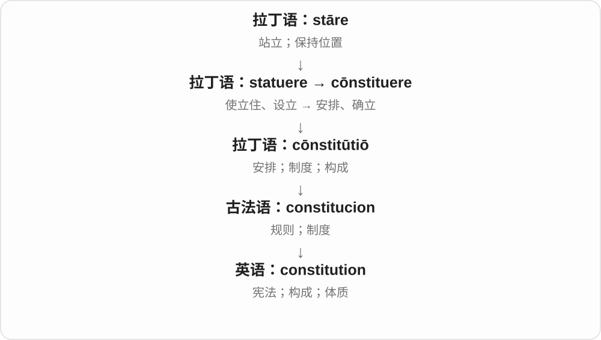

# 1433 · constitutional — 宪法、体质的构成背景，以及合宪与宪政词族

[逐词精讲目录](../00_逐词精讲目录.md) · [总目录](../00_总目录_按常用程度.md)

## 核心词根与来源

从构成方式到基本制度、身体构成，各有落点。宪政概念强调怎样约束权力，和单个措施是否合宪也不是同一层问题。

**CONSTITUTIONAL：先分国家框架，还是人的构成**

constitution → constitutional → constitutionally；constitutionality 问是否合宪；unconstitutional 否定合宪；-ism/-ist 表理念与人物。

- **构成、性质与角度**：constitution · constitutional · constitutionally
- **符合性与否定**：constitutionality · unconstitutional
- **理念与主张者**：constitutionalism · constitutionalist

## 词形与演化规律

constitution + -al；constitutional + -ly/-ity/-ism/-ist；un- + constitutional。

## 单词速览（按词族由简到繁）

同一基础词的相关扩展放在一起，先读基础形式，再读扩展；各组之间优先读常用的。具体词源关系见各词讲解。

| 单词 | 音标 | 核心意思 |
|---|---|---|
| [constitution](#w-7) | 英 /ˌkɒnstɪˈtjuːʃən/；美 /ˌkɑːnstɪˈtuːʃən/ | 宪法；组成、构造；体质 |
| [constitutional](#w-1) | 英 /ˌkɒnstɪˈtjuːʃənəl/；美 /ˌkɑːnstəˈtuːʃənəl/ | 宪法的；合宪的；体质上的；保健散步〔名词〕 |
| [constitutionally](#w-3) | 英 /ˌkɒnstɪˈtjuːʃənəli/；美 /ˌkɑːnstɪˈtuːʃənəli/ | 依宪法、在宪制上；在体质或天性上 |
| [constitutionality](#w-4) | 英 /ˌkɒnstɪtjuːʃəˈnæləti/；美 /ˌkɑːnstɪtuːʃəˈnæləti/ | 合宪性、是否符合宪法 |
| [constitutionalism](#w-5) | 英 /ˌkɒnstɪˈtjuːʃənəlɪzəm/；美 /ˌkɑːnstɪˈtuːʃənəlɪzəm/ | 宪政、宪政主义；依宪法原则限制公权力的理念 |
| [constitutionalist](#w-6) | 英 /ˌkɒnstɪˈtjuːʃənəlɪst/；美 /ˌkɑːnstɪˈtuːʃənəlɪst/ | 宪政主义者；主张依宪制原则行事的人；宪法专家〔依语境〕 |
| [unconstitutional](#w-2) | 英 /ˌʌnkɒnstɪˈtjuːʃənəl/；美 /ˌʌnkɑːnstɪˈtuːʃənəl/ | 违宪的、不符合宪法的 |

## 逐词讲解

### 1. constitution — 宪法；组成、构造；体质

**音标**：英 /ˌkɒnstɪˈtjuːʃən/；美 /ˌkɑːnstɪˈtuːʃən/

**先抓住这个画面**

把一个整体“怎样组织起来”写成基本安排：国家有宪法，身体有自身的体质，材料也有其构成。

**怎么拆**

来自拉丁语 cōnstitūtiō，经古法语进入；和 constitute 对应，但不是最初在英语里简单加 -ion 造出的。

**怎么变成今天的意思**

规则规定国家怎样构成和运作，身体的构成体现为体质。三个义项都围绕“一个整体的基本组织方式”。

**常见搭配与例句**

a written constitution；a strong constitution；the constitution of a substance。

> The constitution sets out the main powers of government.

宪法规定了政府的主要权力。

> She has a strong constitution and rarely misses a day of work.

她体质好，很少因身体原因缺勤。

**别混淆**

constitution 是基本组织或基本法；institution 是机构或制度。the constitution 常按语境特指某部宪法。

### 2. constitutional — 宪法的；合宪的；体质上的；保健散步〔名词〕

**音标**：英 /ˌkɒnstɪˈtjuːʃənəl/；美 /ˌkɑːnstəˈtuːʃənəl/

**先抓住这个画面**

一个整体最基本的构成方式：放在国家是宪法，放在人身上则是体质。

**怎么拆**

英语 constitution + -al；名词 a constitutional 是 constitutional walk / exercise 的省略，不是另一部宪法。

**怎么变成今天的意思**

**拉丁 con- + statuere → constituere → constitutio**  
设立、安排 → 构成、制度

↓

**古法语 constitucion → 中古英语 constitucioun → constitution**  
安排、规则；后来指宪法、构成、体质

↓

**英语 constitution + -al → constitutional**  
与基本构成、体质有关；后来用于宪法

↓

**constitutional walk → a constitutional**  
有益健康的散步 → 保健散步

a constitutional question 是宪法问题；The law is constitutional 则说它符合宪法。早期体质义还留在 constitutional weakness 和散步名词中。

**常见搭配与例句**

constitutional reform；constitutional rights；take a morning constitutional。

> The court considered whether the rule was constitutional.

法院审查了这项规则是否符合宪法。

> He took his morning constitutional before breakfast.

早饭前，他照例出去散步锻炼。

**别混淆**

legal 是法律允许的；constitutional 更具体问是否符合宪法。关于宪法的争论可以是 constitutional debate，却不表示争论各方都合宪。

### 3. constitutionally — 依宪法、在宪制上；在体质或天性上

**音标**：英 /ˌkɒnstɪˈtjuːʃənəli/；美 /ˌkɑːnstɪˈtuːʃənəli/

**先抓住这个画面**

constitution 既能是国家的基本构成，也能是人的身体、性格构成；副词沿这两种框架走。

**怎么拆**

constitutional + -ly。由宪法支线得到按宪法、宪制上；由体质、天性支线得到天生、生理构成上的。

**怎么变成今天的意思**

**拉丁 constituere / constitutio → constitution**  
建立、组成 → 组织方式、基本制度；身体构成

↓

**constitution + -al → constitutional**  
宪法的；体质、天性的等

↓

**派生名词与副词**  
是否合宪、依宪法、宪政立场及人物

↓

**constitutional + -ly → constitutionally**  
依宪法；从体质、天性看

constitutionally protected 受宪法保护的，constitutionally required 宪法要求的，constitutionally unable to 天性上很难做到。

**常见搭配与例句**

constitutionally protected；constitutionally required；constitutionally incapable of。

> The article discusses constitutionally protected rights.

文章讨论受宪法保护的权利。

> He seems constitutionally unable to remain silent.

他好像天生就闲不住嘴。

**别混淆**

constitutionally unable to sit still 可夸张说天生闲不住，不是在说宪法禁止坐着；要先看对象是制度还是人的天性。

### 4. constitutionality — 合宪性、是否符合宪法

**音标**：英 /ˌkɒnstɪtjuːʃəˈnæləti/；美 /ˌkɑːnstɪtuːʃəˈnæləti/

**先抓住这个画面**

不是宪法本身，而是把某条规则拿来问：它与宪法对不对得上？这个属性或问题就是 constitutionality。

**怎么拆**

constitutional + -ity，性质名词，重音移到后面的 /næl/ 附近。现代主要谈宪法符合性，不随意扩展成身体健康程度。

**怎么变成今天的意思**

**拉丁 constituere / constitutio → constitution**  
建立、组成 → 组织方式、基本制度；身体构成

↓

**constitution + -al → constitutional**  
宪法的；体质、天性的等

↓

**派生名词与副词**  
是否合宪、依宪法、宪政立场及人物

↓

**constitutional + -ity → constitutionality**  
某事是否合宪的属性、问题

question the constitutionality of 质疑……的合宪性，review the constitutionality of 审查合宪性，a debate over constitutionality 关于合宪性的争论。

**常见搭配与例句**

question the constitutionality of；review the constitutionality of。

> The lawyers questioned the constitutionality of the measure.

律师们质疑那项措施的合宪性。

> The debate focused on constitutionality rather than cost.

争论集中在是否合宪，而不是费用。

**别混淆**

constitution 宪法和 constitutionality 合宪性不同。质疑合宪性是在提出问题，不代表已经有最终违宪结论。

### 5. constitutionalism — 宪政、宪政主义；依宪法原则限制公权力的理念

**音标**：英 /ˌkɒnstɪˈtjuːʃənəlɪzəm/；美 /ˌkɑːnstɪˈtuːʃənəlɪzəm/

**先抓住这个画面**

不只写一份叫宪法的文件，还要让掌权者按基本规则办事、权力受约束；这才是常见政治思想用法的要点。

**怎么拆**

constitutional + -ism，制度原则、思想取向的名词。与 constitution 基本制度有关，但不能把任何存在宪法的状态都直接等同其较强的规范含义。

**怎么变成今天的意思**

**拉丁 constituere / constitutio → constitution**  
建立、组成 → 组织方式、基本制度；身体构成

↓

**constitution + -al → constitutional**  
宪法的；体质、天性的等

↓

**派生名词与副词**  
是否合宪、依宪法、宪政立场及人物

↓

**constitutional + -ism → constitutionalism**  
依宪制原则组织、限制权力的理念和实践

the principles of constitutionalism 宪政原则，constitutionalism and democracy 宪政与民主，the development of constitutionalism 宪政的发展。不同理论对边界和实现方式有讨论。

**常见搭配与例句**

the principles of constitutionalism；constitutionalism and democracy。

> The course examines the relationship between constitutionalism and democracy.

课程考察宪政与民主之间的关系。

> The essay argues that constitutionalism requires meaningful limits on power.

文章主张，宪政要求权力受到实质约束。

**别混淆**

constitutionalism 不只表示把宪法写下来；宪法成文与否，也不是唯一判断标准。民主、法治、宪政有关联，但各强调的概念不同。

### 6. constitutionalist — 宪政主义者；主张依宪制原则行事的人；宪法专家〔依语境〕

**音标**：英 /ˌkɒnstɪˈtjuːʃənəlɪst/；美 /ˌkɑːnstɪˈtuːʃənəlɪst/

**先抓住这个画面**

把制度原则放到人身上：认同、维护宪政立场的人；有些文本也用它说熟悉宪法的学者或专家。

**怎么拆**

constitutional + -ist，持某种立场或具相关专长的人；也可作定语，描述相应运动、立场。

**怎么变成今天的意思**

**拉丁 constituere / constitutio → constitution**  
建立、组成 → 组织方式、基本制度；身体构成

↓

**constitution + -al → constitutional**  
宪法的；体质、天性的等

↓

**派生名词与副词**  
是否合宪、依宪法、宪政立场及人物

↓

**constitutional + -ist → constitutionalist**  
宪政原则的主张者；特定文本中的宪法专家

a constitutionalist thinker 宪政思想家，a constitutionalist movement 宪政运动，describe oneself as a constitutionalist 自称宪政主义者。

**常见搭配与例句**

a constitutionalist thinker；a constitutionalist movement。

> She describes herself as a constitutionalist.

她自称是宪政主义者。

> The historian compared two constitutionalist movements.

历史学家比较了两场宪政运动。

**别混淆**

这个标签不保证所有人赞成同一套具体制度，也不自动等于法官、律师；具体政治或历史背景决定其立场范围。

### 7. unconstitutional — 违宪的、不符合宪法的

**音标**：英 /ˌʌnkɒnstɪˈtjuːʃənəl/；美 /ˌʌnkɑːnstɪˈtuːʃənəl/

**先抓住这个画面**

一项规则与作为基本框架的宪法冲突，就是在说 constitutional 这项要求没有达到。

**怎么拆**

un- 不 + constitutional 合宪的。这里否定宪法符合性，不是否定人的体质，也不是宣称一个国家没有宪法。

**怎么变成今天的意思**

**拉丁 constituere / constitutio → constitution**  
建立、组成 → 组织方式、基本制度；身体构成

↓

**constitution + -al → constitutional**  
宪法的；体质、天性的等

↓

**派生名词与副词**  
是否合宪、依宪法、宪政立场及人物

↓

**un- + constitutional → unconstitutional**  
与相应宪法要求相违背

an unconstitutional law 违宪法律，rule something unconstitutional 判定某事违宪，an unconstitutional restriction 违宪限制。具体判断取决于相应制度和条文。

**常见搭配与例句**

an unconstitutional law；rule unconstitutional；an unconstitutional restriction。

> The court ruled that the restriction was unconstitutional.

法院判定那项限制违宪。

> The essay asks whether the proposed rule would be unconstitutional.

文章探讨拟议规则是否会违宪。

**别混淆**

unconstitutional 与 unpopular 不受欢迎不同，也与 unfair 不公平并非同义；是在使用一个特定制度标准作评价。

## 这一组要分清什么

constitutionally 也可说天性；constitutionality 不等于宪法；质疑合宪性不预设结果；constitutionalism 不只指有成文宪法。

## 串起来练习

The constitutionalist discussed both constitutionalism and the measure’s constitutionality.

那位宪政主义者讨论了宪政理念，也讨论了这项措施是否合宪。
