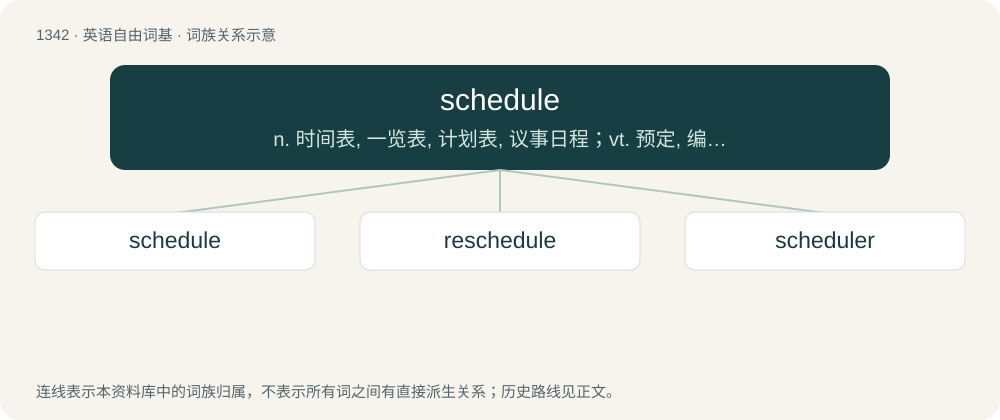

# 1433 · schedule — n. 时间表, 一览表, 计划表, 议事日程；vt. 预定, 编制目录, 制...表, 安排

[总目录](../00_总目录_按常用程度.md)

**类型**：英语自由词基　｜　**来源语言**：见词源记录

## 核心含义与来源

- 核心含义：n. 时间表, 一览表, 计划表, 议事日程；vt. 预定, 编制目录, 制...表, 安排
- 英文含义：A procedural plan, usually but not necessarily tabular in nature, indicating a sequence of operations and the planned times at which those operations are to occur.
- 词形：schedule

**来源记录 1**（名词；A procedural plan, usually but not necessarily tabular in nature, indicating a sequence of operations and the planned times at which those operations are to occur.）

Inherited from Middle English cedule, from Middle French cedule (whence French cédule), from Old French cedule, from Late Latin schedula (“papyrus strip”), diminutive of Latin scheda, from Ancient Greek σχέδη (skhédē, “papyrus leaf”), from Proto-Hellenic \*skʰíd͏̌d͏̌ō, from Proto-Indo-European \*skid-yé-ti, from \*skeyd- (“to divide, split”). Doublet of cedula and cedule. This word was historically pronounced /ˈsɛdjuːl/, /ˈsɛdʒuːl/; the pronunciations with /ʃ/ and /sk/ are due to the spelling (the latter may have been reinforced by learned influence); compare schism.

## 词族图

## 单词速览（常用到不常用）

| 单词 | 音标 | 释义 |
|---|---|---|
| [schedule](#w-1) | 美 /ˈskɛd͡ʒ.ʊl/；/ˈʃɛd͡ʒuːl/ | n. 时间表, 一览表, 计划表, 议事日程；vt. 预定, 编制目录, 制...表, 安排 |
| [reschedule](#w-2) | 英 /ɹiːˈʃɛdjuːl/；美 /ɹiˈskɛd͡ʒʊl/ | \[计\] 重安排, 重调度；\[化\] 修订计划 |
| [scheduler](#w-3) | 英 /ˈʃɛdjələ/ | n. 制表人, 程序机；\[计\] 调度程序 |

## 逐词详解

### 1. schedule

**词性**：名词　｜　**音标**：美 /ˈskɛd͡ʒ.ʊl/；/ˈʃɛd͡ʒuːl/

**中文释义**：n. 时间表, 一览表, 计划表, 议事日程；vt. 预定, 编制目录, 制...表, 安排

**英文义项**：A procedural plan, usually but not necessarily tabular in nature, indicating a sequence of operations and the planned times at which those operations are to occur. / A serial record of items, systematically arranged.

**词源与演化**：

Inherited from Middle English cedule, from Middle French cedule (whence French cédule), from Old French cedule, from Late Latin schedula (“papyrus strip”), diminutive of Latin scheda, from Ancient Greek σχέδη (skhédē, “papyrus leaf”), from Proto-Hellenic \*skʰíd͏̌d͏̌ō, from Proto-Indo-European \*skid-yé-ti, from \*skeyd- (“to divide, split”). Doublet of cedula and cedule. This word was historically pronounced /ˈsɛdjuːl/, /ˈsɛdʒuːl/; the pronunciations with /ʃ/ and /sk/ are due to the spelling (the latter may have been reinforced by learned influence); compare schism.

**例句**：

> The building code includes a schedule of acceptable configurations.

该用例对应义项：A serial record of items, systematically arranged.

### 2. reschedule

**词性**：动词　｜　**音标**：英 /ɹiːˈʃɛdjuːl/；美 /ɹiˈskɛd͡ʒʊl/

**中文释义**：\[计\] 重安排, 重调度；\[化\] 修订计划

**英文义项**：To schedule again or at a different time. / To reclassify; to change the schedule (division into which something is classified) of.

**构词拆分**：re- + schedule

**词源与演化**：

From re- + schedule.

**例句**：

> We'll have to reschedule next Monday's meeting because of the public holiday.

该用例对应义项：To schedule again or at a different time.

### 3. scheduler

**词性**：名词　｜　**音标**：英 /ˈʃɛdjələ/

**中文释义**：n. 制表人, 程序机；\[计\] 调度程序

**英文义项**：A person or device that determines a schedule, that determines the order that tasks are to be done. / An operating system component responsible for allocating several resources, most commonly the use of processors by different concurrent processes or threads.

**构词拆分**：From schedule + -er.

**词源与演化**：

From schedule + -er.

**例句**：

> I use Outlook's scheduler at work and I think I'd like to buy a PDA and synchronize them.
