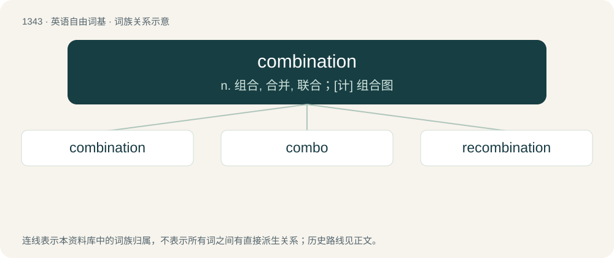

# 1434 · combination — n. 组合, 合并, 联合；\[计\] 组合图

[总目录](../00_总目录_按常用程度.md)

**类型**：英语自由词基　｜　**来源语言**：见词源记录

## 核心含义与来源

- 核心含义：n. 组合, 合并, 联合；\[计\] 组合图
- 英文含义：The act of combining, the state of being combined or the result of combining.
- 词形：combination

**来源记录 1**（名词；The act of combining, the state of being combined or the result of combining.）

From Middle English combinacioun, combynacyoun, from Old French combination, from Late Latin combīnātiō. Morphologically combine + -ation.

## 词族图

## 单词速览（常用到不常用）

| 单词 | 音标 | 释义 |
|---|---|---|
| [combination](#w-1) | 英 /ˌkɒmbɪˈneɪʃən/；美 /ˌkɑmbɪˈneɪʃən/ | n. 组合, 合并, 联合；\[计\] 组合图 |
| [combo](#w-2) | /ˈkɒmbəʊ/ | n. 小型爵士乐团 |
| [recombination](#w-3) | /ˈriːkɔmbiˈneiʃən/ | n. 再组合.重组合, 复合, 再化合；\[计\] 复合的 |

## 逐词详解

### 1. combination

**词性**：名词　｜　**音标**：英 /ˌkɒmbɪˈneɪʃən/；美 /ˌkɑmbɪˈneɪʃən/

**中文释义**：n. 组合, 合并, 联合；\[计\] 组合图

**英文义项**：The act of combining, the state of being combined or the result of combining. / An object formed by combining.

**构词拆分**：combine + -ation

**词源与演化**：

From Middle English combinacioun, combynacyoun, from Old French combination, from Late Latin combīnātiō. Morphologically combine + -ation.

**例句**：

> These guidelines should be followed in combination with those given last week.

该用例对应义项：The act of combining, the state of being combined or the result of combining.

### 2. combo

**词性**：名词　｜　**音标**：/ˈkɒmbəʊ/

**中文释义**：n. 小型爵士乐团

**英文义项**：A small musical group. / A combination.

**构词拆分**：combination + -o

**词源与演化**：

Clipping of combination + -o.

**例句**：

> I order the low priced combo platter: a taco, a burrito and a chimichanga.

该用例对应义项：A combination.

### 3. recombination

**词性**：名词　｜　**音标**：/ˈriːkɔmbiˈneiʃən/

**中文释义**：n. 再组合.重组合, 复合, 再化合；\[计\] 复合的

**英文义项**：Combination a second or subsequent time. / The formation of genetic combinations in offspring that are not present in the parents.

**构词拆分**：re- + combination

**词源与演化**：

From re- + combination.
