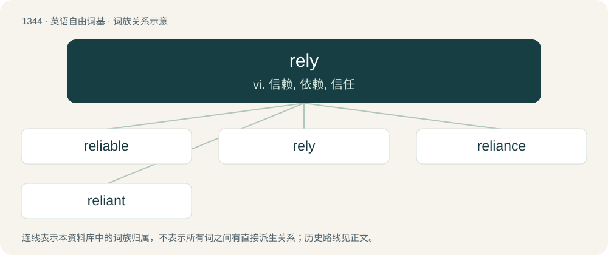

# 1435 · rely — vi. 信赖, 依赖, 信任

[总目录](../00_总目录_按常用程度.md)

**类型**：英语自由词基　｜　**来源语言**：见词源记录

## 核心含义与来源

- 核心含义：vi. 信赖, 依赖, 信任
- 英文含义：To trust; to have confidence in.
- 词形：rely

**来源记录 1**（动词；To trust; to have confidence in.）

From Middle English relien, from Old French relier (“fasten, attach, rally, oblige”), from Latin religo (“fasten, bind fast”), from re- + ligo.

## 词族图

## 单词速览（常用到不常用）

| 单词 | 音标 | 释义 |
|---|---|---|
| [reliable](#w-1) | /ɹɪˈlaɪəbl̩/ | a. 可靠的, 可信赖的；\[法\] 可靠的, 可信赖的, 确实的 |
| [rely](#w-2) | /ɹɪˈlaɪ/ | vi. 信赖, 依赖, 信任 |
| [reliance](#w-3) | /ɹɪˈlaɪ.əns/ | n. 信任, 信赖, 受信赖的人(或事)；\[法\] 信任, 信赖, 信心 |
| [reliant](#w-4) | /riˈlaiənt/ | a. 依赖的, 信赖的 |

## 逐词详解

### 1. reliable

**词性**：形容词　｜　**音标**：/ɹɪˈlaɪəbl̩/

**中文释义**：a. 可靠的, 可信赖的；\[法\] 可靠的, 可信赖的, 确实的

**英文义项**：Suitable or fit to be relied on; worthy of dependence, reliance or trust; dependable, trustworthy / Such that either a sent packet will reach its destination, even if it requires retransmission, or the sender will be told that it didn't.

**构词拆分**：rely + -able

**词源与演化**：

From rely + -able.

**例句**：

> A reliable source of information.

该用例对应义项：worthy of reliance or trust

### 2. rely

**词性**：动词　｜　**音标**：/ɹɪˈlaɪ/

**中文释义**：vi. 信赖, 依赖, 信任

**英文义项**：To trust; to have confidence in. / To depend; to be dependent upon.

**词源与演化**：

From Middle English relien, from Old French relier (“fasten, attach, rally, oblige”), from Latin religo (“fasten, bind fast”), from re- + ligo.

**例句**：

> Rely on your friends.

该用例对应义项：have confidence or faith in

### 3. reliance

**词性**：名词　｜　**音标**：/ɹɪˈlaɪ.əns/

**中文释义**：n. 信任, 信赖, 受信赖的人(或事)；\[法\] 信任, 信赖, 信心

**英文义项**：The act of relying (on or in someone or something); trust. / The condition of being reliant or dependent.

**构词拆分**：rely + -ance

**词源与演化**：

From rely + -ance.

**例句**：

> The industry is working to phase out its reliance on fossil fuels.

该用例对应义项：The condition of being reliant or dependent.

### 4. reliant

**词性**：形容词　｜　**音标**：/riˈlaiənt/

**中文释义**：a. 依赖的, 信赖的

**英文义项**：Having reliance on somebody or something.

**构词拆分**：rely + -ant

**词源与演化**：

From rely + -ant.

**例句**：

> Flanders is more reliant on the export of cars and diamonds than Walloonia.
