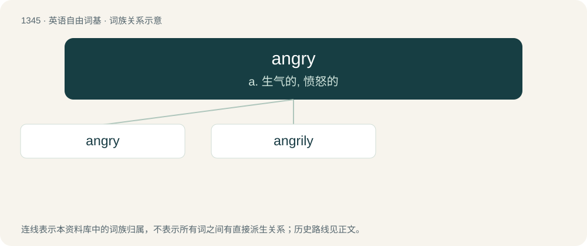

# 1436 · angry — a. 生气的, 愤怒的

[总目录](../00_总目录_按常用程度.md)

**类型**：英语自由词基　｜　**来源语言**：见词源记录

## 核心含义与来源

- 核心含义：a. 生气的, 愤怒的
- 英文含义：Displaying or feeling anger.
- 词形：angry

**来源记录 1**（形容词；Displaying or feeling anger.）

From Middle English angry, equivalent to anger + -y; see anger.

## 词族图

## 单词速览（常用到不常用）

| 单词 | 音标 | 释义 |
|---|---|---|
| [angry](#w-1) | 英 /ˈæŋ.ɡɹi/ | a. 生气的, 愤怒的 |
| [angrily](#w-2) | 美 /ˈæŋ.ɡɹə.li/ | adv. 愤怒地 |

## 逐词详解

### 1. angry

**词性**：形容词　｜　**音标**：英 /ˈæŋ.ɡɹi/

**中文释义**：a. 生气的, 愤怒的

**英文义项**：Displaying or feeling anger. / Inflamed and painful.

**构词拆分**：anger + -y

**词源与演化**：

From Middle English angry, equivalent to anger + -y; see anger.

**例句**：

> The broken glass left two angry cuts across my arm.

该用例对应义项：Inflamed and painful.

### 2. angrily

**词性**：副词　｜　**音标**：美 /ˈæŋ.ɡɹə.li/

**中文释义**：adv. 愤怒地

**英文义项**：In an angry manner; under the influence of anger.

**构词拆分**：angry + -ly

**词源与演化**：

From Middle English angrily, equivalent to angry + -ly.

**例句**：

> "Leave me alone for once," she said angrily.

该用例对应义项：In an angry manner; under the influence of anger.
