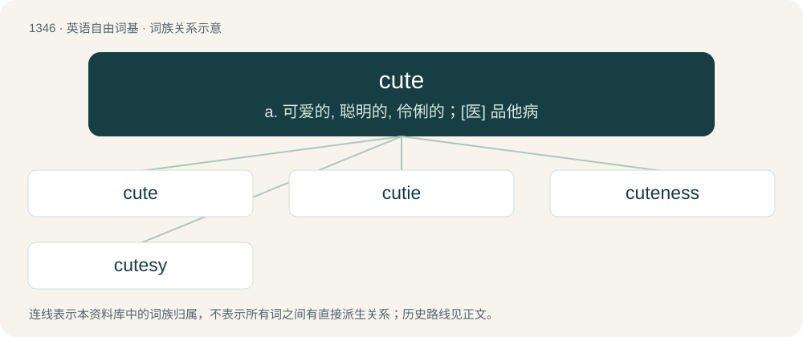

# 1437 · cute — a. 可爱的, 聪明的, 伶俐的；\[医\] 品他病

[总目录](../00_总目录_按常用程度.md)

**类型**：英语自由词基　｜　**来源语言**：见词源记录

## 核心含义与来源

- 核心含义：a. 可爱的, 聪明的, 伶俐的；\[医\] 品他病
- 英文含义：Possessing physical features, behaviors, personality traits or other properties that are mainly attributed to infants and small or cuddly animals; e.g. fair, dainty, round, and soft physical features, disproportionately large eyes and head, playfulness, fragility, helplessness, curiosity or shyness, innocence, affectionate behavior.
- 词形：cute

**来源记录 1**（形容词；Possessing physical features, behaviors, personality traits or other properties that are mainly attributed to infants and small or cuddly animals; e.g. fair, dainty, round, and soft physical features, disproportionately large eyes and head, playfulness, fragility, helplessness, curiosity or shyness, innocence, affectionate behavior.）

Aphetic form of acute, originally meaning “keenly perceptive or discerning, shrewd” (1731). Meaning transferred to “pretty, fetching” by US students (slang) c. 1834. Meaning drifted further to describe the pleasing attraction to features usually possessed by the young.

## 词族图

## 单词速览（常用到不常用）

| 单词 | 音标 | 释义 |
|---|---|---|
| [cute](#w-1) | /kjuːt/ | a. 可爱的, 聪明的, 伶俐的；\[医\] 品他病 |
| [cutie](#w-2) | 英 /ˈkjuːti/；美 /ˈkjuti/ | n. 漂亮女孩 |
| [cuteness](#w-3) | /kjuːtnəs/ | n. 可爱; 娇小可爱 |
| [cutesy](#w-4) | 英 /ˈkjuːtsi/；美 /ˈkjutsi/ | a. 矫揉造作的,忸怩作态的 |

## 逐词详解

### 1. cute

**词性**：形容词　｜　**音标**：/kjuːt/

**中文释义**：a. 可爱的, 聪明的, 伶俐的；\[医\] 品他病

**英文义项**：Possessing physical features, behaviors, personality traits or other properties that are mainly attributed to infants and small or cuddly animals; e.g. fair, dainty, round, and soft physical features, disproportionately large eyes and head, playfulness, fragility, helplessness, curiosity or shyness, innocence, affectionate behavior. / Lovable, charming, attractive or pleasing, especially in a youthful, dainty, quaint or fun-spirited way.

**词源与演化**：

Aphetic form of acute, originally meaning “keenly perceptive or discerning, shrewd” (1731). Meaning transferred to “pretty, fetching” by US students (slang) c. 1834. Meaning drifted further to describe the pleasing attraction to features usually possessed by the young.

**例句**：

> The actor's performance was too cute for me. All that mugging to the audience killed the humor.

该用例对应义项：Affected or contrived to charm; mincingly clever; precious; cutesy.

### 2. cutie

**词性**：名词　｜　**音标**：英 /ˈkjuːti/；美 /ˈkjuti/

**中文释义**：n. 漂亮女孩

**英文义项**：A cute person or animal.

**构词拆分**：cute + -ie

**词源与演化**：

From cute + -ie.

**例句**：

> Who's the cutie in the blue shirt?

### 3. cuteness

**词性**：名词　｜　**音标**：/kjuːtnəs/

**中文释义**：n. 可爱; 娇小可爱

**英文义项**：The state of being cute (endearingly attractive). / acuteness; cunning

**构词拆分**：cute + -ness

**词源与演化**：

From cute + -ness.

**例句**：

> Without thinking I laughed at the cuteness of the cat.

### 4. cutesy

**词性**：形容词　｜　**音标**：英 /ˈkjuːtsi/；美 /ˈkjutsi/

**中文释义**：a. 矫揉造作的,忸怩作态的

**英文义项**：Overly, affectedly or unnecessarily cute; too cute to be taken seriously.

**构词拆分**：cute + -sy

**词源与演化**：

From cute + -sy.

**例句**：

> The couple called each other cutesy pet names like "honeypot" and "smoochie-poochie" that disgusted everyone else.

该用例对应义项：Overly, affectedly or unnecessarily cute; too cute to be taken seriously.
