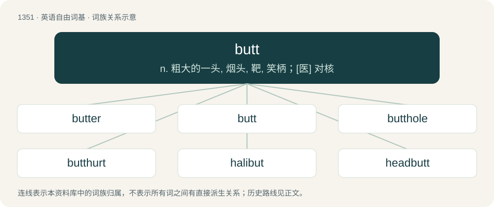

# 1439 · butt — n. 粗大的一头, 烟头, 靶, 笑柄；\[医\] 对核

[总目录](../00_总目录_按常用程度.md)

**类型**：英语自由词基　｜　**来源语言**：见词源记录

## 核心含义与来源

- 核心含义：n. 粗大的一头, 烟头, 靶, 笑柄；\[医\] 对核
- 英文含义：The buttocks or anus (used as a minced oath in idiomatic expressions; less objectionable than arse/ass).
- 词形：butt

**多个词源／构词路径**：同一拼写可能有不同来源；以下按词性和含义分别列出。

**来源记录 1**（名词；The buttocks or anus (used as a minced oath in idiomatic expressions; less objectionable than arse/ass).）

From Middle English but, butte (“goal, mark, butt of land”), from Old English byt, bytt (“small piece of land”) and \*butt (attested in diminutive Old English buttuc (“end, small piece of land”) &gt; English buttock), from Proto-West Germanic \*butt, from Proto-Germanic \*buttaz (“end, piece”), from Proto-Indo-European \*bʰudʰnós (“bottom”), later thematic variant of Proto-Indo-European \*bʰudʰmḗn ~ \*bʰudʰn-, perhaps from Proto-Indo-European \*dʰewbʰ- (“deep”). Cognate with Norwegian butt (“stump, block”), Faroese buttur (“wooden block”), Icelandic bútur (“piece, fragment”), Low German butt (“blunt, clumsy”). Influenced by Old French but, butte (“but, mark”), ultimately from the same Germanic source. Compare also Albanian bythë (“buttocks”), Ancient Greek πυθμήν (puthmḗn, “bottom of vessel”), Latin fundus (“bottom”) and Sanskrit बुध्न (budhná, “bottom”), from the same Proto-Indo-European root. Related to bottom, boot. PIE word \*bʰudʰmḗn

**来源记录 2**（动词；To strike bluntly, particularly with the head.）

From Middle English butten, from Anglo-Norman buter, boter (“to push, butt, strike”), from Frankish \*bautan (“to hit, beat”), from Proto-Germanic \*bautaną (“to beat, push”). Cognate with Old English bēatan (“to beat”). More at beat.

**来源记录 3**（名词；An English measure of capacity for liquids, containing 126 wine gallons which is one-half tun.）

From late Middle English bote, but, butte (“wine cask”), of disputed origin. Probably (1) from Anglo-Norman but, from Old French bot (“barrel, wine-skin”), Late Latin buttis (“cask”); (2) alternatively, a later form of Middle English bitte, bit, butte (“leather bottle”), from Old English bytt, byt, from Proto-West Germanic \*buttjā, from Vulgar Latin \*buttia and thus a doublet of boccia.

**来源记录 4**（名词；Any of various flatfish such as sole, plaice or turbot.）

From Middle English but, butte, botte (“flounder; plaice; turbot”), possibly derived from sense 1 (“blunt end”), meaning "blunt-headed fish." Compare Dutch bot and the second element of English halibut. Cognate with West Frisian bot, German Low German Butt, German Butt, Butte, Swedish butta.

**来源记录 5**（名词；A heavy two-wheeled cart.）

Variant of putt.

**来源记录 6**（名词；The shoulder of an animal, especially the portion above the picnic, as a cut of meat.）

Originally apparently a less-desired cut, named either due to its often being packed in butts (“casks”) for storage and shipping, or from the use of butt to refer to "the larger or thicker end of something, in distinction from the sharp or narrow end" or "the waste end".

## 词族图

## 单词速览（常用到不常用）

| 单词 | 音标 | 释义 |
|---|---|---|
| [butter](#w-1) | 英 /ˈbʌtə/；美 /ˈbʌtɚ/ | 【英文】Someone or something that butts. |
| [butt](#w-2) | 英 /bʌt/ | n. 粗大的一头, 烟头, 靶, 笑柄；\[医\] 对核 |
| [butthole](#w-3) | 美 /ˈbʌtˌhoʊl/ | n. 屁眼 |
| [butthurt](#w-4) | 英 /ˈbʌtˌhɜːt/；美 /ˈbʌtˌhɝt/ | 【英文】A feeling of offense caused by a perceived insult or injustice. |
| [halibut](#w-5) | /ˈhæ.lɪ.bət/ | n. 大比目鱼 |
| [headbutt](#w-6) | /ˈhɛdbʌt/ | 故意用头撞（人） |
| [abut](#w-7) | 英 /əˈbʌt/；美 /əˈbʌt/ | v. 邻接, 毗邻 |
| [buttock](#w-8) | 英 /ˈbʌtək/；美 /ˈbʌtək/ | n. 半边臀部, 屁股, 船尾突出部；vt. 过背摔 |
| [butthead](#w-9) | /ˈbʌtˌhɛd/ | 【英文】An annoying person or someone who is difficult to get along with. |

## 逐词详解

### 1. butter

**词性**：名词　｜　**音标**：英 /ˈbʌtə/；美 /ˈbʌtɚ/

**英文义项**：Someone or something that butts. / Someone or something that butts in; a busybody.

**构词拆分**：butt + -er

**词源与演化**：

From butt + -er.

### 2. butt

**词性**：名词　｜　**音标**：英 /bʌt/

**中文释义**：n. 粗大的一头, 烟头, 靶, 笑柄；\[医\] 对核

**英文义项**：The buttocks or anus (used as a minced oath in idiomatic expressions; less objectionable than arse/ass). / The whole buttocks and pelvic region that includes one's private parts.

**词源与演化**：

From Middle English but, butte (“goal, mark, butt of land”), from Old English byt, bytt (“small piece of land”) and \*butt (attested in diminutive Old English buttuc (“end, small piece of land”) &gt; English buttock), from Proto-West Germanic \*butt, from Proto-Germanic \*buttaz (“end, piece”), from Proto-Indo-European \*bʰudʰnós (“bottom”), later thematic variant of Proto-Indo-European \*bʰudʰmḗn ~ \*bʰudʰn-, perhaps from Proto-Indo-European \*dʰewbʰ- (“deep”). Cognate with Norwegian butt (“stump, block”), Faroese buttur (“wooden block”), Icelandic bútur (“piece, fragment”), Low German butt (“blunt, clumsy”). Influenced by Old French but, butte (“but, mark”), ultimately from the same Germanic source. Compare also Albanian bythë (“buttocks”), Ancient Greek πυθμήν (puthmḗn, “bottom of vessel”), Latin fundus (“bottom”) and Sanskrit बुध्न (budhná, “bottom”), from the same Proto-Indo-European root. Related to bottom, boot. PIE word \*bʰudʰmḗn

**例句**：

> We can't chat today. I have to get my butt to work before I'm late.

该用例对应义项：Body; self.

### 3. butthole

**词性**：名词　｜　**音标**：美 /ˈbʌtˌhoʊl/

**中文释义**：n. 屁眼

**英文义项**：The anus. / An objectionable person; a bastard; a jerk.

**构词拆分**：butt + hole

**词源与演化**：

From butt + hole.

**例句**：

> My butthole is on fire from that dang hot sauce of yours.

该用例对应义项：The anus.

### 4. butthurt

**词性**：名词　｜　**音标**：英 /ˈbʌtˌhɜːt/；美 /ˈbʌtˌhɝt/

**英文义项**：A feeling of offense caused by a perceived insult or injustice.

**构词拆分**：butt + hurt

**词源与演化**：

From butt + hurt. First use appears c. 1996 in the Usenet group alt.graffiti. See cite below.

**例句**：

> He's just full of butthurt because he wasn't allowed to join the society.

该用例对应义项：A feeling of offense caused by a perceived insult or injustice.

### 5. halibut

**词性**：名词　｜　**音标**：/ˈhæ.lɪ.bət/

**中文释义**：n. 大比目鱼

**英文义项**：A large flatfish of the genus Hippoglossus, which sometimes leaves the ocean floor and swims vertically.

**构词拆分**：holy + butt (“flatfish”)

**词源与演化**：

From Middle English halibut, equivalent to holy + butt (“flatfish”), since the fish was often eaten on holy days. Cognate with Dutch heilbot, German Heiligbutt, Heilbutt, Heilbutte, Danish helleflynder, Swedish helgeflundra, and Norwegian Nynorsk hellefisk.

**例句**：

> They eat half of the world's halibut.

### 6. headbutt

**词性**：名词　｜　**音标**：/ˈhɛdbʌt/

**中文释义**：故意用头撞（人）

**英文义项**：A sharp blow delivered by driving the head into an opponent or object, generally by lowering the head and charging forward or by rapidly tilting the head backward and then forward.

**构词拆分**：head + butt

**词源与演化**：

From head + butt.

**例句**：

> Benedito laughed as his billy goat tried to headbutt a ram.

### 7. abut

**词性**：动词　｜　**音标**：英 /əˈbʌt/；美 /əˈbʌt/

**中文释义**：v. 邻接, 毗邻

**英文义项**：To touch by means of a mutual border, edge or end; to border on; to lie adjacent (to); to be contiguous (said of an area of land) / To border upon; be next to; abut on; be adjacent to.

**构词拆分**：a- (“to”) + butt (“boundary mark”)

**词源与演化**：

From Middle English abutten, from Medieval Latin abuttare and Old French abuter, aboter, abouter (“to touch at one end, to come to an end, aim, reach”), from Old French but (“end, aim, purpose”); akin to Old Norse butr (“piece of wood”). Equivalent to a- (“to”) + butt (“boundary mark”).

**例句**：

> His land abuts on the road.

该用例对应义项：To touch by means of a mutual border, edge or end; to border on; to lie adjacent (to); to be contiguous (said of an area of land)

### 8. buttock

**词性**：名词　｜　**音标**：英 /ˈbʌtək/；美 /ˈbʌtək/

**中文释义**：n. 半边臀部, 屁股, 船尾突出部；vt. 过背摔

**英文义项**：Each of the two large fleshy halves of the posterior part of the body between the base of the back, the perineum, and the top of the legs. / The convexity of a ship behind, under the stern.

**构词拆分**：butt + -ock (diminutive suffix)

**词源与演化**：

Inherited from Middle English buttok, probably from Old English buttuc (“end; end piece”; also, “short piece of land”). Attested with its current anatomical meaning since 1300. A diminutive form of what is presumably the Old English precursor of butt + -ock (diminutive suffix).

**例句**：

> My younger sister has a tattoo on her right buttock.

### 9. butthead

**词性**：名词　｜　**音标**：/ˈbʌtˌhɛd/

**英文义项**：An annoying person or someone who is difficult to get along with.

**构词拆分**：butt (“buttocks, backside”) + head

**词源与演化**：

From butt (“buttocks, backside”) + head. Compare buttface.

**例句**：

> You're such a butthead. That hypnosis controller only works on smart people, and that's not me.
