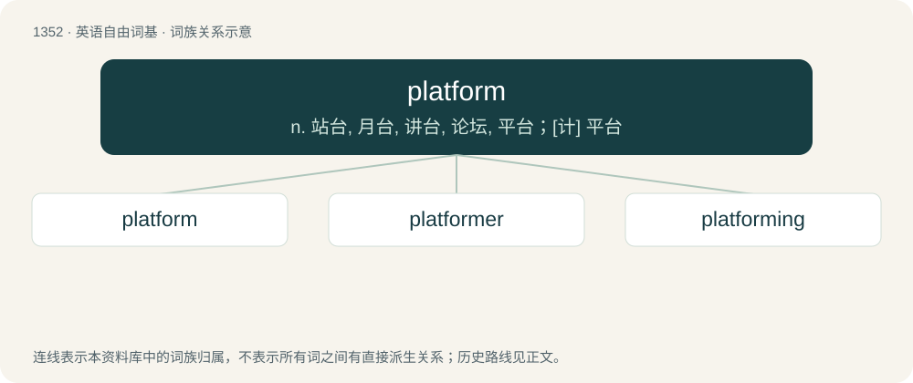

# 1440 · platform — n. 站台, 月台, 讲台, 论坛, 平台；\[计\] 平台

[总目录](../00_总目录_按常用程度.md)

**类型**：英语自由词基　｜　**来源语言**：见词源记录

## 核心含义与来源

- 核心含义：n. 站台, 月台, 讲台, 论坛, 平台；\[计\] 平台
- 英文含义：A raised stage from which speeches are made and on which musical and other performances are made.
- 词形：platform

**来源记录 1**（名词；A raised stage from which speeches are made and on which musical and other performances are made.）

From Middle French plateforme (“a flat form”), from plate (“flat”) (from Old French plat, from Ancient Greek πλατύς (platús, “flat”)) + forme (“form”) (from Latin fōrma (“shape; figure; form”)); compare flatscape.

## 词族图

## 单词速览（常用到不常用）

| 单词 | 音标 | 释义 |
|---|---|---|
| [platform](#w-1) | 英 /ˈplætfɔːm/；美 /ˈplætfɔɹm/ | n. 站台, 月台, 讲台, 论坛, 平台；\[计\] 平台 |
| [platformer](#w-2) | /ˈplæt,fɔːmə/ | 铂重整装置 |
| [platforming](#w-3) | /ˈplæt,fɔːmiŋ/ | (水翼船)凌波平航 |

## 逐词详解

### 1. platform

**词性**：名词　｜　**音标**：英 /ˈplætfɔːm/；美 /ˈplætfɔɹm/

**中文释义**：n. 站台, 月台, 讲台, 论坛, 平台；\[计\] 平台

**英文义项**：A raised stage from which speeches are made and on which musical and other performances are made. / A raised floor for any purpose, e.g. for workmen during construction, or formerly for military cannon.

**词源与演化**：

From Middle French plateforme (“a flat form”), from plate (“flat”) (from Old French plat, from Ancient Greek πλατύς (platús, “flat”)) + forme (“form”) (from Latin fōrma (“shape; figure; form”)); compare flatscape.

**例句**：

> This new talk show will give a platform to everyday men and women.

该用例对应义项：A place or an opportunity to express one's opinion.

### 2. platformer

**词性**：名词　｜　**音标**：/ˈplæt,fɔːmə/

**中文释义**：铂重整装置

**英文义项**：A platform game.

**构词拆分**：platform + -er

**词源与演化**：

From platform + -er.

### 3. platforming

**词性**：名词　｜　**音标**：/ˈplæt,fɔːmiŋ/

**中文释义**：(水翼船)凌波平航

**英文义项**：The video game activity of jumping from one platform to another. / The platforms at a railway station.

**构词拆分**：From platform + -ing.

**词源与演化**：

From platform + -ing.

**例句**：

> This game has a lot of platforming, as well as the occasional puzzle.

该用例对应义项：The video game activity of jumping from one platform to another.
