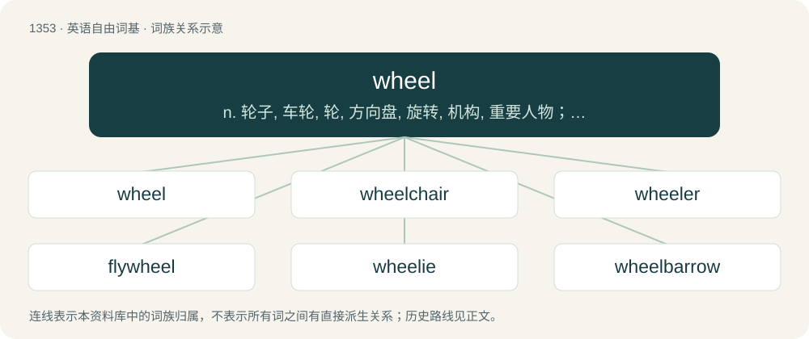

# 1441 · wheel — n. 轮子, 车轮, 轮, 方向盘, 旋转, 机构, 重要人物；vt. 使旋转, 转动, 使转向；vi. 旋转, 转弯, 盘旋

[总目录](../00_总目录_按常用程度.md)

**类型**：英语自由词基　｜　**来源语言**：见词源记录

## 核心含义与来源

- 核心含义：n. 轮子, 车轮, 轮, 方向盘, 旋转, 机构, 重要人物；vt. 使旋转, 转动, 使转向；vi. 旋转, 转弯, 盘旋
- 英文含义：A circular device capable of rotating on its axis, facilitating movement or transportation or performing labour in machines.
- 词形：wheel

**来源记录 1**（名词；A circular device capable of rotating on its axis, facilitating movement or transportation or performing labour in machines.）

From Middle English whel, from Old English hwēol, from Proto-West Germanic \*hwehwl, from Proto-Germanic \*hwehwlą, \*hweulō, from Proto-Indo-European \*kʷekʷlóm, \*kʷékʷlos, \*kʷékʷléh₂, reduplication of \*kʷel- (“to turn”) and a suffix (literally "(the thing that) turns and turns"). See also West Frisian tsjil, Dutch wiel, Danish, Norwegian Bokmål, Norwegian Nynorsk, and Swedish hjul; also Tocharian B kokale (“cart, wagon”), Ancient Greek κύκλος (kúklos, “cycle, wheel”), Avestan 𐬗𐬀𐬑𐬭𐬀 (caxra), Sanskrit चक्र (cakrá); and Latin colō (“to till, cultivate”), Tocharian A and Tocharian B käl- (“to bear; bring”), Ancient Greek πέλω (pélō, “to come into existence, become”), Old Church Slavonic коло (kolo, “wheel”), Albanian sjell (“to bring, carry, turn around”), Avestan 𐬗𐬀𐬭𐬀𐬌𐬙𐬌 (caraⁱti, “it circulates”), Sanskrit चरति (cárati, “it moves, wanders”). Doublet of chakra, chakram, charkha, chukker, cycle, cyclus, and kike.

## 词族图

## 单词速览（常用到不常用）

| 单词 | 音标 | 释义 |
|---|---|---|
| [wheel](#w-1) | /ˈwiːl/ | n. 轮子, 车轮, 轮, 方向盘, 旋转, 机构, 重要人物；vt. 使旋转, 转动, 使转向；vi. 旋转, 转弯, 盘旋 |
| [wheelchair](#w-2) | 英 /ˈwiːlt͡ʃɛə(ɹ)/；美 /ˈ(h)wilt͡ʃɛɹ/ | n. 轮椅 |
| [wheeler](#w-3) | /ˈhwiːlə/ | n. 旋转物, 推车人, 车轮制造人, 辕马, 精明的政客 |
| [flywheel](#w-4) | /ˈflaihwiːl/ | n. 飞轮, 惯性轮；\[化\] 飞轮 |
| [wheelie](#w-5) | 英 /ˈ(h)wiːli/；美 /ˈ(h)wili/ | n. 自行车前轮离地平衡特技 |
| [wheelbarrow](#w-6) | 英 /ˈwiːlbæɹəʊ/；美 /ˈwilbæɹoʊ/ | n. 手推车, 独轮车 |
| [wheelhouse](#w-7) | 英 /ˈwiːlˌhaʊs/；美 /ˈwilˌhaʊs/ | n. 舵手室, 驾驶室 |
| [wheelbase](#w-8) | /ˈhwiːlbeis/ | n. 轴距 |
| [cartwheel](#w-9) | 英 /ˈkɑːtˌwiːl/；美 /ˈkɑɹtˌwil/ | n. 车轮(货车的车轮), 侧手翻 |

## 逐词详解

### 1. wheel

**词性**：名词　｜　**音标**：/ˈwiːl/

**中文释义**：n. 轮子, 车轮, 轮, 方向盘, 旋转, 机构, 重要人物；vt. 使旋转, 转动, 使转向；vi. 旋转, 转弯, 盘旋

**英文义项**：A circular device capable of rotating on its axis, facilitating movement or transportation or performing labour in machines. / A steering wheel and its implied control of a vehicle.

**词源与演化**：

From Middle English whel, from Old English hwēol, from Proto-West Germanic \*hwehwl, from Proto-Germanic \*hwehwlą, \*hweulō, from Proto-Indo-European \*kʷekʷlóm, \*kʷékʷlos, \*kʷékʷléh₂, reduplication of \*kʷel- (“to turn”) and a suffix (literally "(the thing that) turns and turns"). See also West Frisian tsjil, Dutch wiel, Danish, Norwegian Bokmål, Norwegian Nynorsk, and Swedish hjul; also Tocharian B kokale (“cart, wagon”), Ancient Greek κύκλος (kúklos, “cycle, wheel”), Avestan 𐬗𐬀𐬑𐬭𐬀 (caxra), Sanskrit चक्र (cakrá); and Latin colō (“to till, cultivate”), Tocharian A and Tocharian B käl- (“to bear; bring”), Ancient Greek πέλω (pélō, “to come into existence, become”), Old Church Slavonic коло (kolo, “wheel”), Albanian sjell (“to bring, carry, turn around”), Avestan 𐬗𐬀𐬭𐬀𐬌𐬙𐬌 (caraⁱti, “it circulates”), Sanskrit चरति (cárati, “it moves, wanders”). Doublet of chakra, chakram, charkha, chukker, cycle, cyclus, and kike.

**例句**：

> The real numbers can be extended to a wheel, as can any commutative ring.

该用例对应义项：A type of algebra where division is always defined, and in particular division by zero is meaningful.

### 2. wheelchair

**词性**：名词　｜　**音标**：英 /ˈwiːlt͡ʃɛə(ɹ)/；美 /ˈ(h)wilt͡ʃɛɹ/

**中文释义**：n. 轮椅

**英文义项**：A chair mounted on large wheels for the transportation or use of a sick or disabled person. / Designed for use by wheelchairbound people.

**构词拆分**：wheel + chair

**词源与演化**：

From wheel + chair.

**例句**：

> They developed a special computer system and fixed it to his wheelchair.

### 3. wheeler

**词性**：名词　｜　**音标**：/ˈhwiːlə/

**中文释义**：n. 旋转物, 推车人, 车轮制造人, 辕马, 精明的政客

**英文义项**：Someone who operates a wheel. / A vehicle having the specified number or type of wheels.

**构词拆分**：wheel + -er (agent noun suffix)

**词源与演化**：

From Middle English whelere, equivalent to wheel + -er (agent noun suffix) or + -er (measurement suffix) (sense 4). Piecewise doublet of cycler.

**例句**：

> Sami's 18-wheeler was right in front of us.

### 4. flywheel

**词性**：名词　｜　**音标**：/ˈflaihwiːl/

**中文释义**：n. 飞轮, 惯性轮；\[化\] 飞轮

**英文义项**：A rotating mass used to maintain the speed of a machine within certain limits while the machine receives or releases energy at a varying rate, or as a form of energy storage.

**构词拆分**：fly + wheel

**词源与演化**：

From fly + wheel.

**例句**：

> Then his 27-year-old grandson, Matt Jost, struggles with a large flywheel to start the tractor.

### 5. wheelie

**词性**：名词　｜　**音标**：英 /ˈ(h)wiːli/；美 /ˈ(h)wili/

**中文释义**：n. 自行车前轮离地平衡特技

**英文义项**：An action or stunt where a bicycle, motorcycle, or other vehicle is ridden for a short period while it is standing only on its rear wheel or wheels. / A wheelchair user.

**构词拆分**：wheel + -ie

**词源与演化**：

From wheel + -ie.

**例句**：

> Jim fell off his bike when he was trying to do a wheelie.

该用例对应义项：An action or stunt where a bicycle, motorcycle, or other vehicle is ridden for a short period while it is standing only on its rear wheel or wheels.

### 6. wheelbarrow

**词性**：名词　｜　**音标**：英 /ˈwiːlbæɹəʊ/；美 /ˈwilbæɹoʊ/

**中文释义**：n. 手推车, 独轮车

**英文义项**：A small, one-wheeled (or rarely, two-wheeled) cart with handles at one end for transporting small loads.

**构词拆分**：wheel + barrow

**词源与演化**：

From Middle English whelbarwe; equivalent to wheel + barrow.

**例句**：

> I have a wheelbarrow in my garage that I've never used.

### 7. wheelhouse

**词性**：名词　｜　**音标**：英 /ˈwiːlˌhaʊs/；美 /ˈwilˌhaʊs/

**中文释义**：n. 舵手室, 驾驶室

**英文义项**：A building or other structure containing a (large) wheel, such as the water wheel of a mill. / The partially enclosed structure above and around a wheel of an automobile, typically partly formed by a portion of a fender panel that has been extended outward beyond the plane of the rest of the panel.

**构词拆分**：wheel + house

**词源与演化**：

From wheel + house. Sense 3 (“(baseball) a pitch location which is favourable to the hitter”) references the fact that a vessel is controlled from its wheelhouse (sense 1.2), and sense 4 (“a person’s area of authority or expertise”) is a figurative use of sense 3.

**例句**：

> Ever since I started taking antipsychotics, managing my mental health has been a whole different wheelhouse.

该用例对应义项：A set of skills necessitated by a situation.

### 8. wheelbase

**词性**：名词　｜　**音标**：/ˈhwiːlbeis/

**中文释义**：n. 轴距

**英文义项**：The horizontal distance between the front and rear axles of a road or rail vehicle.

**构词拆分**：wheel + base

**词源与演化**：

From wheel + base.

### 9. cartwheel

**词性**：动词　｜　**音标**：英 /ˈkɑːtˌwiːl/；美 /ˈkɑɹtˌwil/

**中文释义**：n. 车轮(货车的车轮), 侧手翻

**英文义项**：To perform the gymnastics feat of a cartwheel. / To flip end over end: normally said of a crashing vehicle or aircraft.

**构词拆分**：cart + wheel

**词源与演化**：

From cart + wheel.

**例句**：

> The race car hit a bump and cartwheeled over the finish line.

该用例对应义项：To flip end over end: normally said of a crashing vehicle or aircraft.
